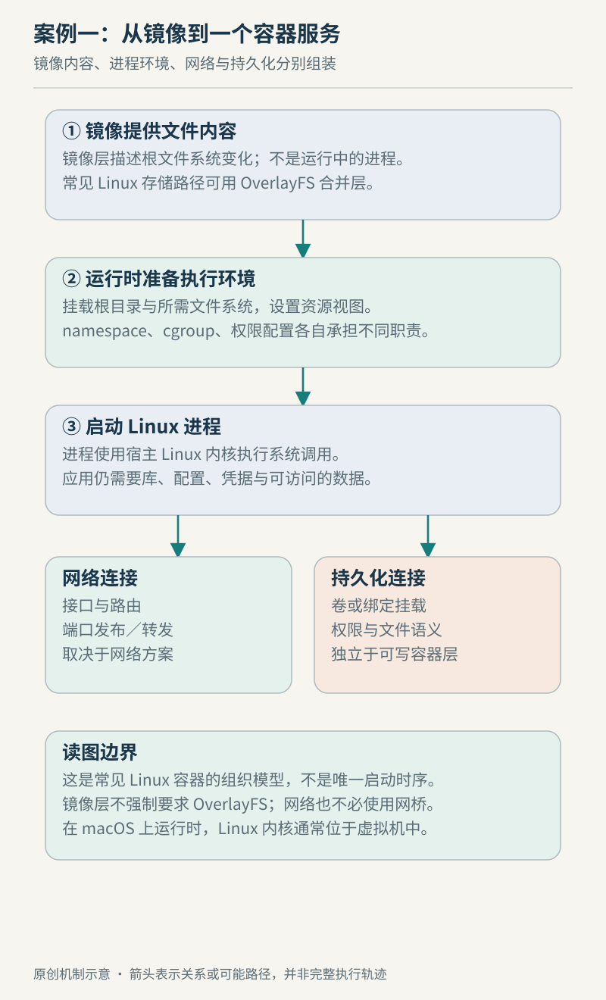

# 案例一　从镜像到一个可访问的容器服务

设想我们准备运行一个接收 HTTP 请求、把上传内容保存到 `/data` 的服务。教学设定是 Linux 宿主、基于 OverlayFS 的根文件视图、独立网络命名空间和单独挂载的数据目录。这不是对所有容器平台的统一描述，也不是一份实测部署记录。我们的任务是解释：程序尚未开始处理请求时，运行环境已经完成了哪些工作？

## 从镜像内容到进程环境

容器运行规范区分创建与启动：进入 `created` 状态，并不表示用户指定的程序已执行；到 `running` 才表示程序已经执行而尚未退出。因此镜像可读、环境准备好、服务已监听、服务能正确处理请求，是四个不同的检查点。把它们揉成“容器起来了”，会让故障定位失去位置。[OCI 生命周期](https://github.com/opencontainers/runtime-spec/blob/main/runtime.md)

在本例中，文件系统准备阶段把只读底层目录与可写上层组织成合并视图。程序读取底层已有文件，不等于先复制整份镜像；当修改需要复制上来时，才出现 copy-up。对于同名对象，合并视图决定用户看到哪一份，而底层镜像的原始内容仍然存在。[OverlayFS 文档](https://docs.kernel.org/filesystems/overlayfs.html)

图例 1　原创教学示意。图中是职责与检查点，不承诺某个运行时严格按此串行执行。

继续准备的还有进程看到的资源范围与允许的行为。OCI 的 Linux 配置包括命名空间、资源限制及安全相关字段。这里应分开问：进程能看到哪些进程和挂载？能够使用多少资源？能够执行哪些操作？根目录长得独立，并不能回答后两个问题。[OCI Linux 配置](https://github.com/opencontainers/runtime-spec/blob/main/config-linux.md)

## 预算不会凭空变成机器

假如为服务设置 CPU 和内存约束，我们仍然运行在共享的宿主资源上。cgroup v2 将进程组织成层级，并由控制器分配或限制资源；上层限制也会约束其子层级。本例中，即使容器自己的配置没有写出紧张预算，上层管理单元仍可能限制它。因此调查预算时，要看实际所属层级和限制，而不能只看一份启动配置。[cgroup v2](https://docs.kernel.org/admin-guide/cgroup-v2.html)

这能解释一种常见困惑：宿主似乎空闲，服务却一直等待。它可能碰到了分组预算，也可能阻塞在别处。预算只是候选原因；还需要计数、时间窗口和请求延迟来验证。不能因为用了容器，就把任何变慢都归为“隔离开销”。

## 监听端口与外部可达是两步

网络命名空间隔离设备、协议栈、路由及端口等资源。veth 对能够连接不同网络命名空间，但“拥有自己的网络视图”并不自动生成一条外部可达路径。[network_namespaces(7)](https://man7.org/linux/man-pages/man7/network_namespaces.7.html)

以 Docker 的桥接网络为具体参照，软件桥连接相应容器接口，端口发布配置则把宿主端口流量转发给容器端口。这些职责不同：应用可能已经成功监听，但宿主入口未发布；入口也可能已经配置，而应用监听了错误地址。因此外部连接失败时，应依次核对应用监听、容器网络连通性和宿主入口，不能只重启应用。[Docker bridge 驱动](https://docs.docker.com/engine/network/drivers/bridge/)

## 数据为什么单独挂载

现在服务开始写入 `/data`。在本例里，它是单独挂载的数据目录，所以这条路径的文件操作不再只是在容器根目录的可写层里增加内容。Docker volume 的生命周期可以独立于容器；挂载覆盖原目录时，原位置的内容会被遮蔽，而不是自动和挂载内容合并。[Docker volumes](https://docs.docker.com/engine/storage/volumes/)

这带来两个不同问题：重建容器后还能找到数据吗？机器崩溃后已经确认的写入还能恢复吗？独立卷有助于管理生命周期，但第二个问题仍需回到文件系统、同步操作、存储后端和备份策略。卷的名字不提供持久性证明。

| 检查点 | 成功说明什么 | 仍不能证明什么 |
| --- | --- | --- |
| 创建完成 | 运行环境已准备到规范所定义的阶段 | 服务程序已就绪 |
| 应用开始监听 | 应用拥有可用的监听端点 | 外部网络已连通 |
| 请求成功返回 | 本次应用路径完成 | 写入已满足故障恢复要求 |
| 数据独立挂载 | 数据与根目录可写层分开管理 | 数据已有可靠备份 |

沿这些检查点回看，一条启动命令其实组织了多份契约。相关原理见[容器章](../chapters/11-containers.md)、[OverlayFS 章](../chapters/09-overlayfs.md)和[网络章](../chapters/14-network.md)。本例核查于 2026-10-22；省略镜像下载、rootless 网络、编排器与安全策略细节，未执行部署或提供性能结论。
