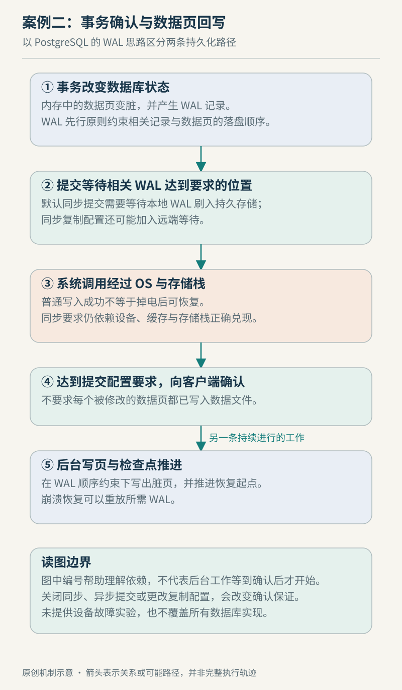

# 案例二　一次数据库事务怎样获得持久性

设想一个 PostgreSQL 应用完成订单状态更新，客户端收到 `COMMIT` 成功。教学条件限定为普通持久表、`fsync=on`、`synchronous_commit=on`、`full_page_writes=on`，且没有要求等待同步备用服务器。我们追踪的是本地持久性，不把这次成功扩大为“所有副本都已经应用了修改”。这些参数会改变成功回复前的等待边界，实际环境应读取实际配置。[PostgreSQL WAL 配置](https://www.postgresql.org/docs/current/runtime-config-wal.html)

## 提交不要求所有数据页立即落盘

如果每次小事务都把相关表和索引页面全部同步到设备，提交会被许多分散写入牵制。WAL 把恢复所需的变化先写成日志：相应日志达到持久存储后，数据页可以随后写出；崩溃恢复时，通过日志重做尚未体现在数据文件中的变化。这不等于“只写日志、永远不写数据”，而是重新组织何时必须完成哪一种写入。[WAL 原理](https://www.postgresql.org/docs/current/wal-intro.html)

图例 2　原创教学示意。箭头突出先写日志的约束；实际执行会并发并批量处理。

可以把恢复需求理解为一份承诺：即使某些数据页还停留在内存，系统也已经保留足以恢复这次提交的信息。多个并发事务还可能共享一次 WAL 同步完成的收益，因此“一个事务对应一次独立磁盘同步”并不是必要关系。[WAL 与成组提交](https://www.postgresql.org/docs/current/wal-intro.html)

这里需要小心地区分数据库缓冲与内核缓存。数据库中的脏页表示其内存内容有待写出；进入文件写入路径后，操作系统和设备还可能各自缓存数据。观察到数据库发起写入，不能因此跳过后面的持久性边界。[PostgreSQL 可靠性说明](https://www.postgresql.org/docs/current/wal-reliability.html)

## 同步调用把承诺向下传递

Linux 的 `fsync()` 用于把文件修改同步到存储，等待设备报告完成；它可能报告同步期间的错误。`fdatasync()` 则可以省略不影响后续数据取回的部分元数据同步。数据库使用的具体同步方法受平台和配置影响，不能仅凭看到某一次 `write()` 返回，就认定 WAL 已经达到承诺的位置。[fsync(2)](https://man7.org/linux/man-pages/man2/fsync.2.html)

传递到设备的要求还必须被设备正确兑现。操作系统缓存、控制器缓存和驱动器缓存组成的路径，使“软件认为已同步”依赖更底层的正确行为。PostgreSQL 的可靠性文档专门讨论这些缓存与掉电保护；数据库无法靠日志算法修复所有底层硬件错误。[存储可靠性边界](https://www.postgresql.org/docs/current/wal-reliability.html)

因此，本例的结论是有条件的：配置遵循所述持久性要求，并且操作系统和存储链路正确履约时，客户端收到成功后，恢复过程能够保留这次提交。它不是对任意设备、远程盘或虚拟磁盘设置的无条件担保。

## 检查点解决的是后续恢复工作

提交之后，脏数据页仍需逐步写回。检查点为后续恢复提供起点，并伴随相关脏页处理；它不要求每个事务都等到下一次检查点才返回。检查点期间的写入节奏可能影响 I/O 负载，恢复需要处理的日志范围也受检查点安排影响。[检查点参数及写回](https://www.postgresql.org/docs/current/runtime-config-wal.html)

如果订单接口恰好在周期性写入阶段变慢，合理的调查是假设写回与 WAL 同步共享了紧张的存储路径。接下来要关联请求延迟、WAL 同步时间、检查点活动与设备行为，而不是看到“检查点”三个字就直接改参数。这里是基于机制提出的诊断方法，不是本书测得的故障结论。

| 所在位置 | 可以说明什么 | 不宜直接推出什么 |
| --- | --- | --- |
| 数据库内存中的修改 | 执行过程已产生变更 | 已经持久保存 |
| 文件写入返回 | 本次写调用完成 | 掉电后必能保留 |
| 所需 WAL 同步完成 | 恢复所需日志跨过约定边界 | 所有表页已同步写完 |
| 客户端收到成功 | 已达到当前提交配置的回复条件 | 任意副本均已应用 |

只读核对可以从 `SHOW fsync;`、`SHOW synchronous_commit;` 和 `SHOW full_page_writes;` 开始，但会话设置与服务端配置需要结合当前连接理解；本书没有运行这些查询。返回[存储章](../chapters/07-storage.md)可重读写入、同步与故障边界。本例核查于 2026-10-22，未覆盖临时／非日志表、复制确认、备份恢复和事务隔离的全部规则，也不建议通过关闭持久性保护来验证速度。
