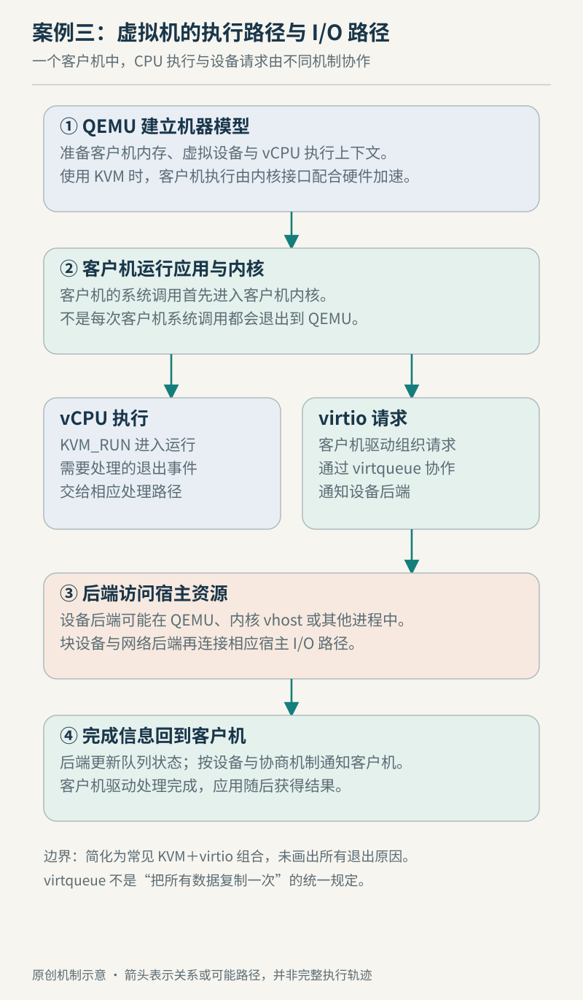

# 案例三　一台虚拟机怎样执行与访问磁盘

设想在支持硬件虚拟化的 Linux 宿主上，用 QEMU 和 KVM 运行兼容架构的 Linux 客户机，并提供 virtio 块设备。我们想理解的不是一条万能启动命令，而是客户机执行代码、访问内存、读取文件时，谁在负责什么。本例是教学设定，未启动虚拟机，也没有测量性能。

## 启动前先建立一台机器

QEMU 的系统模式提供 CPU、内存和设备构成的机器模型，可以选择 KVM 等加速器，也可以采用 TCG 动态翻译。架构和机器类型决定可用配置，某一台机器的命令行不能无条件移到另一平台。本例选定 KVM，所以讨论以受支持的硬件虚拟化执行为前提。[QEMU 系统模式介绍](https://www.qemu.org/docs/master/system/introduction.html)

KVM 的用户态接口从打开 `/dev/kvm` 开始，通过 ioctl 创建 VM 和 vCPU 等对象；内存布局等配置属于 VM 层面的工作。QEMU 等用户态程序组织机器，KVM 提供进入受控客户机执行的内核接口。两者的职责互补，单独存在一个 `/dev/kvm` 节点并不意味着已经具备一台可启动的完整机器。[KVM API](https://docs.kernel.org/virt/kvm/api.html)

图例 3　原创教学示意。执行路径与设备请求路径分开表示，并非每条客户机指令都往返这些对象。

## 进入客户机之后，遇到什么才回来

vCPU 运行涉及 `KVM_RUN`，用户态可在返回后读取退出原因。需要用户态完成的部分 I/O 会通过相应退出信息暴露出来；KVM 能在内核中处理的情况则不必全都交给 QEMU。因而不能把“发生了硬件 VM exit”“`KVM_RUN` 返回用户态”和“每次 I/O 都由主 QEMU 线程处理”画成同一件事。[KVM 运行与退出信息](https://docs.kernel.org/virt/kvm/api.html)

这是理解开销的关键：直接受硬件支持的执行，不表示所有行为免费；有设备交互，也不表示每条指令都被软件解释。评估一项工作要先分清它花在客户机计算、宿主调度、地址转换，还是设备后端的等待上。

## 读取一个文件，先变成设备请求

客户机程序读取文件时，先经过自己的文件系统与缓存。若确实需要块设备数据，客户机驱动把请求放入 virtio 队列，设备侧处理可用缓冲并返回完成状态。virtio 定义的是设备与驱动的协作接口；它不把客户机文件路径直接传给宿主文件系统，也不要求宿主与客户机采用相同的文件系统。[virtio 1.2 设备规范](https://docs.oasis-open.org/virtio/virtio/v1.2/virtio-v1.2.html)

这里有一层容易遗漏的翻译：客户机看到的块设备，可以由宿主上的镜像文件、块设备或其他后端实现。以镜像文件为例，QEMU 的块层还要解释镜像格式和访问后端。raw 与 qcow2 的功能不同；qcow2 可以提供快照等能力，不能把它简单等同于一个没有额外结构的文件。[QEMU 块驱动参考](https://www.qemu.org/docs/master/system/qemu-block-drivers.html)

设备侧也未必只有 QEMU 主进程这一种位置。QEMU 文档说明部分设备模拟可通过 vhost-user 等机制交由其他进程处理。因而图中“后端”应理解为职责，具体实现仍要查看启动配置。[QEMU 设备与后端](https://www.qemu.org/docs/master/system/introduction.html)

## 为何两边都可能看起来空闲

假设客户机服务读文件很慢。宿主 CPU 没满，只能排除某些明显的 CPU 饱和情形，不能排除宿主存储排队；客户机 CPU 没满，也可能只是它正在等设备完成。应先确认客户机请求在何处等待，再沿 virtio、块层和宿主存储检查同一时间窗口。

| 观察范围 | 优先核对 | 不能单独回答的问题 |
| --- | --- | --- |
| 客户机应用 | 缓存命中、读请求、等待时间 | 宿主后端为何慢 |
| 客户机内核 | 设备请求及完成情况 | 镜像文件所在设备的状态 |
| 虚拟设备／后端 | 队列与后端处理方式 | 所有客户机线程是否在计算 |
| 宿主系统 | 调度、存储与其他负载 | 哪一个业务请求受到影响 |

这些是把同一次请求跨层对齐的方法，不是预设某种方案必然更快。观察时还要保留客户机与宿主的时间对应关系，否则两个不同时间段的空闲图表也可能被误当成同一现象的证据。继续阅读[KVM 章](../chapters/12-kvm.md)、[QEMU 章](../chapters/13-qemu.md)与[存储章](../chapters/07-storage.md)，可把执行、虚拟设备与持久性分别接回原理。本例核查于 2026-10-22；不覆盖机密虚拟机、设备直通、实时迁移和嵌套虚拟化，也不把 KVM 当作跨任意指令集的转换工具。
