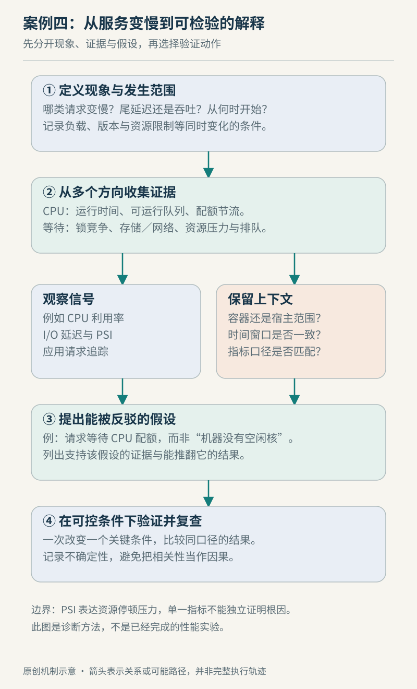

# 案例四　把一次服务变慢拆成可检验的假设

设想一个 Linux 上的 HTTP 服务平时响应稳定，现在部分请求明显变慢，但没有直接崩溃。这里不提供一份虚构的事故复盘；我们搭建一个可以复用的调查顺序。目标不是尽快猜中“CPU”或“磁盘”，而是把每一种猜测写成有支持证据、也可能被推翻的假设。

## 先给“慢”一个可比较的范围

先固定请求类型、时间窗口和观察位置。同一个接口，客户端总耗时包含连接、网络与重试；服务内部计时则可能从请求已经进入工作线程后才开始。若只比较两个名称都叫“延迟”的指标，可能漏掉入口队列中的等待。这是测量口径的分析原则，不是某个内核计数器自动提供的结论。

记录请求量、延迟分布、错误和近期变化，选择一段正常窗口作对照。暂时不要同时增加线程、提高连接数、改缓存和重启服务；否则即使现象消失，也难以判断究竟是哪项变化起作用。需要优先恢复服务时可以先缓解，但要把“恢复”与“解释原因”分别记录。



图例 4　原创诊断方法示意。分支表示候选解释，不表示每次事故必然经过所有检查。

## CPU 使用率只是第一条线索

总 CPU 使用率不高，不代表所有工作线程都有充足执行机会：服务可能只有一个热点线程，也可能受到所在 cgroup 的预算约束。cgroup v2 的 `cpu.stat` 包含使用时间及节流相关计数，解释时要结合控制器配置和上层层级。文档所述 CFS 带宽节流计数只统计本组限额造成的节流，不包括继承自祖先限额的全部影响，因此本组计数没有增加也不能单独排除预算约束。[cgroup CPU 接口](https://docs.kernel.org/admin-guide/cgroup-v2.html)

同样，load average 也不是 CPU 使用百分比。Linux 的 `/proc/loadavg` 包括可运行工作及不可中断等待等负载统计口径，不能仅凭其升高认定“计算太多”。[proc_loadavg(5)](https://man7.org/linux/man-pages/man5/proc_loadavg.5.html)

因此，若怀疑 CPU 排队，下一步是核对可运行工作、实际可用预算与热点线程是否对应到慢请求；若这些证据不支持，调查就应转向等待，而不是继续提高 CPU 配额。

## 把资源压力与应用等待接起来

PSI 通过 `/proc/pressure/` 的 CPU、内存和 I/O 接口统计资源压力造成的停顿。`some` 与 `full` 的含义不同，平均窗口与累计停顿时间也不同；系统级 CPU `full` 不能当作有效的普通压力比例来解释。读数为空或接口不存在时，应先确认平台支持情况。[PSI 文档](https://docs.kernel.org/accounting/psi.html)

可在有相应接口的本机只读查看：

```sh
cat /proc/pressure/cpu
cat /proc/pressure/memory
cat /proc/pressure/io
```

有压力说明一段时间内工作受到了资源紧张影响，却不能直接指出某个业务调用的根因。应把相同时间窗口与应用证据连接起来。例如服务等待数据库，而数据库会话显示锁等待时，宿主的空闲 CPU 就不矛盾了；继续加线程甚至可能增加相同锁上的排队。PostgreSQL 的 `pg_stat_activity` 提供当前活动和等待事件；累计统计有刷新与观察口径，不能期待每个视图都瞬时一致。[PostgreSQL 活动与等待统计](https://www.postgresql.org/docs/current/monitoring-stats.html)

## 每次验证只缩小一个问题

| 候选假设 | 需要相互支持的证据 | 可以推翻或削弱它的观察 |
| --- | --- | --- |
| CPU 预算导致排队 | 慢窗口内节流增加，相关线程需要运行 | 本组与祖先预算证据均不支持，主要时间在外部等待 |
| 数据库锁竞争 | 同一请求路径对应会话锁等待 | 数据库调用很快，等待发生在调用前 |
| 存储压力 | I/O 停顿与请求的存储等待同窗出现 | 慢请求未触及该存储路径 |
| 服务内部队列 | 入队到执行的等待增加，后端仍有余量 | 排队短，耗时集中在实际处理阶段 |

表中的验证条件是调查设计，不能当成预填好的事故结果。只有一种证据时保留候选解释；有相反证据时修改假设。即便暂时通过限流恢复，也要确认是减少了哪条队列中的工作，以及延迟和错误是否同时改善。

最终应能写出一句有范围的解释，例如“在这段窗口内，该类请求主要等待某个资源，证据来自这些相互对应的观测；改变这个条件后现象减轻”。这比“机器性能不够”更能指导后续工作。返回[可观测性章](../chapters/17-observability.md)与[进程章](../chapters/03-process.md)可复习等待和测量边界。本例核查于 2026-10-22，命令未在读者环境执行，未规定通用压力阈值，也不主张直接在生产上试改内核或数据库参数。
