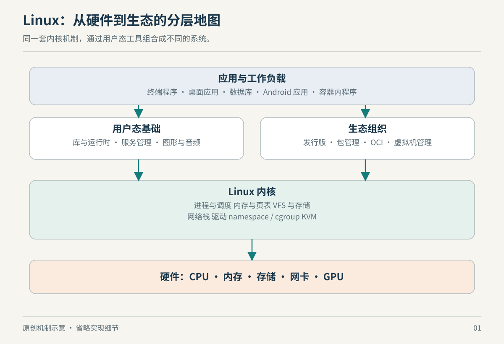

# 第 1 章　计算机、内核与发行版：先建立地图

你在终端中敲下一条命令，屏幕立刻出现结果。这种流畅感很容易制造一个错觉：程序发出一个愿望，电脑便整体响应。实际上，同一段时间里，CPU 在执行指令，内存在保存数据，设备在传输，内核在协调权限和资源，用户态服务在决定策略。理解 Linux 的第一步，是拆开这些职责。



*图 1：原创机制示意。分层表示主要职责，不表示所有操作都必须依次穿过每一层。*

## 硬件会执行，但不会替所有程序分配公平

先把计算机缩小到一个问题：两个程序都想使用 CPU，也都想读写内存，谁来协调？Linux 提供多任务、虚拟内存和设备接口，把原本会相互冲突的要求组织起来。它起初针对 x86 PC，后来扩展到多种架构；内核自身也明确将 Unix 风格和 POSIX 接口作为目标。这解释了它为何既能出现在服务器，也能作为其他平台的底座，但并不意味着各平台的上层软件都相同。[来源：Linux 内核《README》](https://docs.kernel.org/admin-guide/README.html)

常见带 MMU 的机器上，应用通常运行在受限制的用户态，内核运行在更高权限的执行环境。程序要请求受管理的操作，可以通过系统调用进入内核；设备事件可能通过中断引起处理；异常也可能让控制流转入内核。这里的“进入”不是另外启动一个普通应用，而是在既定入口转换执行上下文、处理状态，再按规则返回。架构不同，具体入口指令与寄存器不同，不能把某一种 x86 图当成所有 Linux 机器的电路图。[来源：内核 Entry/exit handling](https://docs.kernel.org/core-api/entry.html)

这个边界让内核能够检查请求，却不意味着每一次普通运算都要经过内核批准。应用的加减乘除、已经建立映射的正常内存访问，可以直接由处理器执行。内核的重要作用之一，是预先建立和维护执行条件；不是坐在每条机器指令前盖章。后面的程序与内存章节会分别解释接口边界和地址映射。

## 数据移动不是 CPU 一字节一字节搬运

CPU 地址、物理地址和设备使用的 DMA 地址不是同一个概念。驱动借助 DMA 接口安排设备访问缓冲区，某些机器上的 IOMMU 还会在设备地址和物理内存之间建立映射。这样理解后，网卡和磁盘就不再像只能等 CPU 逐字抄写的外设：它们可以在准备好的条件下进行传输，而 CPU 继续执行其他工作。[来源：内核 Dynamic DMA mapping Guide，“CPU and DMA addresses”](https://docs.kernel.org/core-api/dma-api-howto.html)

代价是协调变得复杂。一个缓冲区现在归谁使用？设备完成了吗？缓存中的内容是否对另一方可见？这些问题不是简单地“调用一个更快函数”就消失。为了保持主线，本书不展开驱动级 DMA 编程；你只需要记住，现代 I/O 的成本既包括数据本身，也包括建立映射、同步和通知的工作。第 7、14、16 章会从不同方向重新遇到这些成本。

## Linux 这个词有两种尺度

严格讨论系统调用、调度器或文件系统实现时，本书的 Linux 指内核。日常说“装一套 Linux”，通常指发行版：内核加上系统库、命令、服务管理、软件仓库、更新方式以及可能存在的桌面环境。这种口语没有问题，但在分析原因时必须知道自己正在说哪一层。

发行版不是简单把相同软件换个壁纸。以 Debian 的软件包机制为例，包除了文件，还描述依赖、冲突等关系，并可能携带安装、升级或移除阶段的维护脚本。包管理器管理的是一套关联状态，而非只解压一个压缩包。因此“换了内核”与“升级了整套发行版”不是同一操作，“有源码”与“能安全维护整套系统”也不是同一承诺。[来源：Debian Administrator's Handbook，Package Meta-Information](https://www.debian.org/doc/manuals/debian-handbook/sect.package-meta-information.en.html)

| 你看到的变化 | 应优先追问的层次 |
| --- | --- |
| 新增一种系统调用或文件系统选项 | 内核版本、配置与权限 |
| 同名命令参数不同 | 命令实现与软件包版本 |
| 开机后服务没有起来 | 服务管理、配置和依赖 |
| 某个程序找不到共享库 | 加载器、运行库与发行版环境 |
| 图形界面卡顿 | 应用、合成器、驱动与调度，需要证据分辨 |

这张表是排查起点，不是排他的因果判决。同一故障可能横跨多层；我们先定位问题的接口，再沿数据和控制流往下追。

## 为什么“版本旧”不等于“什么都旧”

内核社区区分主线、稳定维护与长期维护分支；发行版还可能维护自己的内核并回移修复。由此得到一个实际结论：看见版本号时，应同时查看发行版维护说明和功能文档，而不只比较第一位数字。本书不列一张很快失效的“最值得装版本”排行榜。[来源：kernel.org，Releases，含 Distribution kernels](https://www.kernel.org/category/releases.html)

还有一条容易混淆的边界：内核给用户程序的接口强调长期兼容，而内核内部给驱动使用的接口并不提供同样的稳定承诺。一个旧程序继续运行，与一个未重新适配的树外驱动还能直接加载，是两个不同问题。某些厂商会额外提供自己的兼容承诺，需要按其范围理解。[来源：内核 The Linux Kernel Driver Interface](https://docs.kernel.org/process/stable-api-nonsense.html)

理解这一点，比背诵发行版家谱更有用。你可以把 Linux 生态看成围绕一批接口形成的协作网络：有人维护内核，有人维护库，有人负责集成和更新，有人构造面向手机、云端或桌面的平台。接下来的章节会逐层打开这些接口。

## 在你的机器上找几个坐标

在 Linux 中可以只读执行：

```sh
uname -srm
cat /etc/os-release
ps -p 1 -o pid,comm,args
```

第一条帮助识别运行中的内核和机器架构；第二条通常描述发行版用户环境；第三条观察当前 PID 视图中的 1 号进程。若在容器内执行，不要假定三个结果都描述同一台“完整机器”：容器里的发行版文件可以来自镜像，而内核属于承载它的 Linux 系统。第 10、11 章会把这件事解释清楚。

## 本章资料与证据边界

以上链接分别支持硬件与内核接口、DMA 地址、包元信息和发布维护机制；表格与排查顺序是本书的教学归纳。本章以常见带 MMU 的通用 Linux 系统为主，不覆盖无 MMU 微控制器、所有启动架构和全部发行版政策。不要从“Linux 支持某机制”推导“你的设备必然启用了它”。
