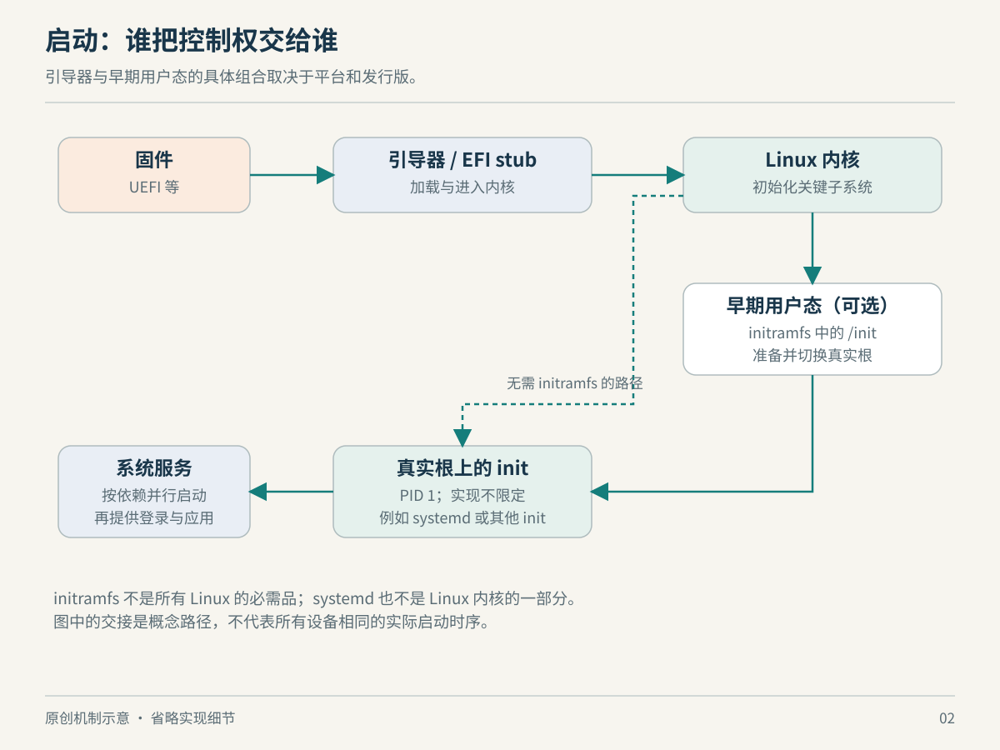

# 第 2 章　从通电到服务：系统怎样活过来

一台服务器上的模型网关没有起来，原因可能是程序崩溃，也可能是数据盘尚未挂载。如果连系统都无法启动，问题又可能出在根文件系统、加载器或驱动。把这些现象都叫作“Linux 坏了”，很难决定下一步查哪里。理解启动过程的价值，是知道每一阶段已经具备什么能力、还在等待谁交接。

## 2.1 启动不是从一份配置文件开始

通电后，最先运行的是平台固件。常见计算机由固件完成初步硬件初始化，再找到引导程序；引导程序把内核及所需初始镜像装入内存。不同机器的具体协议不一样，Linux 并没有规定所有设备必须先经过同一种引导器。systemd 的启动说明也明确包含由 EFI 固件直接加载内核的路径。[启动总览](https://www.freedesktop.org/software/systemd/man/latest/bootup.html)

这解释了一个容易混淆的边界：GRUB 不是 Linux 内核的一部分，也不是 Linux 的必需前提。启用 EFI boot stub 的内核能够作为 EFI 可执行映像被加载；stub 承担相应引导工作，省去常规 EFI 引导器。这里省掉的是一个独立程序环节，内核仍需要接收正确的启动参数与资源。[EFI Boot Stub](https://docs.kernel.org/admin-guide/efi-stub.html)

可以把引导理解为“把接下来能独立运行的程序摆到合适位置，并把必要信息交给它”，而不是操作系统从磁盘中自己醒来。这是本文的教学归纳；它帮助区分控制权属于固件、引导程序，还是已经属于内核。



*图 2-1　原创机制示意，非实际时序/比例。initramfs 是常见而非强制经过的阶段；具体引导路线取决于平台与镜像。*

## 2.2 为什么要有一个临时的根目录

内核接管后，必须建立足够的运行环境，才能执行用户空间程序。然而“真正的根目录在哪里”可能不是一个简单问题：它可能位于需要模块支持的存储设备上，或者必须先解锁、组装，才能挂载。为了找到最终系统，需要工具；为了执行工具，又需要先有文件系统。这就是早期用户空间存在的理由。[Early userspace support](https://docs.kernel.org/driver-api/early-userspace/early_userspace_support.html)

initramfs 提供一种解法：预先准备小型文件树，通常打包成 cpio 归档，由内核解包到内存中的根文件系统。如果其中有可执行的 `/init`，内核运行它。在常见发行版的启动路线中，该程序准备最终根目录，再移交运行环境；也可以直接在 initramfs 中提供最终用户环境，不必另外挂载一个持久化的“真实根”。initramfs 并不是第二个内核，它装的是用户空间所需文件。不要把名称中常见的 `initrd` 与现代 initramfs 的实现细节完全画等号：传统 initrd 使用内存块设备上的文件系统，机制不同。[Ramfs、rootfs 与 initramfs](https://docs.kernel.org/filesystems/ramfs-rootfs-initramfs.html)

设想根分区需要先解锁。这里的依赖关系是：先有可运行的解锁工具和相关内核支持，再有可挂载的根文件系统，最后才有完整用户空间。这个例子是因果说明，不是所有发行版的逐条启动脚本。对自己的机器，应检查镜像实际包含的程序，而不是从一个发行版教程推断全部 Linux。

## 2.3 PID 1 是角色，systemd 是一种实现

启动最终要跨过一个关键门槛：内核能够运行用户空间的初始化程序。找不到可用 init 时，问题可能是根本没有挂载到正确根目录，也可能是 init 文件存在，却缺少它依赖的动态加载器，或可执行文件的架构不匹配。“文件在那里”只能证明目录项存在，不能证明程序可以执行。[No working init found](https://docs.kernel.org/admin-guide/init.html)

在采用 systemd 的系统上，系统管理器通常作为初始 PID 命名空间里的 PID 1，负责组织后续服务。但是 Linux 不要求这一角色必须由 systemd 扮演；本章的服务依赖讨论适用于 systemd，而不是内核启动接口本身。容器中看到的 PID 1 也不必是宿主的 PID 1：PID 命名空间可以有自己的编号及 init 角色。该命名空间的 init 退出时，内核会终止其中的其他进程。[PID namespaces](https://man7.org/linux/man-pages/man7/pid_namespaces.7.html)

因此，对“为什么容器退出了”与“为什么整台机器没启动”应使用不同尺度。前者可能只是一个命名空间的首进程结束，不能据此判断宿主系统发生了重启。

## 2.4 服务启动是依赖图，不是一串 sleep

假设应用需要数据库。一个常见直觉是“把数据库写在应用前面启动”，但这里其实有三个问题：要不要把数据库一起拉起；谁先开始；数据库什么时候真正可以接受请求。systemd 的 `Wants=`、`Requires=` 等表达依赖，`Before=`、`After=` 表达顺序，两类关系分别设置；只有顺序关系不会自动把另一个 unit 拉起。[systemd.unit](https://www.freedesktop.org/software/systemd/man/latest/systemd.unit.html)

“启动完成”的含义还取决于服务类型。`Type=exec` 能让管理器等到可执行文件成功执行，但这不等于应用已经完成内部初始化；`Type=notify` 则允许服务在准备好以后发送 `READY=1`。这也说明，进程已存在、程序已进入、业务已就绪，是不同事实。[systemd.service](https://www.freedesktop.org/software/systemd/man/latest/systemd.service.html)

据此分析，给依赖服务固定等待五秒，只是在猜测它完成初始化的时间。更可靠的设计应有可验证的就绪条件，或者允许客户端按业务需要重试。这是由上述状态区分得到的工程推论，不是 systemd 对应用协议的保证。服务间没有必要的顺序约束时可以并行启动；“系统启动顺序”更像一组局部约束，未必存在全局唯一序列。

## 2.5 在自己的机器上观察交接结果

以下命令用于阅读已有状态，不修改启动配置；本章不提供固定输出，因为实体机、虚拟机和容器的结果可能不同。

```sh
cat /proc/cmdline
ps -p 1 -o pid,comm,args
readlink /proc/1/exe
```

第一条显示当前内核命令行；后两条帮助确认眼前命名空间中的 PID 1。访问 `/proc/1/exe` 可能受权限限制。`/proc` 提供内核与进程信息接口，但容器所见内容取决于挂载与隔离安排。[proc 文件系统](https://docs.kernel.org/filesystems/proc.html)

仅在以 systemd 作为系统管理器的环境里，再观察：

```sh
systemctl get-default
systemctl list-dependencies default.target
systemctl show -p After -p Wants -p Requires default.target
systemd-analyze critical-chain
```

阅读时尝试回答：默认目标拉起了哪些依赖？依赖关系与启动先后是否相同？关键链中等待的是设备、挂载，还是服务？这些命令的意义在于验证关系，不能只凭某一项耗时很长，就断言删掉它能等量缩短总启动时间——并行工作之间可能重叠。相关工具属于 systemd 工具集，其可用性与输出随版本和运行环境而异。[systemd 启动关系](https://www.freedesktop.org/software/systemd/man/latest/bootup.html)

`systemd-analyze` 本身也明确说明，某些服务耗时可能包含等待其他服务的时间，工具不能完整反映所有设备等待与初始化过程。计时图是证据入口，读懂其口径才有诊断意义。[systemd-analyze](https://www.freedesktop.org/software/systemd/man/latest/systemd-analyze.html)

还可以做一次不需要改机器的诊断练习。把“内核已经打印日志，但无法运行 init”“已经进入系统，但应用 unit 失败”“应用 unit 已启动，但接口仍不接受连接”写成三个独立案例。它们对应的调查对象分别是启动交接条件、服务管理记录与应用就绪状态。这个分类是本章机制的应用，不代表日志中必定使用相同措辞。关键在于先确认已经跨过哪道边界，再向下一层取证，避免应用故障发生时还从头怀疑固件。

启动也是理解 Linux 分工的第一个完整案例：内核提供运行与访问资源的机制，早期工具建立必要环境，系统管理器组织服务，应用最后表达业务就绪。任何一层都不能仅凭自己的“成功”，替下一层宣布成功。后面阅读容器和虚拟机时，可以继续沿用这个判断方法：先识别环境准备完成与负载真正可用之间的区别。

### 本章资料与证据边界

本章核实日期：2026-10-22。主要依据 Linux 内核文档与 systemd 项目手册；链接位于具体事实附近。EFI stub、initramfs 与 PID 命名空间各有配置前提；嵌入式设备、Android 与不采用 systemd 的系统不能直接套用本章后半段的服务模型。本文未在读者设备上执行命令，也不把观察命令当成实测报告。

- [Linux：EFI Boot Stub](https://docs.kernel.org/admin-guide/efi-stub.html)、[Early userspace](https://docs.kernel.org/driver-api/early-userspace/early_userspace_support.html)、[initramfs](https://docs.kernel.org/filesystems/ramfs-rootfs-initramfs.html)、[init 启动失败](https://docs.kernel.org/admin-guide/init.html)。
- [systemd：bootup](https://www.freedesktop.org/software/systemd/man/latest/bootup.html)、[unit](https://www.freedesktop.org/software/systemd/man/latest/systemd.unit.html)、[service](https://www.freedesktop.org/software/systemd/man/latest/systemd.service.html)。
- [Linux man-pages：PID namespaces](https://man7.org/linux/man-pages/man7/pid_namespaces.7.html)。
