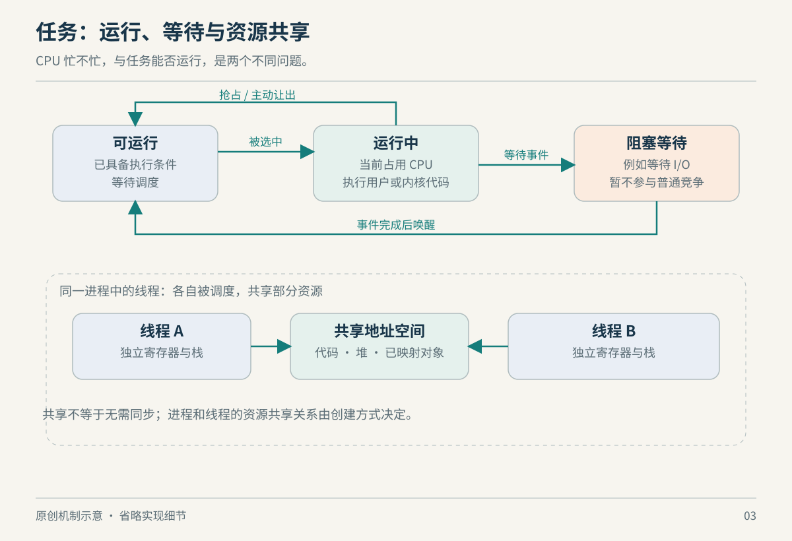

# 第 3 章　进程与线程：谁在运行，谁在等待

一个服务建立了几百条连接，CPU 占用却很低；另一个只有十几个线程，却把机器占满。“运行了多少程序”与“CPU 正在忙什么”之间没有简单对应关系。要理解这种差别，需要把三件事分开：程序文件、进程拥有的资源，以及此刻可被调度的执行流。

## 3.1 进程是资源环境，线程是其中的执行流

程序是磁盘上的代码及相关数据；执行它，才会出现进程。一个进程可以包含多个线程。POSIX 线程共享进程的地址空间、打开的文件描述符等资源，各有自己的栈和线程标识。这使同一进程中的线程能够直接访问共同数据，也意味着“每个线程有自己的栈”不等于栈获得了线程间内存隔离。[pthreads](https://man7.org/linux/man-pages/man7/pthreads.7.html)

Linux 的实现可以按共享关系理解，而不必先背一长串结构体。`clone` 系列接口允许指定是否共享地址空间、文件描述符表及其他执行上下文；线程创建所需的共享组合建立在这些机制上。进程和线程因此既不是“完全相同”，也不是内核里毫不相关的两种世界。[clone](https://man7.org/linux/man-pages/man2/clone.2.html)

比如，两个线程共同处理请求，交换一个指针很方便；但任何一方错误修改共享对象，都可能伤及整个服务。如果改成两个独立进程，传递数据需要显式通信，故障边界也随之变化。这里没有“线程必然更好”的结论，选择取决于愿意交换多少共享便利与隔离能力。



*图 3-1　原创机制示意，非实际时序/比例。状态转换是教学模型，未列出全部内核任务状态。*

## 3.2 fork 与 exec 分别做什么

`fork()` 创建子进程，父子从调用处继续，各自得到不同返回值。它们的虚拟地址空间起初具有相同内容，但之后对私有内存的修改互不影响。Linux 使用写时复制避免立即复制全部数据页；创建任务及管理映射仍有成本，不能把它理解成无代价地“复制一个巨型服务”。[fork](https://man7.org/linux/man-pages/man2/fork.2.html)

若父进程有多个线程，子进程只保留调用 `fork()` 的那个线程，内存中的互斥锁等同步对象状态却会被继承。不能把它当成原线程集合的完整副本；在这种子进程调用 `execve()` 之前，安全可调用的函数也受到异步信号安全要求限制。[fork：多线程程序的限制](https://man7.org/linux/man-pages/man2/fork.2.html)

`execve()` 的作用不同：把调用进程正在执行的程序替换为另一份程序映像。成功时不会返回原来的调用位置；它并不因名字叫“执行”就自动创建一个新进程。shell 启动外部程序可以用“创建执行环境，再在里面替换程序”来理解，但实际实现也可能使用其他进程创建接口。[execve](https://man7.org/linux/man-pages/man2/execve.2.html)

这个区分对排查服务重启很有用：换了一份可执行映像不一定换了 PID，而出现新 PID 也不一定说明旧程序完整复制了所有物理内存。PID 是观察线索，不能独自回答程序生命周期中的全部问题。

## 3.3 阻塞不是 CPU 在那里等

线程等待网络、子进程或某个同步条件时，可以进入睡眠状态，让 CPU 去运行别的可运行线程。例如 `waitpid()` 在指定子进程尚未满足等待条件时可以阻塞调用线程；子进程终止后，父进程取得退出信息并完成回收。已经终止但尚未被适当回收的子进程可能成为僵尸，它不是还在后台执行原来的业务代码。[wait](https://man7.org/linux/man-pages/man2/wait.2.html)

锁也并非总是“调用一次内核，再排队一次”。Linux 的 futex 为用户空间同步提供基础：无竞争路径可以在用户空间完成，争用需要等待或唤醒时才由内核参与。因此看到很多线程，并不意味着它们不断进行系统调用；看到 futex 等待，也不意味着 CPU 正被这些等待者消耗。[futex](https://man7.org/linux/man-pages/man7/futex.7.html)

由此可以推出一条实用判断：如果串行瓶颈是同一把锁，继续增加线程可能只是扩大等待队列；如果线程经常等待互不相关的 I/O，适度并发则可能利用原来闲置的执行时间。线程数量是设计参数，不是吞吐量本身。

在工具里，`R` 表示正在运行或可运行，`S` 表示可中断睡眠，`D` 表示不可中断等待，`Z` 表示僵尸。`D` 常被称作磁盘睡眠，但不应据此断言每个 D 状态线程都在访问物理磁盘；诊断还需要具体等待位置与设备信息。状态值是瞬间分类，不是业务根因。[ps 状态码](https://man7.org/linux/man-pages/man1/ps.1.html)

## 3.4 调度是在公平、响应与成本之间取舍

调度器决定可运行线程何时获得 CPU。普通任务希望既不被长计算饿死，又能让刚被唤醒的交互任务尽快响应。历史上的 CFS 用虚拟运行时间近似跟踪公平份额；把“真正并行的理想处理器”转化为现实 CPU 上的轮流执行，是理解公平调度的入口。[CFS 设计](https://docs.kernel.org/scheduler/sched-design-CFS.html)

内核自 6.6 起开始转向 EEVDF。其核心可以概括为：先看任务是否有资格竞争，再按虚拟截止时间选取，兼顾公平份额与响应需求。这里的“截止时间”是调度算法内部的虚拟量，不是承诺你的 HTTP 请求一定在某时刻完成；也不能把普通公平调度与 `SCHED_DEADLINE` 实时策略混为一谈。[EEVDF](https://docs.kernel.org/scheduler/sched-eevdf.html)、[调度策略接口](https://man7.org/linux/man-pages/man7/sched.7.html)

切换执行流需要保存、恢复运行上下文，实际代价还与地址空间、CPU 缓存及迁移等条件有关。我们不为“一次上下文切换”提供通用纳秒值：脱离处理器、内核、负载和测量方法，这个数字很容易误导。更频繁轮换有时改善响应，有时反而让有效计算比例下降，这是一种需要测量的权衡。

“进入内核”也不等于“换成另一个进程”。线程执行一个很快完成的系统调用，可以进入内核处理后直接回到自己；只有发生了执行流切换，才是在这里讨论的任务上下文切换。资源统计把自愿与非自愿上下文切换分别计数，适合用于观察等待与抢占的差异。[getrusage](https://man7.org/linux/man-pages/man2/getrusage.2.html)

## 3.5 观察一个服务，而不是只盯总 CPU

在常见 Linux 的 procps `ps` 实现中，可以用自己的 shell 做一个只读入口：

```sh
ps -L -p "$$" -o pid,tid,stat,psr,pcpu,comm
cat /proc/$$/status
ls /proc/$$/task
```

`$$` 是当前 shell 的 PID。观察 `pid` 与 `tid`，理解“同一个进程拥有多个执行流”的表示方式；自己的 shell 可能只有一个线程，不必期待一定出现多行。要看已有多线程服务，可把 PID 换成自己有权观察的服务。`/proc/PID/task` 展示线程相关条目；不同权限与挂载设置可能限制可见性。[proc 文件系统](https://docs.kernel.org/filesystems/proc.html)

再对照业务现象：线程是持续可运行，还是多数时间睡眠？CPU 很低而请求很慢，可能需要查依赖与等待；CPU 很高也要区分有用计算、锁自旋或其他工作。这些是提出假设的方法，不是单凭一张状态快照就能确定的诊断。`ps` 是快照，百分比也有其统计口径，比较时应保持工具和采样方式一致。

试着构造两个思想实验。第一个服务只有一个工作线程，它连续计算；第二个服务有很多线程，却都在等外部响应。即便第二个进程的线程数远大于第一个，也不能据此推出它更消耗 CPU。再把第二个实验改为所有线程争用同一段必须串行完成的工作，就能看出“让更多请求进入进程”与“让更多请求完成”为什么可能分离。这里比较的是机制可能产生的结果，不是对某类服务的性能排名。

工程上可以把请求耗时拆成等待获得 CPU、实际执行，以及等待其他条件的时间。这个分解是教学用的分析框架，各项可能因并发而重叠，不能拿不同时钟口径的数值随意相加。它最有用的地方，是提醒我们每次优化都提出明确假设：到底想减少哪种等待？若目标没有说清，增线程、改优先级或换调度参数，都可能只是改变现象。

### 本章资料与证据边界

本章核实日期：2026-10-22。依据 Linux man-pages 与内核调度文档。EEVDF 的具体实现、发行版回移补丁与调度配置会变化；本章解释普通调度的目标，不提供实时性保证。关于锁竞争与线程数量的取舍是基于机制的工程分析，未声称对某个应用做过性能测试。

- [pthreads](https://man7.org/linux/man-pages/man7/pthreads.7.html)、[clone](https://man7.org/linux/man-pages/man2/clone.2.html)、[fork](https://man7.org/linux/man-pages/man2/fork.2.html)、[execve](https://man7.org/linux/man-pages/man2/execve.2.html)。
- [wait](https://man7.org/linux/man-pages/man2/wait.2.html)、[futex](https://man7.org/linux/man-pages/man7/futex.7.html)、[getrusage](https://man7.org/linux/man-pages/man2/getrusage.2.html)。
- [CFS](https://docs.kernel.org/scheduler/sched-design-CFS.html)、[EEVDF](https://docs.kernel.org/scheduler/sched-eevdf.html)、[sched](https://man7.org/linux/man-pages/man7/sched.7.html)、[ps](https://man7.org/linux/man-pages/man1/ps.1.html)。


进一步阅读：[第 21 章　并发与同步](21-concurrency.md)，补充本章机制在共享数据、软件集成或资源放置中的延伸。
