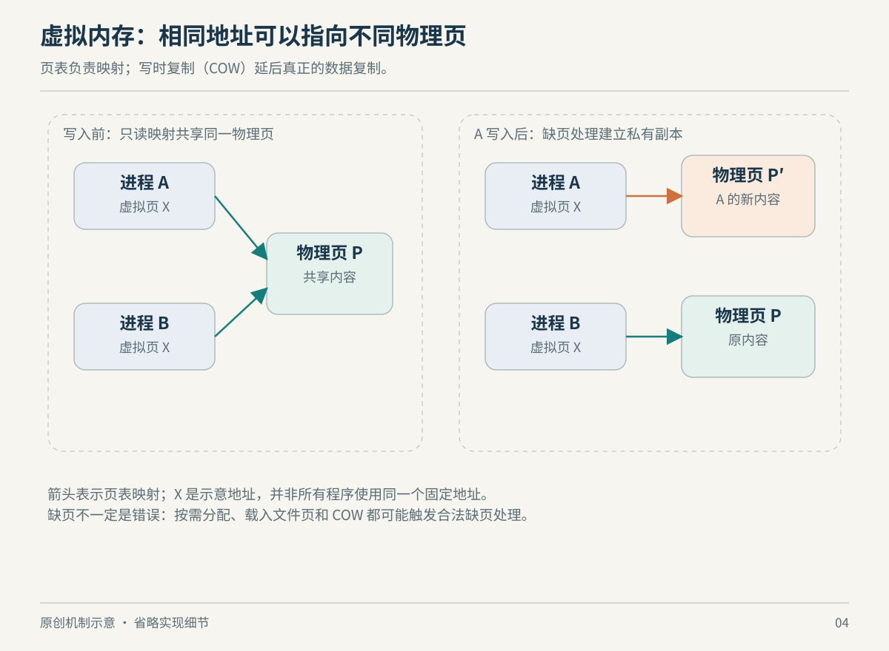

# 第 4 章　内存：地址是一份受管理的承诺

一个程序申请了很大的数组，系统内存却没有立即上涨；另一个文件被反复读取，第二次明显更快；几个进程各显示用了不少内存，相加却似乎超过整台机器。这些并不是统计失灵，而是“用了多少内存”本来就包含不同问题。

## 4.1 指针不是内存条上的位置

在本章讨论的带内存管理单元（MMU）的常见系统上，程序访问的是虚拟地址。内核维护映射与权限，硬件完成地址转换；不同进程可以使用相同虚拟地址而对应不同物理页，也可以把不同虚拟地址映射到共享的物理页。页是这种管理的基本单位之一，大小与架构、内核配置有关，不能把 4 KiB 当成所有 Linux 的定律。[内存管理概念](https://docs.kernel.org/admin-guide/mm/concepts.html)

页表表达这些映射，TLB 则缓存地址转换结果。TLB 未命中通常意味着需要进一步查找映射，不自动等于发生缺页，更不等于访问磁盘。Linux 的软件页表模型允许多级结构，具体硬件未使用的层级可以折叠；“Linux 有五级页表抽象”不能直接改写成“每台机器每次访问都走五级”。[Page Tables](https://docs.kernel.org/mm/page_tables.html)

因此，一张地址空间图画的是某个进程可见的布局，不是物理内存条的切块照片。后面讨论共享库、文件映射和虚拟机时，应始终问：眼前这个地址属于哪一层，哪个机制负责把它解释为下一层的资源？



*图 4-1　原创机制示意，非实际时序/比例。图中页数与页大小只服务于讲解。*

## 4.2 申请、映射与实际驻留不是同一时刻

`malloc()` 是用户空间的分配接口。分配器可能复用已有空间，也可能向内核申请更多地址空间；一次小额分配不必对应一次系统调用。调用 `free()` 表示应用把空间交还给分配器，也不保证进程 RSS 立即下降。要分析“内存为什么没有回去”，需要先区分应用对象是否释放、分配器是否保留，以及内核所见映射是否变化。[malloc](https://man7.org/linux/man-pages/man3/malloc.3.html)

内核还可能采用按需分配：先建立地址范围，等程序实际触碰某些页，再补足所需映射或内容。这能避免为从不使用的空间立即付出全部物理内存成本；但也把部分工作延迟到了访问时。缺页异常是这种机制的正常入口之一，并非每次都说明程序写错了地址。[Page Tables：缺页](https://docs.kernel.org/mm/page_tables.html#mmu-tlb-and-page-faults)

如果缺页能在不从存储载入数据页的情况下解决，统计上属于 minor fault；需要相应 I/O 的是 major fault。首次分配匿名页、建立已有内存页的映射，与从磁盘调入内容的成本显然不同，不能只把所有 fault 次数加在一起评估严重程度。[getrusage](https://man7.org/linux/man-pages/man2/getrusage.2.html)

一个教学例子是预留大型稀疏结构：地址空间可能很大，实际触碰的页却很少。这个例子说明为什么虚拟空间大小不能直接当作 RAM 占用；它并不保证任意分配都会成功。Linux 的 overcommit 策略控制承诺空间的方式，申请成功也不在所有策略下等于未来每一页都一定能获得物理资源。[Overcommit Accounting](https://docs.kernel.org/mm/overcommit-accounting.html)

## 4.3 写时复制把成本推迟到真正分歧时

父进程 `fork()` 后，父子可以先共享私有映射背后的物理页，等其中一方需要写入时再为私有内容建立分离。这就是写时复制（copy-on-write，COW）的核心：共享尚未分歧的内容，付费发生在真正产生独立修改的时候。[fork](https://man7.org/linux/man-pages/man2/fork.2.html)

文件映射也需要区分共享与私有。`MAP_SHARED` 的修改可以被映射同一区域的其他进程看到，并作用于底层文件；`MAP_PRIVATE` 建立私有写时复制映射，修改不会写回原文件。由此，“我在地址空间里改了这个文件对应的字节”并不能独自回答磁盘文件是否改变，必须看映射语义。[mmap](https://man7.org/linux/man-pages/man2/mmap.2.html)

把这两点放在一起，可以理解一些多进程服务的内存变化：起初共享很多页，工作负载开始修改后，私有占用逐步增加。它不必是对象泄漏，也可能是共享程度下降。反过来，只看总 RSS 大体不变，也不能证明对象生命周期正确；指标说明资源状态，程序语义还需要别的证据。

## 4.4 文件缓存也是有用的内存

普通文件 I/O 常利用页缓存保留文件内容。干净缓存页有可重新读取的后备内容，内存吃紧时可以回收；修改后尚未写回的脏页则需要处理其持久化。这里讲的是常见缓冲 I/O 路径，并不覆盖 Direct I/O 等绕行方式。[Ramfs 文档对页缓存的说明](https://docs.kernel.org/filesystems/ramfs-rootfs-initramfs.html)

这解释了“空闲内存很少”为什么不一定危险：一部分 RAM 可能正在替应用缓存可回收的数据。`MemAvailable` 是不发生换出情况下可供新应用使用内存的估计值，`MemFree` 只是当前空闲页，两者回答的问题不同。缓存也不是都可瞬间无成本回收，脏页、正在使用的页和其他限制会影响实际行为。[proc_meminfo](https://man7.org/linux/man-pages/man5/proc_meminfo.5.html)

性能讨论应把“第一次读文件”与“热缓存读取”分开。若只测后者，就不能声称测到了存储设备吞吐。这里没有通用的加速倍数：文件大小、缓存容量、访问模式与系统其他负载都改变结果。

## 4.5 RSS、PSS 与 OOM 各自在说什么

RSS 统计进程映射中驻留在 RAM 的部分，共享页可以进入多个进程的 RSS；PSS 把共享页按共享者比例分摊。假设两个进程共同映射同一份 100 MiB 驻留内容，只讨论这段映射，各自 RSS 都可以计入 100 MiB，PSS 则各分摊约 50 MiB。这个简化算例不是实测，也不包含页表及内核其他开销。[proc_pid_smaps](https://man7.org/linux/man-pages/man5/proc_pid_smaps.5.html)

系统内存压力升高时，回收文件缓存和把适合换出的页移到 swap 都可能参与缓解。swap 不等于扩大了同等性能的 RAM；换回需要时间，反复换入换出可能让应用迟缓。无法满足必要分配时可能触发 OOM 处理，但 OOM 不是“RSS 最大者必定被杀”的简单规则；还要考虑分配上下文及策略。[内存回收与 OOM 概览](https://docs.kernel.org/admin-guide/mm/concepts.html#reclaim)

容器中的内存上限另有控制组语义，后续隔离章节会继续解释：宿主看起来尚有可用 RAM，某一容器仍可能先触及自身限制。本章的全局指标不用于替代控制组指标。

## 4.6 一次只读观察

下面查看当前 shell 的映射与汇总，不触发大规模分配，也不修改内核参数：

```sh
getconf PAGESIZE
cat /proc/meminfo
cat /proc/$$/maps
cat /proc/$$/smaps_rollup
```

`maps` 帮助找出可执行文件、共享库及匿名映射；`smaps_rollup` 在内核与权限允许时提供汇总。较旧内核或受限环境可能没有该文件，可改读 `/proc/$$/smaps`。这些接口的内容与可用性由内核实现及权限控制。[proc 文件系统](https://docs.kernel.org/filesystems/proc.html)

观察时把问题写完整：“我想知道的是地址空间规模、当前驻留量、独占成本，还是系统还能承受多少新负载？”然后再选指标。这样的问法比“Linux 把我的内存吃掉了”更容易走到可验证的解释。

例如，你发现服务处理一轮请求后 RSS 没有回落。至少存在几种待检验解释：业务仍引用对象、分配器保留可复用空间、缓存按设计留下内容，或者共享页因修改变成私有页。仅有这一次 RSS 曲线，无法选出正确答案。可以先记录负载结束后的稳定状态，结合应用分配统计与映射分类，再判断下一次相同工作是否继续增加无法解释的占用。这个排查次序是本章的工程建议，并未给任何具体程序判定“无泄漏”。

反过来，RSS 回落也不表示成本消失：若内容只是被换出，后续访问仍可能付出调入代价。容量问题与延迟问题要一起看。理解内存不是寻找一个“真实数字”替代所有统计，而是把每个数字放回它测量的对象之中。

### 本章资料与证据边界

本章核实日期：2026-10-22。假定具备 MMU 的常见 Linux，不涵盖无 MMU 平台；大页、NUMA、设备内存与内存锁定仅在需要时延伸，不据此推导所有硬件行为。COW 算例与 PSS 算例是原创教学分析。没有通过制造 OOM 或清空缓存来“验证”结论，也未给读者机器编造观测值。

- [Linux：内存概念](https://docs.kernel.org/admin-guide/mm/concepts.html)、[页表](https://docs.kernel.org/mm/page_tables.html)、[overcommit](https://docs.kernel.org/mm/overcommit-accounting.html)、[proc](https://docs.kernel.org/filesystems/proc.html)。
- [man-pages：malloc](https://man7.org/linux/man-pages/man3/malloc.3.html)、[mmap](https://man7.org/linux/man-pages/man2/mmap.2.html)、[getrusage](https://man7.org/linux/man-pages/man2/getrusage.2.html)、[smaps](https://man7.org/linux/man-pages/man5/proc_pid_smaps.5.html)、[meminfo](https://man7.org/linux/man-pages/man5/proc_meminfo.5.html)。
