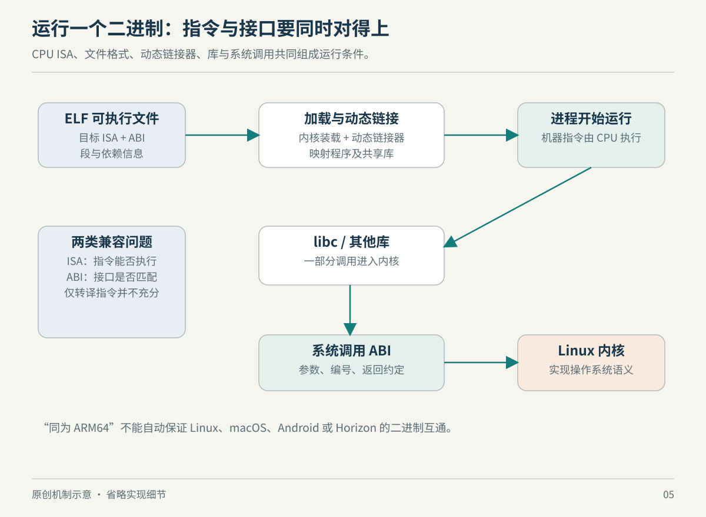

# 第 5 章　程序怎样运行：从 ELF 到系统调用

把一份程序从服务器复制进容器，它却提示找不到文件，尽管 `ls` 清楚显示文件存在；把 x86 程序放到 ARM Linux，它也不会因为内核名称相同就自动理解指令。要解释这些现象，需要越过“源代码可以编译”的层面，看看一份二进制与运行环境究竟约定了什么。

## 5.1 API 管名字，ABI 管实际怎样交接

应用编程接口（API）描述程序员能调用什么；应用二进制接口（ABI）进一步约定编译后的程序如何传递参数、表示数据、调用函数与进入操作系统。这里是术语层面的归纳。例如，源代码都写 `write(fd, p, n)`，不表示不同架构将这几个参数放在同样的寄存器里；Linux 系统调用约定确实随架构 ABI 改变。[syscall](https://man7.org/linux/man-pages/man2/syscall.2.html)

因此，“同样的 C 代码能重新编译”与“同一份二进制能直接执行”是不同能力。二进制保存了已经做出的选择：面向哪种指令集、哪类文件格式、哪套调用约定，以及哪些运行库。移植工作常常是在这些边界上逐项满足条件，而不是只有“翻译 CPU 指令”这一件事。



*图 5-1　原创机制示意，非实际时序/比例。动态链接与静态链接路线不同；图中接口并不表示每次函数调用都会进入内核。*

## 5.2 ELF 是装载说明，不只是机器指令的包装

Linux 常见可执行文件采用 ELF 格式。ELF 文件头记录类别、机器架构等信息；程序头表描述装载需要的段，节表则服务于链接及其他用途。这两个视角不能简单混为一谈：链接器关心如何组织代码和数据，装载器关心把哪些内容以什么属性放入地址空间。[elf](https://man7.org/linux/man-pages/man5/elf.5.html)

在动态链接路线中，可执行文件通常指定一个解释器，也就是动态加载器。加载器寻找所需共享库、建立运行所需关联，再把控制权交给程序；所以“主文件存在”还不够，解释器及依赖也需要存在。路径、搜索规则与环境会影响库的解析，复制可执行文件并不等于复制了它的完整运行条件。[ld.so](https://man7.org/linux/man-pages/man8/ld.so.8.html)

这可以解释前面的“文件存在却找不到”现象：`execve()` 的 `ENOENT` 可以来自程序路径，也可以来自脚本解释器或 ELF 解释器不存在。错误消息中的“找不到”未必指你眼前的那个文件。真正的排查方向应包括解释器路径，而不是反复修改主文件权限。[execve：错误条件](https://man7.org/linux/man-pages/man2/execve.2.html)

一个有用的比喻是演出安排：节目单在场，不代表演员、舞台与入口都已经到位。但这只是记忆辅助；真正定位问题仍需读 ELF 元数据及加载错误，不能凭比喻猜依赖名称。

## 5.3 libc 不是内核，也不只是一层透明转发

libc 提供许多标准库功能及系统调用封装。部分函数主要在用户空间完成计算或管理，部分会按需要进入内核。glibc 与 musl 都可用于 Linux 用户空间，但它们在扩展接口、动态加载行为等方面存在差异；“同为 Linux 的 C 库”不构成任意二进制互换的承诺。[musl 项目：与 glibc 的差异](https://wiki.musl-libc.org/functional-differences-from-glibc.html)

再看一个反直觉例子：获取时间这类功能有时可以经 vDSO 完成。内核把小型共享对象映射到用户空间，libc 利用其中功能和可读数据，在适用条件下避免传统系统调用陷入。因此，观察不到某一次对应 syscall，不等于应用没有调用那项库功能。[vDSO](https://man7.org/linux/man-pages/man7/vdso.7.html)

理解这层边界，也能避免把性能工具的输出当成源码逐行记录。一个库调用可能引出多个系统调用，也可能一个都没有；同一函数的具体路径还会受参数和运行条件影响。追踪结果描述的是那次执行经过的机制，不是函数名称的唯一实现。

## 5.4 “兼容”需要逐层说明

判断一份二进制能否运行，可以按下面几个不同问题检查。表格是基于本章接口关系整理出的诊断框架，不是某一项目承诺的完整兼容矩阵。

| 层面 | 要问的问题 | 不满足时的典型方向 |
| --- | --- | --- |
| 指令集及特性 | CPU 能否执行目标指令？ | 为目标重新编译，或使用适当的翻译/仿真层 |
| 可执行文件与 ABI | 装载器是否支持文件格式与调用约定？ | 对照目标平台的装载与 ABI 支持 |
| 解释器与用户库 | 指定加载器、库及所需符号是否可用？ | 检查实际依赖，而非只复制主程序 |
| 内核接口 | 所需系统调用及相关功能是否存在？ | 检查内核配置、版本和功能探测结果 |
| 运行环境 | 设备、路径、权限与服务是否满足？ | 检查程序的真实外部条件 |

静态链接减少了运行时寻找部分共享库的依赖，但没有把内核接口、CPU 特性及所有外部资源一起打包。基于上表可推知，“静态程序”也不是“对一切 Linux 永久通用的程序”。遇到兼容性声明，应问清它覆盖的是哪一层。

QEMU 的 Linux 用户态仿真是跨层处理的一例：它不只执行目标程序的指令，还需要把目标系统调用转换为宿主调用，处理位宽、字节序等差异。能跑一部分程序不自动等于能完整模拟另一套设备和内核；用户态仿真与系统仿真是不同工作范围。[QEMU 用户态仿真](https://www.qemu.org/docs/master/user/main.html)

## 5.5 哪种接口稳定，哪种允许变化

Linux 内核项目明确区分用户空间接口与内核内部接口：前者强调长期稳定，后者不提供相同的稳定二进制/源码接口承诺。这说明为什么旧用户程序与第三方内核模块，面对内核更新时会呈现不同维护体验；不能用“Linux 很重视兼容”推出某个外部模块无需适配。[The Linux Kernel Driver Interface](https://docs.kernel.org/process/stable-api-nonsense.html)

同样，内核接口的稳定性不等于用户空间库完全一致。旧程序在新环境运行时仍可能缺少所需库；新程序也可能依赖旧内核没有的功能。这是把前述层次组合后的判断：兼容性应写成明确条件，而不是只写一个系统名称。

## 5.6 不运行程序，也能读到哪些信息

安装了 GNU binutils 的常见 Linux 环境，可阅读系统自带可执行文件的元数据：

```sh
readelf -h /bin/ls
readelf -l /bin/ls
readelf -d /bin/ls
readelf --version-info /bin/ls
```

`-h` 看文件头与机器类型，`-l` 看程序段及解释器，`-d` 看动态项，最后一条看版本信息。发行版可能采用不同路径或工具集；如果没有 `/bin/ls` 或该文件并非 ELF，就选择本机已知的 ELF 程序。命令在这里只读取元数据，没有执行被检查程序。[GNU readelf](https://sourceware.org/binutils/docs/binutils/readelf.html)

不必一次理解每个字段。先完成三件事：写下它面向的机器架构，找到解释器路径，列出直接声明的依赖。再回到容器中检查这些条件是否成立。这样，“为什么程序不能运行”就从泛泛的发行版差异，变成了可以逐项验证的接口问题。

最后做一个移植前的纸面练习：假设你已经把所有目标 CPU 指令正确转换，接下来还能缺什么？沿图检查，仍可能缺可执行映像的装载规则、调用约定适配、系统接口语义以及程序所依赖的服务。反过来，假设接口已经补齐，目标指令中的某些扩展又无法在宿主原生执行，工作也没有完成。这个练习不是在否定指令翻译的价值，而是说明它解决的是整条链路中的确定部分。

这样的分层还能改善兼容性报告。与其记录“这个平台不支持”，不如记录“映像已装载，进入程序后调用某接口失败”或“尚未执行，解释器路径缺失”。后者限定了已验证与未验证的范围，也让后续接手者知道应该补哪种证据。

### 本章资料与证据边界

本章核实日期：2026-10-22。以常见 ELF/Linux 用户空间为主，未承诺所有架构、ABI、加载器和兼容层行为相同。musl 项目文档说明该项目自身的实现选择；版本相关细节应以实际 libc 为准。表格与兼容性检查顺序是原创教学整理，未作为对任何特定二进制的测试结论。

- [man-pages：ELF](https://man7.org/linux/man-pages/man5/elf.5.html)、[ld.so](https://man7.org/linux/man-pages/man8/ld.so.8.html)、[syscall](https://man7.org/linux/man-pages/man2/syscall.2.html)、[vDSO](https://man7.org/linux/man-pages/man7/vdso.7.html)、[execve](https://man7.org/linux/man-pages/man2/execve.2.html)。
- [Linux 内核接口稳定性说明](https://docs.kernel.org/process/stable-api-nonsense.html)、[musl 功能差异说明](https://wiki.musl-libc.org/functional-differences-from-glibc.html)、[GNU readelf](https://sourceware.org/binutils/docs/binutils/readelf.html)、[QEMU 用户态仿真](https://www.qemu.org/docs/master/user/main.html)。
