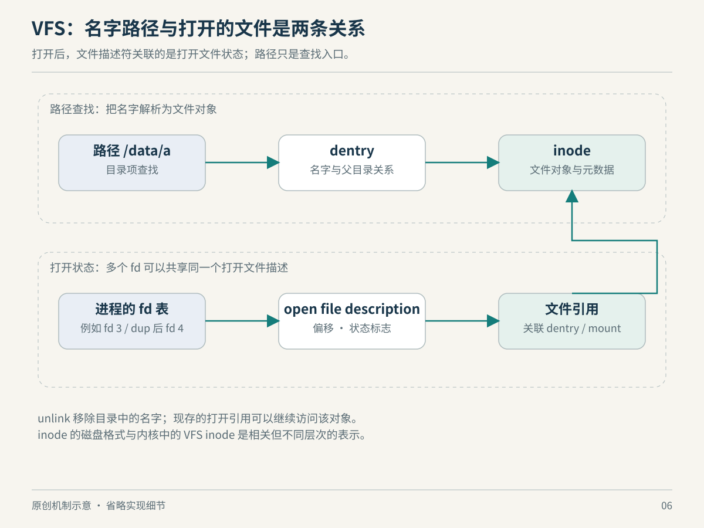

# 第 6 章　文件：名字、对象与打开的关系

你可能遇到过两件看似矛盾的事：日志已经删除，磁盘空间却没回来；两个程序打开同一个文件，却各自从头读。若把文件理解为“磁盘上一个带名字的东西”，这两件事都不容易解释。Linux 实际上把名字、对象和一次打开所产生的状态分开管理。理解这个分层，比背诵目录用途更能帮助我们理解文件系统。

## 从字符串到对象

应用提交 `/var/log/app.log` 时，内核拿到的首先只是一个字符串。绝对路径从调用进程的根目录出发，逐段寻找 `var`、`log` 和最后的名字；相对路径则从工作目录或 `openat()` 指定的目录出发。中间还可能经过符号链接和挂载点。因而“同一个路径”需要附带上下文：进程的根、工作目录和挂载视图都可能影响结果。[路径解析规则](https://man7.org/linux/man-pages/man7/path_resolution.7.html)

VFS，即虚拟文件系统层，向应用提供统一入口，再把具体操作交给相应文件系统。它不要求所有数据来自磁盘：ext4、网络文件系统和内存中的伪文件系统都可以接入。统一的是访问接口；持久性、延迟和失败方式仍由后端决定。[Linux VFS 概览](https://docs.kernel.org/filesystems/vfs.html)



*图 6-1　原创机制示意，非实际时序或内存比例。路径查找与 fd 访问是两条相接但不同的路线。*

目录查找中，dentry 表示某个名字与目录关系的内核对象，inode 表示文件系统对象及其属性。多个名字可以通往同一个 inode，这就是硬链接的基础。dentry 缓存也可以记录“这里暂时没有这个名字”，避免反复询问后端。缓存帮助查找，但缓存中的对象并不等于磁盘目录记录本身。[VFS 对象说明](https://docs.kernel.org/filesystems/vfs.html)、[路径查找实现说明](https://docs.kernel.org/filesystems/path-lookup.html)

可以把这些对象理解为不同的问题：路径回答“从这里怎么找到它”，inode 回答“找到的是哪个对象”，而一次打开还要回答“我现在读到哪里了”。这是教学上的问题分解，不是说内核真的运行了三个相互独立的小系统。

## 一个整数为什么能代表文件

`open()` 成功后返回的 fd 是进程描述符表中的小整数索引。它引用一个 open file description，中文可称“打开文件描述”；后者记录偏移量和文件状态标志。另一次独立 `open()` 通常产生另一份打开状态，即使最终指向同一个文件。因此两个程序能够各自从第一个字节开始读。[open(2)](https://man7.org/linux/man-pages/man2/open.2.html)

`dup()` 则复制引用：两个 fd 指向同一份打开文件描述，因而共享文件偏移。通过一个 fd 读过一段，另一个接着读取的位置也会改变。描述符自身的标志与打开状态标志又是不同层次，例如 close-on-exec 标志属于 fd。[dup(2)](https://man7.org/linux/man-pages/man2/dup.2.html)

| 你关心的问题 | 应关注的层次 | 直接后果 |
| --- | --- | --- |
| 这个路径在当前进程里指向哪里 | 根目录、工作目录、挂载与路径查找 | 换一个挂载视图，结果可能不同 |
| 两个名称是否代表同一文件对象 | 文件系统中的 inode 关系 | 硬链接可以共享内容 |
| 两次读取是否共享当前位置 | 打开文件描述 | 独立打开与 `dup()` 不同 |
| 这个数字是否有效 | 当前进程的 fd 表 | 另一个进程中的同号 fd 无须相关 |

这也解释了 shell 重定向的关键：程序关心的是 fd 1 可否写入，而 shell 可以先把 fd 1 接到终端、文件或管道。接口让输出去向可以变化，程序不必为每一种去向另写一套主逻辑。这里的设计启示是作者解释：保留稳定的操作入口，允许其背后的对象变化。

## 删除的是名字，回收的是对象

`unlink()` 删除目录中的一个名字。若仍有其他硬链接，对象仍可由那些名字访问；即使最后一个名字被删，只要仍有进程保持打开引用，文件也不会马上消失。等这些打开引用结束后，相关空间才有机会被回收。[unlink(2)](https://man7.org/linux/man-pages/man2/unlink.2.html)

于是，日志删除后空间未释放的一个可能原因，是服务仍持有旧文件。你随后在原路径创建的新日志是另一个对象，服务不会因为字符串相同就自动改写新对象。这不是每一次磁盘占用异常的唯一原因，但它提供了一条可验证的解释链：名字消失、旧引用保留、空间尚未释放。

还要留意“路径存在”与“操作一定成功”之间的距离。检查一次路径，再执行一次操作，中间目录关系可能被其他线程或进程改变。内核路径查找文档专门讨论并发变化，因此不能把路径当成永远稳定的身份证。[路径查找与并发](https://docs.kernel.org/filesystems/path-lookup.html)

## 挂载是在组织可见的树

挂载把某个文件系统的树接到路径空间中的位置。它不是把两个磁盘的字节简单相加，也不是把所有内容复制进一个目录。`/proc/self/mountinfo` 描述当前进程的挂载信息，包括挂载 ID、父子关系、文件系统类型等。这里特意写“当前进程”，因为挂载视图可以被隔离。[proc_pid_mountinfo(5)](https://man7.org/linux/man-pages/man5/proc_pid_mountinfo.5.html)

只读观察可以从下面两条命令开始：

```bash
cat /proc/self/mountinfo
ls -l /proc/self/fd
```

第一条查看挂载拓扑；第二条查看执行 `ls` 时那个进程自身可见的 fd，因此它不是 shell 持续打开文件的完整清单，也不是整机清单。不同发行版、容器环境和权限策略会改变显示内容。本书不预置一份“标准输出”。

读完这一章，遇到文件异常时可以先判断自己问的是哪一层：找不到名字，还是访问对象失败？共享的是内容，还是打开偏移？观察的是宿主视图，还是容器视图？这几个问题能把很多“Linux 很奇怪”的现象还原为明确的引用关系。

## 统一接口也有不能统一的地方

管道同样用 fd 读写，但它没有普通文件那样可任意跳转的偏移。它是有容量限制的字节流：空管道上的阻塞读取需要等待数据；管道满时写者可能等待读者腾出空间；所有写端关闭后，读者才能观察到结束。若某个进程意外保留了写端，接收者可能一直等不到 EOF。[pipe(7)](https://man7.org/linux/man-pages/man7/pipe.7.html)

这使“万物皆文件”更适合作为接口习惯，而非关于所有对象性质相同的命题。程序可以共同使用描述符管理资源，却仍须知道对象是否可定位、是否有消息边界、何时代表结束。否则，把一个适用于普通文件的循环照搬到管道，可能得到完全不同的等待行为。

试着在脑中追踪一个小场景：生产者把内容写入管道，消费者读到结束后退出。如果生产者的父进程还保留着写端，问题出在数据没写完，还是引用没关闭？这个问题不要求你记住管道缓冲区大小，而要求你把资源引用关系画清楚。前面解释日志空间时，使用的正是同一种思维。

因此学习 VFS 不只是为了认出若干内核结构名，而是为了识别抽象契约的适用范围。统一入口降低组合成本；对象专属语义决定组合后能否正确运行。两者一起看，才能既欣赏 Linux 的可组合性，又避免把简洁口号当成全部规则。

## 本章资料与证据边界

本章核对日期：2026-10-22。主要资料为 Linux 内核 VFS、路径查找文档，以及 Linux man-pages 的 [open(2)](https://man7.org/linux/man-pages/man2/open.2.html)、[dup(2)](https://man7.org/linux/man-pages/man2/dup.2.html)、[unlink(2)](https://man7.org/linux/man-pages/man2/unlink.2.html)、[path_resolution(7)](https://man7.org/linux/man-pages/man7/path_resolution.7.html)、[proc_pid_mountinfo(5)](https://man7.org/linux/man-pages/man5/proc_pid_mountinfo.5.html)。

这里讨论普通文件的核心关系；网络文件系统、OverlayFS 与特殊设备可能具有额外语义。inode 编号只在相应文件系统与观察条件下有意义，不能当跨系统永久身份。图解省略了锁、引用计数和文件系统专属对象。
