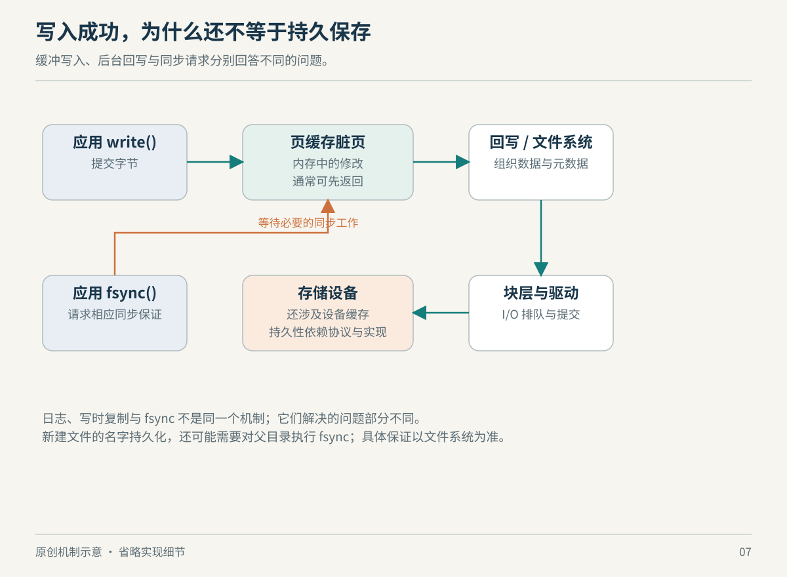

# 第 7 章　写入什么时候才算完成：缓存、块设备与可靠性

保存一份文件，界面可能瞬间提示成功，磁盘指示灯却还在闪。我们需要区分几种完成：数据离开了应用缓冲区、内核接受了数据、设备确认完成，以及断电之后还能恢复。它们之间的距离，是存储系统在性能与可靠性之间做选择的地方。

## 普通写入先改变了什么

`write()` 返回的是此次接受的字节数，不保证总是等于请求长度，也不天然保证数据已经持久化。程序需要处理部分写入和错误，不能把“调用没有抛异常”当成整批内容已安全保存。同步选项与具体后端还会改变行为。[write(2)](https://man7.org/linux/man-pages/man2/write.2.html)

在常见的缓冲文件 I/O 路径中，文件内容通过 page cache，即页缓存进入内存。修改后尚未回写的页称为脏页。内核可以稍后集中写回，减少细碎设备请求；干净缓存也能服务后续读取。这里的缓存不只是应用自己的缓存，而是操作系统管理的文件数据缓存。[内核内存概念：Page cache](https://docs.kernel.org/admin-guide/mm/concepts.html#page-cache)



*图 7-1　原创机制示意，非实际时序或性能比例。不同 I/O 模式可能绕开图中的部分阶段。*

由此可以作一个工程推理：只测短时间 `write()` 吞吐，很可能测到内存吸收突发流量的能力；长时间持续写，才会逐渐暴露后端吞吐与回写压力。反过来，一次读取很快，也可能是命中了缓存。判断性能，先讲清测试落在哪一层，通常比立刻调整参数更有价值。

## 为什么块层还需要排队

文件系统知道文件、目录和空间分配，块设备接口处理的则是相应的块 I/O。Linux 的 blk-mq 采用软件与硬件队列组织请求，利用现代设备的并行能力，也允许请求合并和调度。它回应的是一个具体变化：当设备能并行处理大量操作时，操作系统内部单一队列的争用本身也可能成为瓶颈。[blk-mq 设计说明](https://docs.kernel.org/block/blk-mq.html)

“排队”并不总表示设计落后。设备忙时需要等待；适当合并能减少操作数；但过深的队列也可能让单个请求等待更久。这是从队列机制得出的分析，而非某块 SSD 的性能结论。高吞吐与低尾延迟是两个指标，不能用一个顺序复制速度代替所有工作负载。

## fsync 同步的是什么

`fsync(fd)` 请求把该文件修改过的数据和相关元数据同步到底层持久存储，并等待设备报告完成。关键的另一个边界是目录：文件内容同步，并不自动保证“这个名字已经写入父目录”。需要持久化目录项时，还须对相应目录执行同步。`fdatasync()` 则可以省略那些不影响后续数据读取的元数据同步。[fsync(2)](https://man7.org/linux/man-pages/man2/fsync.2.html)

这让“安全更新配置”成为两类问题。第一类是读者正在访问路径时，会不会读到一半更新；第二类是机器突然失去电源时，更新能否保留。`rename()` 在适用条件下提供路径替换的原子性，使目标名称不会出现一个可观察的缺失间隙；它并没有把所有存储层自动变成断电事务。[rename(2)](https://man7.org/linux/man-pages/man2/rename.2.html)

常见设计是先写同一文件系统中的临时文件，处理完整写入和文件同步，再替换名称并同步目录。这里给的是思考顺序：内容、名称和错误处理分别需要照顾。跨文件系统重命名、特定网络后端和并发写者需要另行设计。若程序在多个阶段中途报错，恢复策略也不能只靠一句“用了原子 rename”。

| 机制 | 主要回答的问题 | 无法单独回答的问题 |
| --- | --- | --- |
| 页缓存 | 如何减少反复设备访问与吸收写入 | 断电后是否保留 |
| 原子路径替换 | 路径切换是否出现中间可见状态 | 文件与目录是否都已持久化 |
| 文件同步 | 文件数据与相关元数据是否提交 | 父目录项是否已同步 |
| 文件系统恢复机制 | 崩溃后如何恢复内部一致性 | 应用多对象事务是否正确 |

## 日志与写时复制解决不同环节

ext4 的日志机制主要保护崩溃后的元数据一致性。日志先记录事务，再把变更落实到最终位置；恢复时可以重放已提交事务。默认常见的 `data=ordered` 模式不是把所有用户数据都写入日志；`data=journal` 与 `data=writeback` 的保证和代价也不同。因此“文件系统有日志”不足以推出“最后一次保存一定保留完整内容”。[ext4 Journal 文档](https://docs.kernel.org/filesystems/ext4/journal.html)

Btrfs 则以写时复制为核心，支持不必立刻完整复制所有文件的快照、reflink、校验和等能力。写时复制的直观模型是：共享旧内容的引用暂时保留，修改时为新版本安排新存储，而不是直接覆盖所有共享者。快照因而能够快速建立，但之后的新修改仍会消耗空间。[Btrfs 官方简介](https://btrfs.readthedocs.io/en/latest/Introduction.html)

不宜据此简单宣布谁“更先进”。选型需要工作负载、运维经验、恢复手段和实现限制。快照与源数据处于同一故障域时，也不能作为唯一备份；设备整体损坏后，共享的旧块并不会因为名字叫快照就幸存。这个结论来自故障域分析，而不是某个文件系统品牌的承诺。

## 在自己的机器上分辨层次

下列命令只查看信息，不修改挂载或缓存：

```bash
cat /proc/mounts
cat /proc/diskstats
```

前者帮助确定使用的文件系统与挂载选项；后者是累计块设备统计，需要结合采样间隔和设备关系解释，不能把一个大数字直接读成“当前负载很高”。容器内可能只能看到部分设备信息；复杂存储还可能叠加逻辑卷、加密或网络后端。

真正值得带走的习惯是追问“谁确认了完成”。应用、内核、文件系统和设备都能给出成功，但它们回答的是不同层次的问题。一旦分清，就能理解为什么数据库关心同步延迟，为什么复制文件很快不等于服务尾延迟很低，也能看出缓存从来不是免费的魔法。

## 看起来是文件，也未必有持久介质

另一种很有教育意义的对照是 tmpfs。它使用虚拟内存存放内容，按实际内容消耗资源，可以在允许的条件下使用交换空间；卸载后内容丢失。挂载容量上限也不是开机时已经独占预留的物理内存。[tmpfs(5)](https://man7.org/linux/man-pages/man5/tmpfs.5.html)

这意味着“写到文件里”不能单独描述持久性。同一个应用写入 `/data/result`，若该路径背后换成 tmpfs，文件接口依旧成立，故障后的保存性质却改变了。对临时中间结果，这可能是合适设计；对唯一业务副本，就必须重新判断。文件名、扩展名和应用的保存按钮，都不能替代挂载信息。

可以做一个不必运行程序的思考实验：任务先产生一百份中间文件，最终只保留一份结果。若把全部中间文件持久化，恢复时可能节约重算时间，却增加写入；若只保存最终结果，正常路径可能更轻，失败后却需要重算。这不是 Linux 替你决定的问题，而是上层工作流对数据价值的判断。底层机制提供不同保证，上层负责选择需要哪一种。

这个对照还提醒我们，容量与可靠性不是同一个指标。空闲空间很多，不代表最近的写入已提交；文件操作很快，不代表内容会跨重启保留。先写清数据的寿命和可否重算，再讨论缓存和文件系统，方案通常会更清楚。

## 本章资料与证据边界

本章核对日期：2026-10-22。主要来源为 [write(2)](https://man7.org/linux/man-pages/man2/write.2.html)、[fsync(2)](https://man7.org/linux/man-pages/man2/fsync.2.html)、[rename(2)](https://man7.org/linux/man-pages/man2/rename.2.html)、[内核内存概念](https://docs.kernel.org/admin-guide/mm/concepts.html)、[blk-mq](https://docs.kernel.org/block/blk-mq.html)、[ext4 Journal](https://docs.kernel.org/filesystems/ext4/journal.html) 与 [Btrfs Introduction](https://btrfs.readthedocs.io/en/latest/Introduction.html)。

本章主线是普通本地文件的缓冲 I/O，不覆盖所有 DAX、直接 I/O、远程存储和设备缓存异常情形。同步承诺仍依赖底层设备正确实现协议。这里没有进行断电测试，也没有给出文件系统性能排名。
