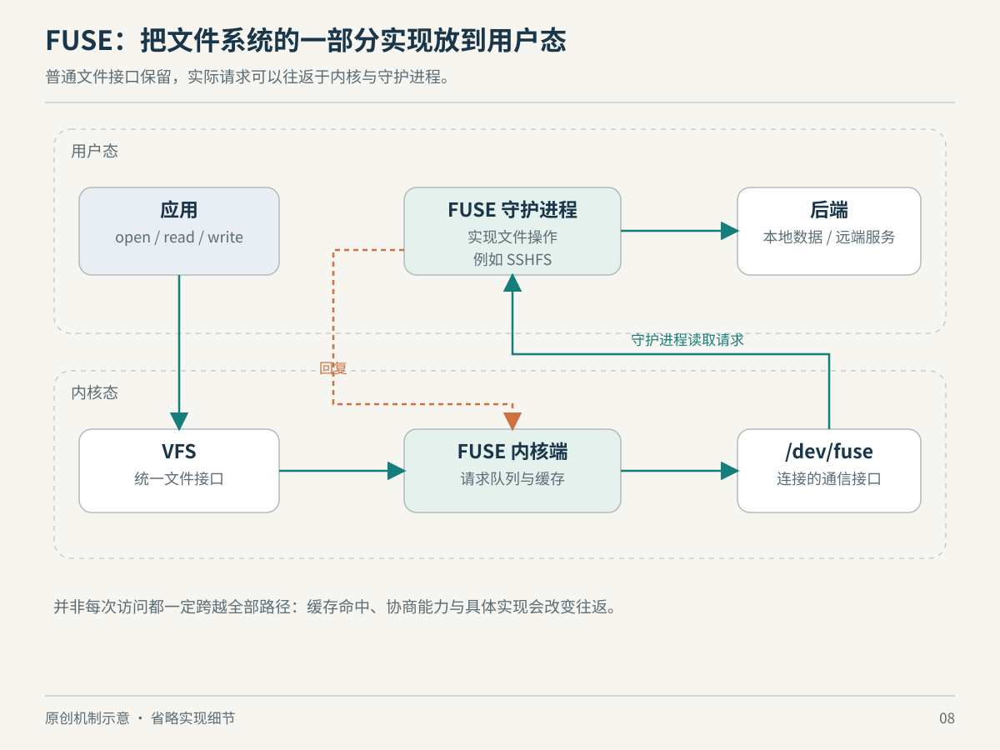

# 第 8 章　FUSE：把文件系统的实现搬到用户态

假设你有一套远程数据服务，现成工具却只会读本地目录。最直接的方案是修改每个工具，让它们调用远程 API；另一条路线是给这套数据提供文件视图。工具仍然 `open()`、`read()`，而实现者把这些请求转成远程访问。FUSE 让后一条路线不必从编写内核文件系统驱动开始。

## 内核并没有离场

FUSE 是用户态文件系统框架。应用仍通过普通系统调用进入内核，内核中的 FUSE 客户端把需要后端处理的操作送给用户态文件系统进程；普通 FUSE 连接通过 `/dev/fuse` 交换请求与响应。libfuse 与挂载辅助工具帮助建立、服务这些连接。因此，“用户态文件系统”指主要实现逻辑的位置，不代表访问绕过了内核。[FUSE Overview](https://docs.kernel.org/filesystems/fuse/fuse.html)



*图 8-1　原创机制示意，非实际时序。箭头表示需要后端处理的一条请求，缓存命中可能省去往返。*

libfuse 的高层接口把文件操作表达为回调，例如查询属性、列目录、读取和写入。开发者可以把其中的读取映射为数据库查询、网络请求或解密操作，但仍需要决定文件大小、错误、权限、重命名等语义。实现一个“能够返回字节的 read 回调”，与实现让复杂应用可靠工作的文件系统，中间还有很大距离。[libfuse 操作接口](https://libfuse.github.io/doxygen/structfuse__operations.html)

这里的抽象价值不是让远程对象突然拥有本地磁盘的性质，而是给现有程序提供一个共同入口。对象存储的目录、原子重命名和随机写能力若与 POSIX 文件模型不同，实现就必须补出语义、明确限制，或者拒绝相应操作。该判断是对接口适配工作的分析，不是对某个 FUSE 项目的统一结论。

## 把灵活性放在哪里，就把代价放在哪里

用户态实现更容易使用普通库、调试工具与进程管理方式。但需要后端处理的操作，会增加请求排队、用户态服务执行和返回响应这些环节。若后端本身是网络服务，网络延迟也加入关键路径。小而频繁的元数据操作，可能比大块顺序读取更容易暴露这些成本。

这不意味着 FUSE 必然“慢到不能用”。同样的文件操作，缓存命中后可能不需要找守护进程；后端延迟、请求大小、并发和缓存策略会改变结果。正确的问题是：我的热点操作需要多少次往返，每次等待什么，有多少能够合并或缓存？下面的模式差异正是为了调整这些路径。

FUSE 的直接 I/O 模式绕开页缓存；缓存模式允许读取命中页缓存并进行预读。缓存写又分为 write-through 与 writeback-cache：前者把写请求送到用户态，后者可以先把脏数据留在缓存，随后回写。于是一次 `write()` 很快返回，并不证明远端已经完成持久化。writeback-cache 还假定修改都经过 FUSE 内核端，不能把它直接当作存在外部写者的网络后端的通用加速开关。[FUSE I/O Modes](https://docs.kernel.org/filesystems/fuse/fuse-io.html)

libfuse 接口另外区分 `flush`、`release` 和 `fsync`。它们不能因名称近似而随意合并：`flush` 与关闭动作有关，可能在多个描述符关闭时出现；`release` 对应打开状态最终释放；持久性要求则必须由相应同步实现来兑现。应用依赖这些契约，远程服务端的成功回复也要与契约匹配。[libfuse 回调语义](https://libfuse.github.io/doxygen/structfuse__operations.html)

| 使用场景 | 优先追问的问题 |
| --- | --- |
| 目录中有大量小文件 | 属性与目录项能缓存多久，更新如何失效 |
| 大文件连续读取 | 后端吞吐、请求粒度与预读是否匹配 |
| 多客户端同时修改 | 本地缓存是否可能看到旧版本 |
| 数据库把它当磁盘 | 同步、锁和错误语义是否满足数据库假设 |

这些是评估问题，不是一套通用调优参数。给所有 FUSE 文件系统套同一个缓存时间，可能提高一类操作的速度，却破坏另一类操作需要的一致性。

## 权限与故障也是文件系统的一部分

挂载成功不代表所有本机用户都能访问。FUSE 有限制其他用户访问的默认保护；`allow_other` 会改变这一边界，`default_permissions` 可让内核按文件模式检查权限，但后端自身的鉴权仍需正确实现。不能因为守护进程“是普通程序”，就认为访问控制可以省略。[FUSE 挂载选项](https://docs.kernel.org/filesystems/fuse/fuse.html#mount-options)

服务进程变慢，会把等待传播给文件访问者。更微妙的是依赖环：守护进程处理某次操作时，又访问了必须由自己处理的挂载内容，就可能形成相互等待。内核文档展示了这类死锁场景，并提供连接中止机制。这里值得学的是故障传播方向：用户态实现把一部分复杂性移出内核，却也使这个进程成为访问路径中的服务依赖。[FUSE 请求与死锁说明](https://docs.kernel.org/filesystems/fuse/fuse.html)

## virtiofs 为什么与它相似，又不是同一条路线

虚拟机也经常需要共享宿主目录。virtiofs 复用 FUSE 协议，但把普通内核到用户态的 `/dev/fuse` 通道替换为 virtio-fs 设备接口：客户机作为客户端，经 virtqueue 发请求，由宿主侧处理。这是针对宿主与客户机共处一台机器的共享文件场景，不需要先把目录包装为网络文件服务器。[内核 virtiofs 文档](https://docs.kernel.org/filesystems/virtiofs.html)

因此 FUSE、virtiofs 和网络文件系统不能只按“都能挂成目录”归为同一种实现。共同的操作表面下面，服务位置、传输边界和一致性策略可以非常不同。后面讨论虚拟机 I/O 时，这种“保留协议语义，替换传输路径”的思路还会出现。

如果机器已经使用了相关挂载，可以只读查看：

```bash
cat /proc/self/mountinfo
```

在文件系统类型字段寻找 `fuse`、`fuse.*` 或 `virtiofs`，但要结合本机实际情况。没有找到，只说明当前挂载视图中没有相应条目，不能证明内核不支持它；查看设备节点存在与否，也不能代替功能和权限检查。

## 真实案例：SSHFS 怎样复用已有能力

SSHFS 是一个具体例子：它通过 SFTP 访问远程文件系统，在本地呈现可挂载的视图。它复用了 SSH 服务器常见的 SFTP 能力，而不是要求远端安装一种全新的专用文件协议服务。这展示了 FUSE 在生态中的价值：把已有远端接口接到已有本地工具之间。[SSHFS 项目 README](https://github.com/libfuse/sshfs)

但选择方案时，还应阅读项目自己公开的维护状态。核对时，其 README 说明缺少持续活跃的常规贡献者，维护者仍合并补丁和发布版本，开发能力有限。它是架构教学中有价值的案例，却不能仅凭“用了很多年”就推导出当前适合所有新项目。这里的维护描述只针对该项目在核对日的公开说明。

假设你用编辑器打开远端目录，可以沿四个位置检查等待：编辑器是不是频繁扫描整个树，内核缓存有没有命中，SSHFS 是否在等待请求完成，远端服务器是否忙于处理。即便看到相同的“打开文件很慢”，原因也可能不同。这个案例的价值，是练习把一个用户动作拆成可观察的服务依赖，而不是把所有延迟归给 FUSE 本身。

同理，若你只需要一次性复制文件，挂载未必比显式传输更合适；若许多现成工具都需要反复访问同一视图，接口适配的收益则可能更明显。这是结合操作形态作出的判断，不能脱离访问频率、故障处理与维护要求给出统一答案。

## 本章资料与证据边界

本章核对日期：2026-10-22。资料包括 [FUSE Overview](https://docs.kernel.org/filesystems/fuse/fuse.html)、[FUSE I/O Modes](https://docs.kernel.org/filesystems/fuse/fuse-io.html)、[libfuse fuse_operations](https://libfuse.github.io/doxygen/structfuse__operations.html) 与 [virtiofs](https://docs.kernel.org/filesystems/virtiofs.html)。挂载信息格式见 [proc_pid_mountinfo(5)](https://man7.org/linux/man-pages/man5/proc_pid_mountinfo.5.html)。

本章解释普通请求模型，省略 passthrough、DAX、连接协商和内核版本间的全部能力差异。没有声称所有 FUSE 实现支持相同缓存、锁或持久性语义，也没有把示意图当成性能测量。
