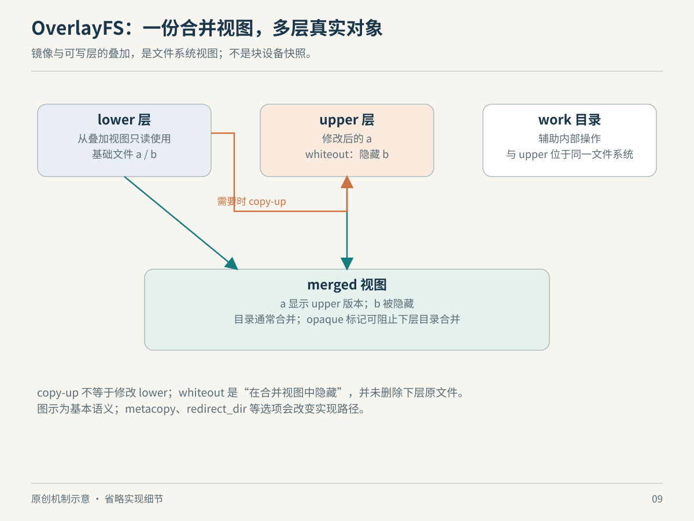

# 第 9 章　OverlayFS：共享底稿，分别修改

开十个使用相同基础镜像的容器，是否必须先复制十份操作系统文件？如果每个容器都要改配置，又怎样避免互相影响？OverlayFS 提供一种文件视图：把已有目录作为底稿，把修改放进另一个目录，再向应用呈现合成结果。它的重点是组织可见内容，不是创建新的 CPU 或内核。

## 几层目录，各自承担什么

典型可写 OverlayFS 有只读视角的 lower 层、承接修改的 upper 层、应用看到的 merged 挂载点，以及配合内部操作的 work 目录。后两者不应当作新的镜像内容层；work 必须与 upper 位于同一底层文件系统。多个 lower 可以按优先级叠加，同名非目录项由更高层遮蔽，目录则可能合并。[内核 OverlayFS 文档](https://docs.kernel.org/filesystems/overlayfs.html)



*图 9-1　原创机制示意，非磁盘实际布局；图中“遮蔽”改变可见视图，不修改 lower 原文件。*

用一个教学例子理解：lower 有 `app.conf` 和 `manual.txt`，upper 新建 `notes.txt`。应用在 merged 中可以同时看到它们。若 upper 又有 `app.conf`，它就成为这个名称的可见版本。这个例子解释的是视图规则，并不表示每次路径访问都要从头遍历全部磁盘目录。

这与把目录内容完整复制一遍很不一样。完整复制立即付出全部空间和时间；叠加视图则把部分成本延后到修改时。由此也可推导：启动快和首次修改快是两件事。共享底稿减少重复工作，却没有承诺未来所有操作都没有额外成本。

## 第一次修改为何可能格外贵

当 lower 文件需要写入时，典型路径会先把它复制到 upper，再修改 upper 版本，这就是 copy-up。Docker 对经典 `overlay2` 驱动的说明特别提醒：即便只改文件中的很少内容，首次 copy-up 也可能带来整文件复制成本，后续写入则直接作用于 upper。因此把大文件反复原地修改，与读取大量共享文件，是两种很不一样的负载。[Docker overlay2 的 copy-up 说明](https://docs.docker.com/engine/storage/drivers/overlayfs-driver/#copyup)

不能把这个基本模型绝对化为“任何元数据修改都必然复制全部数据”。内核可通过 metacopy 等特性先复制元数据，数据仍从 lower 读取，待需要修改数据时再处理。目录重命名也受 `redirect_dir` 等配置影响：没有相应支持时，lower 或 merged 目录的重命名可能返回 `EXDEV`。这些行为需要结合内核、挂载参数和后端核对。[OverlayFS：Metadata only copy up 与 renaming directories](https://docs.kernel.org/filesystems/overlayfs.html)

这个差异很适合形成观察习惯：文档里的“一般路径”用于建立模型；涉及性能、兼容性或备份时，还必须确认运行环境启用了哪些例外。不要因为自己记住了 copy-up，就把某一次实际操作的成本当成已知。

## 删除为什么也需要记录

如果 lower 不改动，删除 merged 中的 lower 文件该怎么办？只在 upper 中“不创建它”是不够的，因为下次查找仍会看到 lower。系统必须明确记住“这个名字在上层已经删除”。OverlayFS 用 whiteout 表达删除遮蔽；opaque 目录则控制是否继续把下层同名目录内容合并进来。[OverlayFS：whiteouts and opaque directories](https://docs.kernel.org/filesystems/overlayfs.html#whiteouts-and-opaque-directories)

因而，在容器里删除一个来自底层镜像的大文件，不应期待底层镜像占用立刻减少。你通常改变的是当前合成视图。这里的空间推论来自“lower 仍保留”的结构；实际磁盘占用还受镜像引用、垃圾回收和存储后端管理影响。

OCI 镜像规范也用 whiteout 表达层之间的删除，但归档格式与内核运行时表示不能混为一谈。OCI 层是文件系统变更集，定义 `.wh.` 形式的删除条目及 opaque 标记；解包或快照实现需要把规范中的含义转成自身的存储表示。不能把镜像 tar 中的特殊文件名直接当作所有运行中 OverlayFS 的磁盘内部格式。[OCI Image Layer Filesystem Changeset](https://github.com/opencontainers/image-spec/blob/main/layer.md)

| 看到的概念 | 它所在的层次 | 容易误解的地方 |
| --- | --- | --- |
| OCI 镜像层 | 分发与变更集格式 | 不是一个运行中的挂载点 |
| OverlayFS | 内核文件系统机制 | 不是完整的容器隔离方案 |
| `overlay2` | Docker 经典存储驱动 | 不代表所有 Docker 后端 |
| fuse-overlayfs | 用户态叠加实现 | 不是内核 OverlayFS 的别名 |

## 容器存储为什么还要卷

Docker 文档把镜像和容器可写层的后端管理，与容器数据持久化分开讨论。卷与 bind mount 可以把特定路径接到可写层之外的数据位置；容器生命周期结束，不必等同于业务数据生命周期结束。实际如何备份、授权和共享，仍然取决于所选挂载方式。[Docker Storage](https://docs.docker.com/engine/storage/)

由这个结构可理解一个常见设计：镜像承载可重复构建的程序与依赖，数据目录使用明确管理的持久存储。原因不只是性能，还包括恢复时能否分别重建程序和恢复数据。它不是“所有写操作都必须使用卷”的命令，而是把不同生命周期交给不同管理方式。

还要注意名称相似不等于实现相同。`fuse-overlayfs` 是通过 FUSE 提供叠加能力的独立项目，服务于包括无特权容器在内的场景；它表明“叠加视图”是一种可在不同位置实现的思路。[fuse-overlayfs 项目说明](https://github.com/containers/fuse-overlayfs)

## 先确认自己到底在看什么

可以在 Linux 上只读执行：

```bash
cat /proc/self/mountinfo
```

找到类型为 `overlay` 的条目后，查看其挂载选项；某些环境会隐藏或省略底层路径。不要直接编辑运行中挂载背后的 upper、lower 或 work 来试验，这会破坏通过合成视图管理状态的假设。Docker 当前文档也明确区分经典 `overlay2` 与 containerd image store 的 overlayfs snapshotter，所以排障时应先确认所用后端。[Docker OverlayFS storage driver](https://docs.docker.com/engine/storage/drivers/overlayfs-driver/)

理解 OverlayFS 之后，再看容器会更清楚：镜像层负责可共享的内容，叠加文件系统提供可修改视图，其他内核机制负责进程、资源与权限边界。它们可以组合，却没有任何一个单独等于“容器”。

## 层的历史不等于最后看到的目录

再作一个镜像构建的思想实验：第一层加入文件，后一层删除它，最终目录里确实看不到它，但分发的底层变更集仍可能包含先前内容。可见结果与历史层内容是两个观察对象。这是根据层和删除遮蔽机制得出的推论，也说明只检查最后的目录，不足以判断镜像历史里包含过什么。

Docker 的构建文档专门提供 secret mount 和 SSH mount，用于在需要的构建步骤中临时提供凭据，并明确不应把构建参数或普通环境变量作为传递秘密的通用办法，因为它们可能保留在镜像中。[Docker Build secrets](https://docs.docker.com/build/building/secrets/)

这个例子不需要展开复杂安全技术，就能说明内容生命周期的重要性：有些数据应该成为可重现产物的一部分，有些只是构建时的输入，有些则属于运行时状态。若在最初设计里没有区分，之后再加一层删除，解决的通常只是最终视图。层机制让历史可以共享和缓存，也要求我们更明确地决定哪些东西应当进入历史。

可把这个判断方法迁移到普通文件操作：当前看不到，不等于底层从未存储；当前没有引用，也不等于所有副本已经同步删除。OverlayFS 把这些层次显露得特别清楚，但它并不是这个原则唯一出现的地方。

## 本章资料与证据边界

本章核对日期：2026-10-22。主要资料为 [内核 OverlayFS](https://docs.kernel.org/filesystems/overlayfs.html)、[Docker overlay2](https://docs.docker.com/engine/storage/drivers/overlayfs-driver/)、[Docker Storage](https://docs.docker.com/engine/storage/)、[OCI Image Layer 规范](https://github.com/opencontainers/image-spec/blob/main/layer.md) 与 [fuse-overlayfs](https://github.com/containers/fuse-overlayfs)。

本章不把任何驱动认定为所有版本和平台的默认，也不展开全部 inode、硬链接、NFS 导出和凭据规则。copy-up、目录重定向与 metacopy 的细节必须以目标内核和挂载参数为准；本次未执行特权挂载或存储性能实验。
