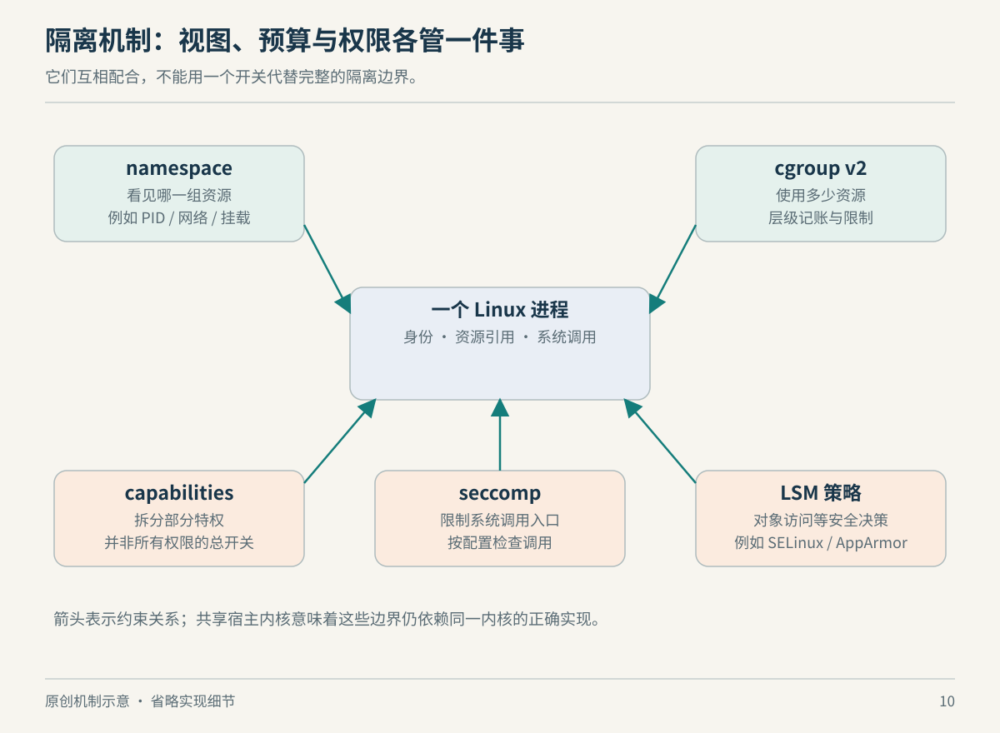

# 第 10 章　隔离、预算与权限：三个不同的问题

假设你在同一台 Linux 机器上运行自己的网关、数据库和第三方构建任务。你希望它们各有目录、互不占用端口，也不能因为某项任务突然吞掉内存，就把其他服务拖死。直觉上这像“给每个人一台小电脑”，但 Linux 没有一个统一的“小电脑开关”。它把问题拆成视图、资源和权限，再让上层软件组合。

## 看见什么，与能用多少，是两件事

namespace（命名空间）让某类系统资源拥有相互分开的实例。进程仍由同一个内核调度，但观察资源时，得到的是所在命名空间的视图。Linux 提供 mount、PID、network、IPC、UTS、user、cgroup 和 time 等类型。选择哪些类型、是否共享某一种，构成了隔离方案的一部分。[资料：Linux man-pages，namespaces(7)](https://man7.org/linux/man-pages/man7/namespaces.7.html)

例如，mount namespace 分开的是挂载关系。两组进程可以把不同目录树作为自己的文件环境，却仍通过某个绑定挂载接触同一批底层文件。因此“路径不同”并不推出“数据不同”。挂载传播属性还决定某些挂载变化是否向其他视图传播，不能把命名空间理解为任何时候都绝对断开的目录复制品。[资料：mount_namespaces(7)](https://man7.org/linux/man-pages/man7/mount_namespaces.7.html)

network namespace 则分开网络设备、路由、协议栈和端口等资源。两个服务能各自在自己的网络空间监听相同端口，是因为它们不再争用同一份端口空间。要让它们通信，仍需提供连接路径；veth 设备对便是常用的连接部件。命名空间划定网络视图，网络拓扑决定这些视图怎样互通。[资料：network_namespaces(7)](https://man7.org/linux/man-pages/man7/network_namespaces.7.html)



*图 10-1　原创机制示意。三组机制回答不同问题，不表示每次操作都按图示顺序执行。*

下面这张表可以作为读后检查：如果某工具声称自己提供了“隔离”，至少要继续问它改变了哪一种关系。

| 你希望得到的效果 | 主要检查的机制 | 不能据此推断的事 |
| --- | --- | --- |
| 目录树、挂载点不同 | mount namespace | 文件内容一定互不共享 |
| 网络端口与路由独立 | network namespace | 已经有外网或 DNS |
| 可见的进程编号不同 | PID namespace | 使用了另一个内核 |
| 总内存、CPU 预算受约束 | cgroup 控制器 | 文件和权限也已隔离 |
| 身份和特权范围不同 | user namespace、capabilities | 所有内核入口都被禁止 |

表中是机制用途的归纳；具体接口边界见上述手册及下述资料。

time namespace 也提醒我们，名字可能比实际能力宽。它主要虚拟化单调时钟和启动时钟的值，不是随意为每个容器建立一套独立的现实日期。看到一个特性名称后，应先读它隔离的具体对象。[资料：time_namespaces(7)](https://man7.org/linux/man-pages/man7/time_namespaces.7.html)

## cgroup 管预算，不替你安排所有资源

cgroup v2 把进程组织成层级，再由控制器实施资源管理。本章以普通公平调度任务为例，`cpu.max` 表示一个周期内可消耗的 CPU 时间预算；`memory.max` 是内存使用的硬限制接口，`memory.high` 用于施加回收压力和节流。上层限制不会因为子组另设一个更宽松的值而消失。[资料：内核 cgroup v2 文档，CPU、Memory 与层级规则](https://docs.kernel.org/admin-guide/cgroup-v2.html)

这里的 CPU 带宽限制不能直接外推到 `SCHED_FIFO`、`SCHED_RR`、`SCHED_DEADLINE` 等调度策略。扩展 BPF 调度器是否实施相应限制，也取决于其回调实现。[资料：cgroup v2，CPU Interface Files](https://docs.kernel.org/admin-guide/cgroup-v2.html#cpu-interface-files)

考虑一种教学情境：普通公平调度的服务明明只有少数工作线程，响应却周期性变慢。如果它在周期前段耗完 CPU 预算，随后就可能等待预算恢复；“机器还有空闲 CPU”可以成立，而“这一组任务还有可用预算”同时不成立。排查方向应包含限额与节流计数，而不只是线程数。这个解释是对预算模型的应用，不是对某台机器的实测诊断。

反过来，网络空间隔离得再完整，也不会自动限制内存。理解这点以后，你就能解释为什么某些“容器里程序被杀”的事件，应追查资源控制，而不是继续研究镜像格式。

## 身份不是单一的 root 开关

user namespace 允许进程在内部拥有 UID 0，同时在外部映射为普通用户。这里的“root”有作用范围：它不等于获得初始用户命名空间里的全部权限。阅读权限报错时，仅看容器内 `id` 的结果是不够的，还要理解用户标识映射和相应命名空间的关系。[资料：user_namespaces(7)](https://man7.org/linux/man-pages/man7/user_namespaces.7.html)

capabilities 把传统超级用户权限拆成可分别控制的能力，而且是每线程属性。它的价值是让任务只获得完成工作需要的特权；但能力的粒度并非总是很细，某些权限覆盖面很广。因此“只加一个 capability”本身没有说明风险大小，还要看这个能力允许哪些操作。[资料：capabilities(7)](https://man7.org/linux/man-pages/man7/capabilities.7.html)

seccomp 处理的是另一层问题：进程可以进入哪些系统调用。过滤器能检查系统调用号及直接参数等信息，但不能把参数指针当成可任意解引用的数据。因此它不是完整的路径访问控制，也不是单独就能成立的沙箱。内核文档明确把它定位为缩小暴露接口的工具。[资料：内核 Seccomp BPF 文档](https://docs.kernel.org/userspace-api/seccomp_filter.html)

LSM（Linux Security Modules）为内核中的安全检查提供框架，SELinux、AppArmor 等通过相应机制表达访问策略。于是，一个文件操作可能在普通权限检查之外，还受到安全策略约束。不能因为 UID 正确、文件模式允许，就断言访问必然成功。[资料：内核 Linux Security Module Usage](https://docs.kernel.org/admin-guide/LSM/index.html)

## 用观察代替猜测

在普通 Linux 环境，可以只读查看当前 shell 的命名空间与资源归属：

```bash
ls -l /proc/self/ns
cat /proc/self/cgroup
cat /proc/self/status
```

`/proc/self` 指向读取它的进程；因此这里每条外部命令看到的是它自身，通常继承了 shell 的环境。比较命名空间时，应比较同一类链接，而不是只看数字有没有出现。`status` 中的能力与 seccomp 字段提供状态线索，但不能代替完整策略。命令未在读者设备上运行，本书不预设输出。接口说明见上述 namespaces、capabilities 与 seccomp 资料。

可以做一个不需要修改配置的思考练习：某服务能读到不该出现的目录，而且经常抢占 CPU。前一个现象应检查挂载关系与访问权限，后一个应检查资源控制。它们可能来自同一套部署配置，却需要两条不同的证据链。

## 同一个拒绝，可能来自不同的约束

设想你给一项图像处理任务准备了独立目录，并设置资源预算。它启动时报告“无法写入输出文件”。此时至少有三种不同的问题：进程看到的路径指向错误位置；它的普通用户身份没有写权限；某项安全策略拒绝了访问。增加 CPU 配额不会修复其中任何一种。这个案例是帮助定位的假设情境，不是某个产品的真实故障记录。

比较好的检查顺序是先确认对象，再确认身份，最后确认额外规则：文件在这一进程的目录视图里究竟是哪一个对象；该对象的访问检查使用什么凭据；是否还有 LSM 等策略。若连对象都没有对应上，继续研究 UID 的细节可能只是围绕错误路径做推理。这个顺序是作者提出的排查方法，不是内核内部固定的检查次序。

另一个假设情境是两项任务都能正常访问文件，但其中一项明显拖慢另一项。你需要把“有无访问资格”与“共享了哪些资源”重新分开。即使目录完全不同，它们也可能在竞争同一个存储设备、内存带宽或其他宿主资源。隔离应被写成可检查的需求：希望保护的是机密性、可写范围、可见范围，还是服务质量？“已经放进容器”无法替代这些具体目标。

完成这一轮判断，你便能用一句有信息量的话描述方案：哪些资源有独立视图，哪些资源仍共享，哪些预算受控，哪些权限被缩减。它比单纯说“轻量隔离”更接近真实系统，也更容易让下一位维护者接着验证。

## 本章资料与证据边界

本章引用均为 Linux 内核文档或 man-pages 接口手册，链接已于 2026-10-22 读取。命名空间类型、cgroup 文件是否存在，还取决于内核构建、版本、挂载方式与发行版策略。本文解释组合机制，不承诺某组默认配置能满足任意多租户威胁模型。

继续查阅：[namespaces](https://man7.org/linux/man-pages/man7/namespaces.7.html)、[cgroup v2](https://docs.kernel.org/admin-guide/cgroup-v2.html)、[capabilities](https://man7.org/linux/man-pages/man7/capabilities.7.html)、[seccomp](https://docs.kernel.org/userspace-api/seccomp_filter.html)、[LSM](https://docs.kernel.org/admin-guide/LSM/index.html)。
