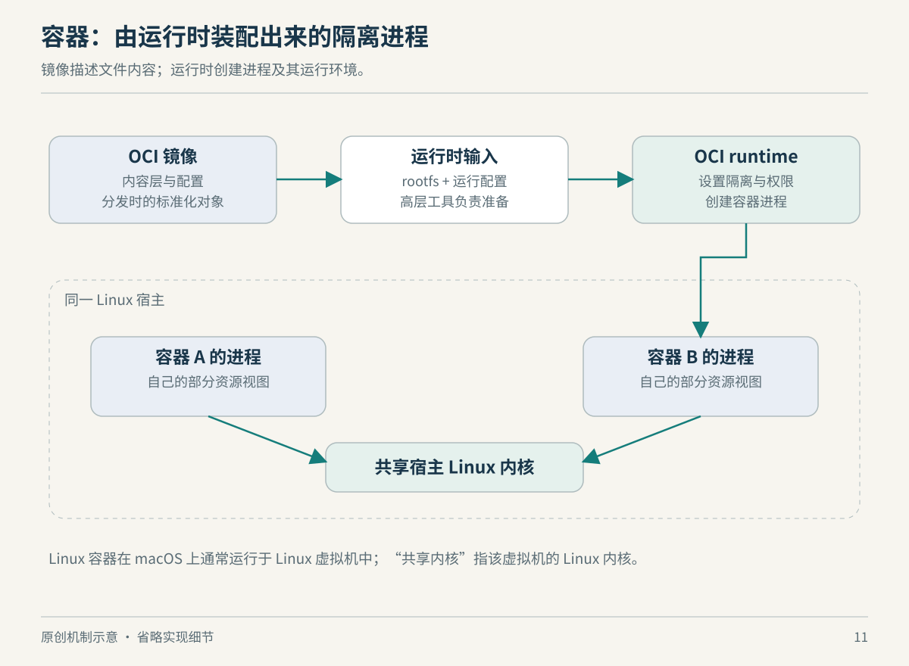

# 第 11 章　容器：把内核机制组装成运行环境

同一个服务，在开发机能运行，到服务器却缺一个动态库；升级后又发现新旧服务共用配置，回退也不干净。容器生态首先提供了一种把程序运行环境描述、分发和启动起来的方法。理解它，应沿着“下载了什么，准备了什么，最后运行了什么”往下看。

## 镜像是可分发的内容，容器是运行状态

OCI 镜像由清单、可选索引、文件系统层与配置等部分构成。层描述文件系统变化，配置包含入口参数、环境等运行相关信息；索引可以关联不同平台的镜像清单。因此，“某镜像支持 ARM64 和 AMD64”往往是分发系统能为平台挑选不同内容，不意味着一份机器码天然能在两种 CPU 上执行。[资料：OCI Image Format Specification](https://github.com/opencontainers/image-spec/blob/main/spec.md)

将镜像准备为可运行状态后，运行时消费的是本地 bundle。OCI 规范定义了 `config.json`，以及配置引用的根文件系统。这里必须分清两个描述：镜像规范组织分发内容，运行时规范描述如何启动与管理容器；镜像层不必直接等同于某个固定的内核文件系统实现。[资料：OCI Filesystem Bundle](https://github.com/opencontainers/runtime-spec/blob/main/bundle.md)

上一章的机制在这里被拼接起来：运行时按配置选择命名空间、资源限制、用户映射和其他进程属性。OCI Linux 配置也允许某类命名空间被继承或加入现有实例，因此一个运行中的容器未必每个维度都独立。判断它的边界，要看实际配置。[资料：OCI Linux Configuration，Namespaces 与资源配置](https://github.com/opencontainers/runtime-spec/blob/main/config-linux.md)



*图 11-1　原创机制示意。展示常见职责划分，不限定所有容器产品都采用相同调用链。*

## containerd、runc 和 Docker 为什么会同时出现

`runc` 是按 OCI 规范启动与运行容器的命令行工具。它处在接近进程建立与运行时配置的层次。把它想成“完成一次受配置约束的进程启动工作的部件”，比把它想成包办一切的容器平台更合适。[资料：runc 项目说明](https://github.com/opencontainers/runc)

containerd 管理更长的生命周期，提供镜像分发、执行和快照等部件，并允许替换符合规范的执行实现。它的职责说明还把网络创建、镜像构建等工作划到更高层系统。于是，存储快照器可以变，低层执行器也可以变，而上层仍获得一组较稳定的管理接口。[资料：containerd Scope and Principles](https://containerd.io/scope/)

这也解释了很多看似重复的软件名称：一个面向用户的工具负责工作流，一个后台服务管理对象和任务，一个低层运行时建立进程环境。分析故障时，可以顺着责任拆开：拉取失败、根文件系统准备失败、进程启动失败和应用启动后报错，分别发生在不同位置。这里是依据职责划分提出的排查方法，不是说每项产品都会把日志整齐分成这四类。

Kubernetes 又向上一层管理集群中的工作负载。控制平面与工作节点分工，节点承载 Pod。它把“期望有多少实例、安排到哪些节点”等问题纳入协调范围，而不是取代节点上的内核机制。看到 Pod 处于异常状态，只能说明某层目标没有实现，不能据此确定故障已发生在内核。[资料：Kubernetes Cluster Architecture](https://kubernetes.io/docs/concepts/architecture/)

## 为什么应用在容器里会表现得不一样

容器里经常由应用自己成为 PID namespace 的 PID 1。这个位置有特殊含义：它接收孤儿进程，并承担命名空间内的 init 角色；其退出也影响整个空间。信号处理存在特殊规则。因此，一个平时作为普通子进程运行的程序，成为 PID 1 后，其退出与子进程管理行为值得专门检查。[资料：pid_namespaces(7)，The namespace init process](https://man7.org/linux/man-pages/man7/pid_namespaces.7.html)

以此为基础，可以理解一个常见工程选择：给应用加一个负责收集子进程和转发信号的小型 init。这不是“容器都必须装完整操作系统”，而是补上应用没有承担的进程管理责任。是否需要它取决于应用本身是否创建子进程、怎样等待子进程及怎样处理停止信号；应读应用与运行工具的说明，而不是照抄模板。

rootless 则回答“谁有权限管理这一套环境”。Docker 文档中的 rootless 模式使守护进程与容器都在非 root 用户下运行，并利用 user namespace；它与仅对容器进行用户映射、而守护进程仍有 root 权限的方案不同。降低管理进程权限改变了风险边界，但资源管理和网络功能仍受环境条件约束。[资料：Docker Rootless mode](https://docs.docker.com/engine/security/rootless/)

这几条线应分别看：镜像决定可见的程序与库，进程配置决定身份与视图，生命周期管理决定退出与重启，应用自己决定业务行为。很多“容器兼容性问题”，实际是其中某一条约定没有满足。

## Mac 上的 Linux 容器隔着什么

macOS 没有 Linux 内核提供的这套完整接口。以 Docker Desktop 的文档为例，它使用 Linux 虚拟机承载 Linux 容器，并提供不同的虚拟机管理后端。容器之间可以共享这台虚拟机的 Linux 内核；虚拟机再与 macOS 宿主隔开。[资料：Docker Desktop Virtual Machine Manager](https://docs.docker.com/desktop/features/vmm/)

因此，讨论“把项目目录挂进容器”时，要先画出宿主、Linux 虚拟机与容器三者的位置。文件跨越哪条边界，决定了需要哪种共享机制；在 Linux 裸机上看到的 I/O 特征，不能直接搬来预测 Mac 上的表现。这是从架构关系得到的判断方法，具体速度仍须测量。

同样，Linux 容器不自带一份任意可更换的 Linux 内核。普通进程容器仍依赖运行它的那份内核接口；若产品使用另一个内核或其他隔离执行环境，应把那层额外机制明确画出来，而不能只按容器镜像判断。

## 一次只读核对

若已安装 Docker，可以查看它所连接的服务端环境：

```bash
docker version
docker info
```

这些命令查询服务状态，不创建容器。需要留意输出中的服务端与客户端区别，并确认连接的是本地服务还是其他上下文。此处不给固定输出，也不假定读者已安装 Docker；产品字段和选项以对应版本帮助为准。

读后练习：团队说“我们把所有依赖都放进镜像，所以换任何机器都能运行”。请逐项检查 CPU 架构、内核接口、运行时配置、外部数据与服务五个条件。镜像改善了依赖交付，但不会消除这些边界。

## 用一次发布把各层串起来

下面是一项教学用的部署推演。你把网关程序、所需库和默认配置准备为镜像，在开发机运行成功，再将同一内容交给服务器。应先问服务器挑到的是哪个平台的清单，再问根文件系统怎样准备，然后确认启动参数、环境和挂载，最后观察应用自己是否通过初始化。每一步都对应前文的一种职责，而不是让“镜像没变”成为所有问题的终点。

假如开发机使用一个写在项目目录里的配置，而服务器通过另外的挂载提供配置，镜像相同也不能推出运行输入相同。假如程序创建工作子进程后立即退出，重新拉取镜像也不会补上它未履行的进程管理责任。两个例子都在说明：可分发内容只是运行合同的一部分。实际排查时应记录真实配置与日志，本书没有替具体部署做成功验证。

如果升级失败，回退也应拆开考虑。回到旧的程序内容、回到旧的启动参数，与外部数据回到旧状态，是不同的动作。把它们分别记录，才知道“回滚成功”验证了什么。这个推演是作者的方法建议，避免把交付工具的作用扩大成对全部业务状态的保证。

## 本章资料与证据边界

以上资料均于 2026-10-22 读取。正文讲 OCI 与常见 Linux 进程容器的职责关系；不把某种快照器、低层运行时或网络插件写成唯一实现。Docker Desktop 后端随平台与产品版本变化，本章只使用其“Linux VM 承载容器”的架构事实，不提供版本选型承诺。

本章主要资料：[OCI 镜像](https://github.com/opencontainers/image-spec/blob/main/spec.md)、[OCI bundle](https://github.com/opencontainers/runtime-spec/blob/main/bundle.md)、[OCI Linux 配置](https://github.com/opencontainers/runtime-spec/blob/main/config-linux.md)、[runc](https://github.com/opencontainers/runc)、[containerd 职责](https://containerd.io/scope/)、[Kubernetes 架构](https://kubernetes.io/docs/concepts/architecture/)。
