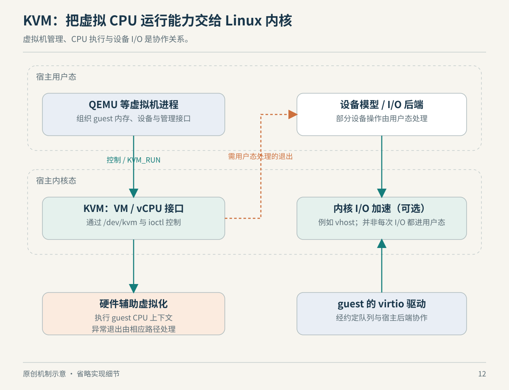

# 第 12 章　KVM：让另一个内核运行起来

容器把一份 Linux 内核提供的环境分给不同进程。如果你想测试另一套内核，或者让客体操作系统自己管理驱动、地址空间和进程，就要换一个层次：给它一个能够启动的机器环境。

这里把运行虚拟机的系统叫宿主，把虚拟机内部的系统叫客体。先不要急着把“虚拟机”与某个桌面软件等同。一次虚拟机运行，至少涉及客体 CPU 的执行、内存映射、设备与中断，以及管理这些状态的程序。

## Linux 把虚拟 CPU 也暴露为可管理对象

KVM 的用户空间 API 很有 Linux 风格：程序打开 `/dev/kvm`，用 ioctl 创建 VM 对象，再创建 vCPU 等对象；不同层次各有文件描述符。用户空间程序通过这些接口建立客体状态，并以 `KVM_RUN` 进入执行；共享的运行结构携带返回原因等信息。[资料：内核 KVM API 文档，General description 与 kvm_run](https://docs.kernel.org/virt/kvm/api.html)

这不是让应用去拼一堆普通进程，假装它们是内核。KVM 参与虚拟 CPU 执行的控制；更高层的虚拟机监控程序（VMM）还要组织机器模型与相关资源。在本书后面会看到 QEMU 是这类程序之一，但它也能选择别的执行后端。



*图 12-1　原创机制示意。省略中断控制、设备加速和部分内核处理路径，不表示所有退出都返回用户空间。*

硬件辅助虚拟化允许合适的客体指令在处理器上执行，同时由虚拟化机制管理控制边界。理解它的关键不是记住某条入口指令，而是知道“客体内核自己的特权”与“控制整个宿主的权限”可以分开。KVM 文档对嵌套虚拟化中的 L0、L1、L2 层级作了明确区分；内外都是内核，也仍有不同控制层。[资料：Running nested guests with KVM](https://docs.kernel.org/virt/kvm/x86/running-nested-guests.html)

## 客体以为的物理内存，仍不是宿主的任意内存

以前面虚拟内存章的地址转换为起点：客体进程先通过客体页表，把虚拟地址解释成客体物理地址；宿主虚拟化层还必须将客体物理地址约束到分配给它的宿主内存。在支持相应硬件机制的 x86 平台，这涉及 EPT/NPT 等二级地址转换。KVM 也有应对其他条件的影子页表机制。[资料：The x86 kvm shadow mmu，Translation](https://docs.kernel.org/virt/kvm/x86/mmu.html)

所以“虚拟机有 8 GB 内存”不是说它能自己选宿主任意 8 GB 地址。客体可以管理它被呈现出来的物理地址空间，但这些地址如何落到宿主资源，由外层约束。

这里的图像化理解很有价值：两套地址表不是重复劳动，而是分别服务两种所有权。客体管理内部进程，宿主管理虚拟机之间以及它们与自己的关系。把这两层分开后，才容易继续理解为何虚拟机内的内存指标和宿主看到的进程内存指标不应强行相等。

## 设备为什么经常比 CPU 更难处理

CPU 能执行代码，还不足以构成一台好用的机器。客体必须能发现设备、提交请求、等待完成，并收到中断。QEMU 的系统模拟提供机器与设备模型；某些后端处理可以交给其他进程或内核侧机制。因此，不能把整台虚拟机的性能归结为“有没有打开 KVM”。[资料：QEMU Introduction，Feature Overview](https://www.qemu.org/docs/master/system/introduction.html)

virtio 通过标准化的设备与驱动协议改善这条路径。客体驱动与设备后端利用共享内存中的队列交换缓冲区描述，而不必把每个请求都包装成某种历史硬件的全部操作细节。它仍需要驱动、队列管理与通知，不是“数据自动穿透”。[资料：Virtio on Linux](https://docs.kernel.org/driver-api/virtio/virtio.html)

vhost-user 进一步把设备后端处理放到独立的用户空间进程，通过控制协议建立 virtqueue 等资源共享。Linux 内核中的 vhost 和用户空间的 vhost-user 不能只因名字相似就当成同一个运行位置。它们是理解数据路径时需要展开的不同部件。[资料：QEMU Vhost-user Protocol，Introduction](https://www.qemu.org/docs/master/interop/vhost-user.html)

换句话说，优化往往发生在“谁处理队列、要切换多少次、能共享什么缓冲区”等具体路径上。看到一张性能图之前，至少要问：CPU 执行后端是什么，设备后端是什么，磁盘与网络又接到哪里？

## 直通不是把设备权限问题删除

设备直通让客体直接使用被分配的设备，可以减少某些模拟开销。DMA 意味着设备本身能够访问内存，因此除了 CPU 地址转换，还需要考虑设备侧的访问边界。VFIO 文档将 IOMMU 保护、设备分组和用户空间设备访问联系起来；一块设备是否能单独分配，还受硬件拓扑与隔离条件影响。[资料：内核 VFIO 文档，Groups, Devices, and IOMMUs](https://docs.kernel.org/driver-api/vfio.html)

这也给“把 GPU 给虚拟机”增加了必要的现实条件：设备能否可靠重置、宿主是否还需要它、客体驱动是否适配，都属于实际系统集成问题。本章不据此承诺任意 GPU、任意宿主都可直通，也不提供修改设备绑定的操作。

## 怎样观察自己处在哪一层

在 Linux 上，可以先做两个只读检查：

```bash
uname -m
ls -l /dev/kvm
```

它们分别提供当前内核报告的机器架构，以及设备节点是否可见的线索。节点存在不保证当前账户能使用它，更不能证明某一目标客体能启动；节点缺失也可能只是设备未暴露到当前环境。真正创建 VM 时，程序还需要查询 KVM 能力并处理错误，接口依据见本章 KVM API 资料。

读后练习：某云实例内运行的虚拟机无法开启硬件加速。问题可能发生在物理机器、外层 VMM、客体配置或访问权限的哪一层？画出控制关系，再逐层收集证据，通常比反复重装 QEMU 更有方向。

## 一次请求究竟慢在哪里

可以用一个假设负载检验自己是否理解了层次。客体内的服务接到请求，先做一段纯计算，再读一个文件，最后发出网络响应。纯计算阶段，你会关心 vCPU 的执行与宿主调度机会；读文件阶段，需要展开客体文件系统、虚拟块设备和宿主存储路径；发送阶段，又要展开虚拟网卡及其后端。这里仅给出分析路线，不预测某一阶段必然是瓶颈。

这条路线也避免一种常见的测量错误：只在客体里看到 CPU 使用率低，就宣布宿主不忙。客体看到的是它自己的系统活动，而负责它运行的外层程序和宿主资源仍需另外观察。相反，宿主有空闲，也不能凭一个总量指标断言客体始终获得了合适的执行机会。应把各层的观测对象写在指标旁边，再比较它们是否指向同一时间段和同一请求。

再设想你换成更快的物理磁盘，服务却没有明显改善。这不立即证明新磁盘没有价值，也不证明 KVM 有问题。原请求可能命中了缓存，可能在等待另一项服务，也可能真正受限于设备后端处理。沿数据路径提出可以被否定的假设，比按软件名称分配责任更有效。

虚拟化最值得学习的地方，正是它把“机器”拆成若干合同：处理器执行合同、地址转换合同和设备通信合同。你不必先实现一台虚拟机，已经可以用这些合同读懂云主机、桌面虚拟机与嵌套环境的差异。至于某个合同具体由哪层实现，应回到对应产品和版本的文档；上一张机制图不能代替实际配置图。

## 本章资料与证据边界

资料读取日期为 2026-10-22。二级页表部分明确以 x86 文档为例；其他架构的术语与实现不可直接照搬。本章展示常见 KVM/VMM 分工，不囊括机密计算、所有中断加速和嵌套路径。图中简化不构成性能比例，也不构成隔离完整性的实验证明。

本章资料：[KVM API](https://docs.kernel.org/virt/kvm/api.html)、[嵌套 KVM](https://docs.kernel.org/virt/kvm/x86/running-nested-guests.html)、[x86 MMU](https://docs.kernel.org/virt/kvm/x86/mmu.html)、[virtio](https://docs.kernel.org/driver-api/virtio/virtio.html)、[vhost-user](https://www.qemu.org/docs/master/interop/vhost-user.html)、[VFIO](https://docs.kernel.org/driver-api/vfio.html)。
