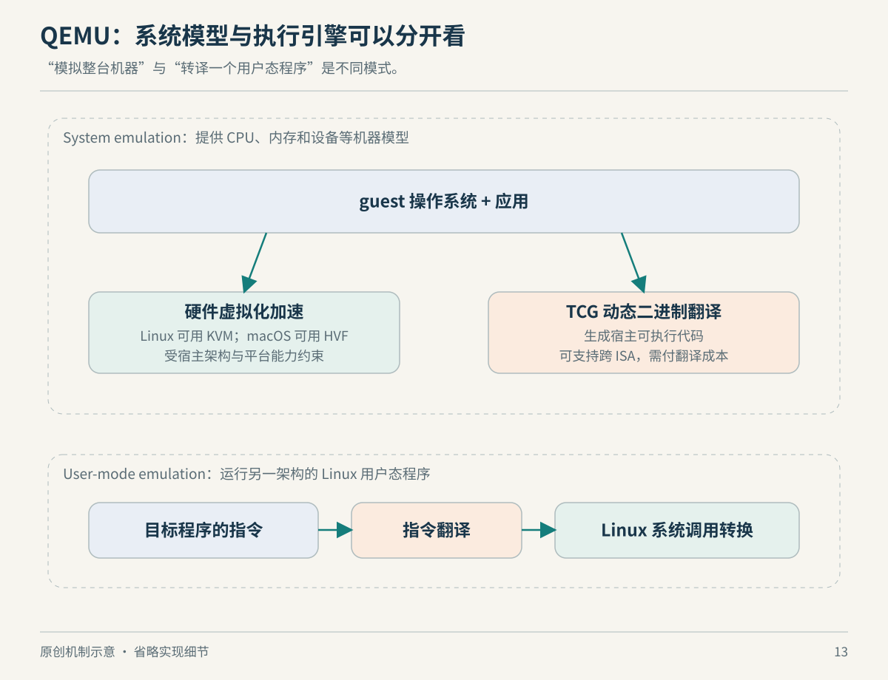

# 第 13 章　QEMU：模拟、虚拟化与跨架构的边界

“我已经把指令全部转过去了，为什么程序仍然不能正常运行？”这是做跨架构或跨平台移植时非常值得问的问题。CPU 指令表达计算，但程序还会请求操作系统服务、访问设备，依赖异常、线程与内存的语义。QEMU 正好提供了一组可以拆开观察的方案。

## 先分清系统模拟与用户模式模拟

QEMU 系统模拟提供机器模型，运行客体操作系统。用户模式模拟则面向另一架构的用户程序，处理系统调用转换、信号等接口，并依赖宿主系统完成相应工作。后者不包含一份完整客体内核，也不等于能让任何操作系统的任何应用跨平台执行。[资料：QEMU User space emulator，Features](https://www.qemu.org/docs/master/user/main.html)

例如，你只想在 x86 Linux 上运行一段 ARM Linux 用户程序，可能不需要启动整个 ARM Linux 系统；但若要研究该平台的启动、中断或内核驱动，用户模式就不是那个层次的环境。这个选择来自所需接口范围，而不是简单取决于程序体积。

系统模拟也不能只写“模拟 ARM”就结束。QEMU 的 ARM `virt` 是为虚拟机设计的通用板级平台，并不对应一块真实硬件。能运行支持该虚拟平台的客体，不等于已完整模拟某款手机或游戏主机。[资料：QEMU ‘virt’ generic virtual platform](https://www.qemu.org/docs/master/system/arm/virt.html)



*图 13-1　原创机制示意。路径用于区分职责，不能解释为任意组合都被产品支持。*

## TCG 在运行时翻译代码

QEMU 的 TCG（Tiny Code Generator）执行动态翻译。首次遇到代码时，把它转换成宿主可执行的代码块，并缓存与相应 CPU 状态有关的翻译结果；后续可复用和链接这些块。这里的“动态”强调翻译发生在运行过程中，而不是预先把整个程序永久转换成另一份可执行文件。[资料：QEMU Translator Internals](https://www.qemu.org/docs/master/devel/tcg.html)

中间表示（IR）把客体行为与宿主代码生成隔开，让前端和后端不必彼此硬编码全部组合。TCG 操作具有明确的变量类型与输入输出约定。读者不必现在学习每个操作码，但应理解这一层的作用：同样的加法、访存与控制流语义，可以通过不同后端落到不同机器。[资料：QEMU TCG Intermediate Representation](https://www.qemu.org/docs/master/devel/tcg-ops.html)

缓存并不消灭语义难题。客体 CPU 的状态会影响指令解释，状态改变也会影响哪些翻译块可用。只看到“翻译块命中率很高”，还不足以证明整个系统兼容；正确性仍取决于被翻译行为是否匹配预期。这是对动态翻译模型的解释，不是对所有工作负载的性能结论。

## KVM、HVF 与 TCG 不能随意互换

QEMU 根据平台和目标提供多种加速后端；命令行的 `-accel` 或相关机器选项选择后端，可用集合由构建与架构等条件决定。硬件辅助后端依赖宿主硬件支持相应执行模式，不会把 ARM CPU 自动变成能直接执行 x86 指令的 CPU；跨 ISA 的指令翻译仍需相应的软件或专门方案。[资料：QEMU Invocation，machine 与 accelerator 选项](https://www.qemu.org/docs/master/system/invocation.html)

因此，在 Apple Silicon 上选择 HVF，并不等于给一台 x86 客体开启了“原生 x86 硬件加速”。讨论速度前应先说清宿主 ISA、客体 ISA、机器模型和执行后端。若 CPU 路径选错，讨论磁盘缓存参数很可能还没有触及主要问题。

| 目标 | 首先需要厘清的层次 | 本书中的对应问题 |
| --- | --- | --- |
| 在同架构宿主上运行另一套内核 | 硬件辅助虚拟化与机器设备 | 谁控制客体执行与内存 |
| 运行另一 ISA 的 Linux 用户程序 | 指令翻译与用户空间 ABI | 系统调用如何适配 |
| 重现某块开发板或主机 | 板级设备、固件与时序接口 | 它究竟看见哪台机器 |
| 把程序静态移植为本机可执行文件 | 控制流恢复与外部接口重建 | 计算与环境分别怎样实现 |

表格是学习路线归纳，不是产品支持矩阵。

## 静态重编译为什么仍可能需要高层适配

静态重编译把分析与转换尽量提前到运行前。它与动态翻译的一个关键差异是：程序真实执行之前，就要尽量识别哪些字节是代码、控制流怎样跳转，以及外部行为由谁实现。QEMU 的文档描述的是动态翻译，本节据此做方法对照，不声称 QEMU 本身替你完成任意程序的静态移植。

一个真实对照是 N64Recomp：它结合二进制、符号与元数据生成 C 函数，输出仍期望与运行时配合使用。它的说明直接把代码重编译与运行时职责分开，并列出编译器及代码模式方面的限制。因此，它是这一路线的实例，不是“任意机器码自动变成本机应用”的证明。[资料：N64Recomp，How it Works](https://github.com/N64Recomp/N64Recomp)

即使机器指令的计算语义全部转换正确，程序执行某个系统调用时，目标系统仍要提供约定的结果。QEMU 用户模式显式包含系统调用转换，就是“指令执行”之外还有“接口服务”的直接例子。图形设备命令、文件对象和同步接口，同样需要明确归属；“指令全覆盖”只回答了兼容问题的一部分。

在模拟与移植讨论中，高层模拟（HLE）通常表示在某个接口层重新提供行为，而非逐项重现其底层实现。本书把它作为方法性术语使用，不把它定义为硬件必须安装的组件。你可以转换程序指令，再用宿主图形接口实现原平台的图形服务；也可以模拟设备供原驱动使用。选择哪层承担兼容性，决定要实现与验证哪些合同。

例如，N64ModernRuntime 的 ultramodern 重新实现 libultra 的多项功能，包括线程、消息队列与定时器；平台相关 I/O 通过回调接入，图形渲染器也由使用者提供。这是“重编译结果仍需环境适配”的具体项目证据。此处将接口重实现与 HLE 联系起来，是方法归类，不意味着该项目把全部组件统一命名为 HLE。[资料：N64 Modern Runtime](https://github.com/N64Recomp/N64ModernRuntime)

后一段是作者依据上述执行层和接口层区分作出的工程归纳，未声称某一主机、某款游戏或某份闭源固件已被验证兼容。面对具体移植项目，还必须拿到对应接口的规格、实现证据和行为测试。

## 把“能跑”分成可以验证的条件

一个更可靠的问题清单是：目标代码能否执行；系统接口能否得到正确返回；线程、信号与内存语义是否满足程序假设；所需设备或服务是否存在。不同问题需要不同证据，不能拿启动画面替代后面几项。

若安装了相应 QEMU 系统程序，可以只查看它实际提供的目标：

```bash
qemu-system-aarch64 --version
qemu-system-aarch64 -machine help
qemu-system-aarch64 -accel help
```

这些命令显示版本或支持列表，不启动客体。具体程序可能未安装，构建也可能裁剪了后端；应以本机结果和对应版本文档为准。看到一个加速器名称，只证明程序能列出它，不保证当前系统能够成功初始化它。

## 为移植项目建立一份分层验证表

如果你正在做移植，可以自己准备四组小型验证，而不必一开始就拿整个大型应用的成功率判断方向。第一组只检验计算行为，例如算术结果与位操作；第二组检验内存与并发假设；第三组检验文件、时间和线程等系统接口；第四组检验应用依赖的设备与服务。这是作者建议的测试组织方式，具体用例应由目标平台的规格决定。

分组之后，失败信息会更有价值：算术测试通过、文件接口测试失败，说明至少应该先检查接口映射，而不是立即怀疑所有指令翻译。反过来，应用界面能显示，也不意味着隐藏路径中的异常或并发行为已经正确。验证结果必须连同覆盖范围一起表达。

这种方法也解释了静态与动态方案为什么可能混用。项目可以提前转换大部分可识别代码，再对难以提前确定的部分保留另一条处理路径；是否可行仍须具体设计和验证。本章只指出方法之间的逻辑组合空间，不宣称任意翻译器已经支持这种组合。

学习到这里，比较准确的目标描述就不再只是“把这个架构转成那个架构”，而是“让哪些代码，在什么操作系统接口和设备假设下，得到哪些经过验证的行为”。目标描述越具体，资料收集、实现与测试才能围绕同一个对象展开。

## 本章资料与证据边界

资料读取日期为 2026-10-22。正文直接事实来自 QEMU 官方文档及 N64Recomp、N64ModernRuntime 项目说明；静态移植与 HLE 部分包含明确标识的方法比较，不是具体项目兼容承诺。性能高低需绑定版本、宿主与客体架构、设备后端及负载测量，本章不提供未经实测的倍数。

主要资料：[用户模式](https://www.qemu.org/docs/master/user/main.html)、[系统启动选项](https://www.qemu.org/docs/master/system/invocation.html)、[Translator Internals](https://www.qemu.org/docs/master/devel/tcg.html)、[TCG IR](https://www.qemu.org/docs/master/devel/tcg-ops.html)、[ARM virt](https://www.qemu.org/docs/master/system/arm/virt.html)。
