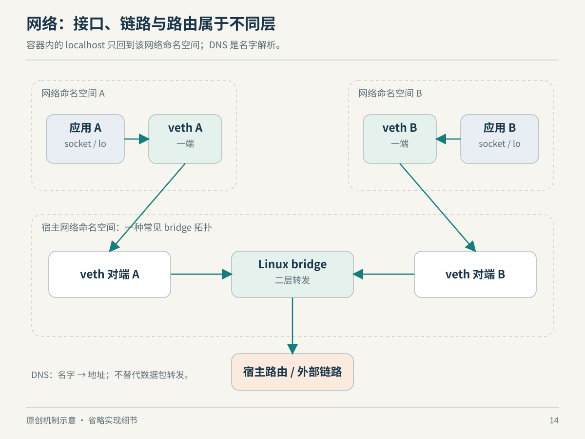

# 第 14 章　网络：从一个 socket 到另一端

网络问题经常伪装成应用问题：代理明明已经启动，另一个容器却连不上；IP 地址能访问，域名却不行；两个程序都说自己监听了 8080，系统竟然没有报端口冲突。理解这些现象，不必先背完所有协议头，而应先区分四件事：程序的通信端点、内核处理协议的规则、包可以经过的路径，以及程序看到的网络范围。

## socket 连接程序与协议栈

应用使用 `socket()` 创建通信端点，得到一个文件描述符，再通过 `bind()`、`connect()`、`send()`、`recv()` 等操作使用它。socket 是面向程序的接口，不等于网卡，也不必经过物理网络；地址族决定通信空间，类型与协议决定传输语义。Unix domain socket 甚至主要服务于同机进程通信。[来源：socket(7)](https://man7.org/linux/man-pages/man7/socket.7.html)

TCP 向应用提供有序的双向字节流。丢包重传与顺序恢复由协议实现，但应用自己的消息边界不会随 `write()` 自动保存：发送两次，不代表接收端恰好读到两次。若你的代理协议有“请求头＋正文”，它仍需自己定义长度或分隔方法。接收字节也不代表对方业务已经成功执行。[来源：tcp(7)](https://man7.org/linux/man-pages/man7/tcp.7.html)

UDP 保留数据报单位，却不提供 TCP 式的可靠有序传输。它允许应用在更上层设计所需行为；“UDP 不可靠”描述的是传输接口的承诺，不是宣布所有 UDP 应用都不可靠。UDP socket 也可以调用 `connect()` 设置默认目的端，因此看到这个函数名，不能直接推断已经进行 TCP 握手。[来源：udp(7)](https://man7.org/linux/man-pages/man7/udp.7.html)

这三个概念解释了一种常见误判：程序拿到 fd，只说明端点创建成功；`connect()` 成功、数据成功发送、业务返回成功，是后续不同的检查点。排障需要把它们拆开，不能用一个“网络通了”替代全部证据。

## 地址属于一个网络视图

在 IPv4 中，`127.0.0.1` 指向本地回环；监听 `0.0.0.0` 表示绑定本地所有 IPv4 地址，而非宣告所有远端都能抵达。可达性还取决于路由、过滤、网络连接与应用的上层协议。监听地址与访问地址不是同一种指令：客户端一般不应把服务端的通配绑定地址当成目标地址。[来源：ip(7)](https://man7.org/linux/man-pages/man7/ip.7.html)

Linux 的 network namespace 把网络设备、路由表、协议栈相关资源和端口空间等组织成隔离视图。因此两个进程即使位于同一台物理主机，只要分别处在不同网络 namespace，就可能拥有各自的 8080 与回环接口。容器中的 `localhost` 通常指向这个容器所在网络 namespace，不会自动指向宿主机，也不会自动指向隔壁容器。采用共享网络 namespace 的部署则另当别论。[来源：network_namespaces(7)](https://man7.org/linux/man-pages/man7/network_namespaces.7.html)



*图14：原创机制示意，非实际拓扑或时序。回环留在各自网络视图中；跨视图通信需要显式连接。*

## veth、bridge、路由与 NAT 各管一层

veth 是成对出现的虚拟以太网设备：从一端发出的帧在另一端接收。把两端分别放入不同网络 namespace，就得到跨越两个网络视图的一段连接。它本身不负责替你配置 IP、默认路由、名字解析或访问策略。[来源：veth(4)](https://man7.org/linux/man-pages/man4/veth.4.html)

bridge 在二层依据 MAC 地址转发帧，可把多个连接组织为一个以太网广播域。路由解决的是三层目的地址应从哪个下一跳或接口到达。用办公楼作一个有限类比：bridge 更接近连接同一区域的交换设施，路由更接近决定跨区域出口；类比只帮助区分职责，不能代替实际转发表。[来源：Ethernet Bridging](https://docs.kernel.org/networking/bridge.html)

NAT 则改写地址或端口。常见有状态 NAT 会借助连接跟踪记录映射，使后续包及返回方向按相应关系处理。容器的“宿主端口映射”可能由目的地址转换等机制实现，具体运行时也可能采用用户态转发。不能因为启用了 bridge 就认定已经存在 NAT，更不能因为做了 NAT 就认定服务通过了身份认证。[来源：nftables NAT 文档](https://wiki.nftables.org/wiki-nftables/index.php/Performing_Network_Address_Translation_%28NAT%29)

把这些职责放回一次连接，诊断就有了方向：应用在其网络视图内选择目的端点；内核根据路径处理包；虚拟设备或物理设备传递流量；若配置了地址转换，就在相应位置处理映射。这是对上述机制的组合解释，不表示所有 Linux 流量必经 veth、bridge 或 NAT。

## 一个代理连接的思想实验

假设宿主程序 A 监听回环地址的 12580，容器程序 B 配置代理地址 `127.0.0.1:12580`。不要急着修改端口：先在纸上画出 A 和 B 所在的网络视图。如果它们处在不同 namespace，B 发往回环的连接从一开始就在寻找自己的本地端点，根本没有走到 A。增加宿主防火墙放行规则，可能完全没有碰到真正的问题。

再假设把地址改成一个 B 可以路由到的宿主地址，连接仍然失败。这时问题已经改变：路径可能正确，但 A 仍只绑定回环，不接受该地址上的连接。继续假设 A 的绑定也已匹配，连接建立却收到错误 HTTP 状态码，那么排查范围又应前移到应用协议、认证或上游服务。这个过程体现的是分层证据怎样逐步收窄范围，而不是给所有部署一条固定修复命令。

| 当前证据 | 可以暂时支持什么 | 尚不能证明什么 |
| --- | --- | --- |
| 本地存在监听 socket | 某进程在此视图绑定了端点 | 其他网络视图一定可达 |
| 目标地址存在路由 | 内核有候选转发路径 | 下一跳、对端与过滤一定正常 |
| TCP 连接建立 | 本次传输端点已接通 | TLS、认证与业务都成功 |
| 收到业务响应 | 请求进入了应用链路 | 返回内容一定符合需求 |

这是基于本章接口语义构造的教学案例，不是对某款容器产品默认设置的描述。它也提醒我们：每次修改之后，要重新命名当前故障，避免用“还是不通”把连接失败、协议失败和业务失败混在一起。

## DNS 是连接之前的另一条链

名字解析配置由用户态解析器读取，`/etc/resolv.conf` 是常见配置入口。它可能指向本地解析服务，也可能由系统管理工具维护。域名查不到时，问题可能发生在解析阶段，尚未进入你原本想连接的目标服务；而连接 IP 成功，也不能证明域名返回了正确地址。[来源：resolv.conf(5)](https://man7.org/linux/man-pages/man5/resolv.conf.5.html)

先看本机视图，再看路径，可以使用以下只读命令。`ip` 与 `ss` 通常来自 iproute2，精简系统未必安装；它们显示的是执行进程所处的网络 namespace，不承诺展示宿主机全貌。以下不附虚构输出。[命令资料：ip(8)](https://man7.org/linux/man-pages/man8/ip.8.html)、[ss(8)](https://man7.org/linux/man-pages/man8/ss.8.html)。

```sh
ip address show
ip route show
ss -lnt
readlink /proc/self/ns/net
cat /etc/resolv.conf
```

观察时先回答：服务监听在哪个地址？客户端与服务端是否共享网络视图？是否存在到目标的路由？最后再区分解析、连接、TLS 和应用响应。这比先把所有防火墙关掉更能保留问题证据，也更容易说明究竟是哪一层发生了变化。

## 本章资料与证据边界

本章引用的是 Linux man-pages、Linux 内核 bridge 文档与 nftables 项目文档，资料核对日期为 2026-10-22。正文各链接可独立追溯。这里给出的是常见内核网络机制，不代表每个容器运行时的默认拓扑；rootless 网络、用户态网络和云网络插件可能采用不同实现。IPv4 示例也不能直接替代完整 IPv6 配置。排障次序与办公楼类比为本书的教学组织，不是协议规范。
