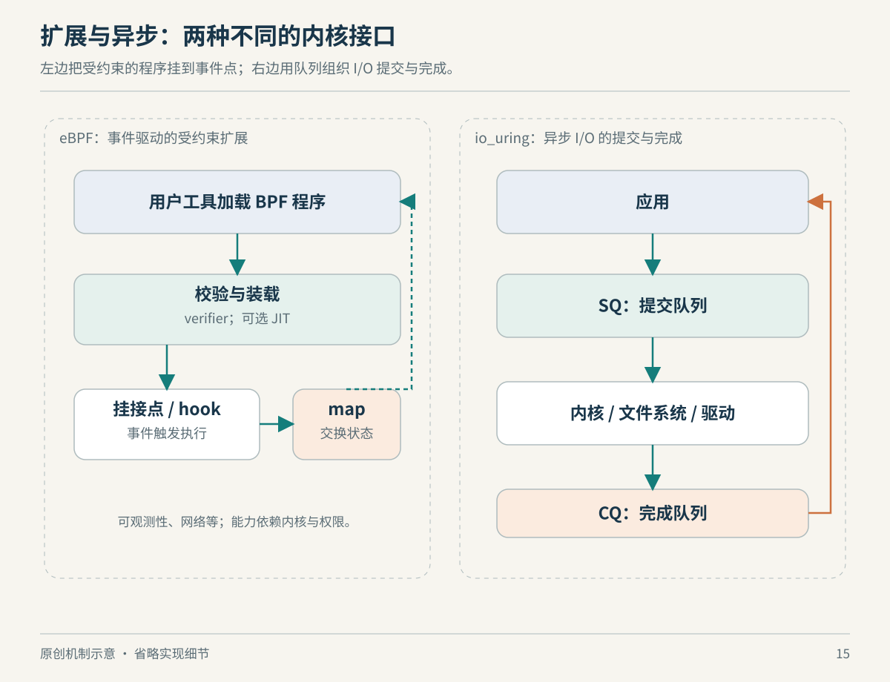

# 第15章　eBPF 与 io_uring：怎样扩展内核边界

前面几章反复出现一种设计：用户程序通过接口请求内核完成工作。现在来看两种更灵活的接口。eBPF 允许把受约束的处理逻辑放到内核预留的执行位置；io_uring 则把许多 I/O 请求与结果组织成队列。它们都能减少某些交互成本，但解决的是不同的问题，不能因为都与性能有关就把它们混成一种技术。

## eBPF 先要回答“在哪里运行”

eBPF 的祖先 BPF 用于包过滤，现代 eBPF 的用途已经扩展到跟踪、网络处理等领域。用户态加载程序，内核先检查，再让它在指定事件发生时执行；程序类型与挂接位置决定它能获得什么上下文、调用哪些辅助功能。它不是给普通应用一个任意调用内核内部函数的入口。[来源：bpf(2)](https://man7.org/linux/man-pages/man2/bpf.2.html)

想统计某类事件，传统办法可能是让每个事件都把大量数据送到用户态，再集中计算。eBPF 可以在事件发生附近完成筛选和聚合，用户态再读取结果。这个例子解释其价值来自哪里：减少不需要的数据搬运，保持现场上下文，而不是凭空让所有工作消失。挂得越频繁、计算越重，附加成本也越值得测量。

*图15：原创机制示意，非实际执行时序或性能比例。eBPF 的程序挂接与 io_uring 的请求提交是两种不同关系。*

## verifier 限制行为，map 保存状态

verifier 会分析程序状态与可达路径，检查寄存器类型、内存访问范围和栈数据是否已初始化等条件。不满足约束，加载就可能被拒绝。这里最容易误读的是“被验证”：它表示通过内核实现的安全检查，不代表程序符合你的业务意图、没有观测偏差或零性能开销；也不应把旧资料里的限制清单当作所有版本永恒不变的规则。[来源：eBPF verifier](https://docs.kernel.org/bpf/verifier.html)

单次事件处理结束后，跨事件状态可以保存在 map 中。map 有哈希表、数组等类型，内核程序与用户态可以通过相应接口访问。设想用“进程身份→累计字节数”的表保存统计，就不必逐条打印每次读写。但并发更新、键的生命周期与容量仍需设计；统计容器时也要说明采用的是宿主 PID、namespace 内 PID，还是其他身份。[来源：BPF maps](https://docs.kernel.org/bpf/maps.html)

许多平台会用 JIT 把 BPF 指令转为本机指令执行。这里的 JIT 主要回答“这些 BPF 指令怎样执行”，verifier 回答“这段程序是否满足可接受条件”，二者职责不同。JIT 也不等于让 BPF 程序获得与任意内核模块相同的权限。[来源：Linux Socket Filtering 的 BPF 引擎说明](https://docs.kernel.org/networking/filter.html)

## 可移植性不是没有条件

内核内部结构会变化。BTF 是描述类型等信息的元数据格式，帮助工具知道结构与字段是什么；它还可包含函数和行号信息。这与把整个内核内存直接暴露给程序是两回事。[来源：BPF Type Format](https://docs.kernel.org/bpf/btf.html)

libbpf 负责解析目标文件、处理重定位、加载与挂接。其 CO-RE 机制利用目标内核的信息适配某些结构布局变化，使同一份编译产物可以跨越相容环境。它不保证旧内核突然拥有新 helper、新挂点或新程序类型，也不保证缺失 BTF 的环境满足同样条件。评价“可运行到处”时，应把类型适配能力与功能存在性分开。[来源：libbpf Overview](https://docs.kernel.org/bpf/libbpf/libbpf_overview.html)

bpftrace 把“探针、条件、动作”组织成较短的追踪表达式，适合快速提出观察问题。比如先统计某事件是否发生，再考虑分组与延迟分布。它是建立在相关内核能力之上的工具，不会免除挂点存在性和权限要求，也不能让没有采集到的事件自动成为“没有发生”。[来源：bpftrace Language](https://bpftrace.org/docs/release_024/language)

网络挂点也有差异。XDP 通常用于较早的接收路径处理，tc 层也能运行 BPF 程序；AF_XDP 则让程序通过专门接口接收经重定向的数据帧。仅凭工具名字里有 BPF，无法知道流量经过了哪一层，也无法认定必然零拷贝。[来源：AF_XDP](https://docs.kernel.org/networking/af_xdp.html)；[Linux Socket Filtering](https://docs.kernel.org/networking/filter.html)

## 先设计问题，再决定探针

假设你想判断一个本地代理为什么尾延迟变大。可以先提出一个明确的问题：“请求处理期间，文件读取等待是否增加？”随后再决定要观察哪些事件、按什么身份关联、如何记录时间，而不是先把所有探针都开启。只统计系统调用次数，回答的是发生频率；想回答等待时间，则需要能匹配的开始和结束事件。两种结果都可能正确，却服务于不同问题。

若选择按进程统计，还要考虑进程退出、标识复用以及工作是否转交给其他进程。把一个 map 清空后，短时间没有新数据，也不能证明系统已经恢复，因为观察窗口可能尚未覆盖工作高峰。这里的难点不只是把程序通过 verifier，更是确保统计对象与读者真正关心的对象一致。

| 设计选择 | 好处 | 需要检查的偏差 |
| --- | --- | --- |
| 每事件输出明细 | 容易回看单次过程 | 数据量、缓冲与输出成本 |
| 内核侧先做聚合 | 减少重复数据传输 | 分组是否丢失关键差异 |
| 只保留直方图 | 容易看分布与尾部 | 看不到具体请求身份 |
| 按短窗口采集 | 限制观察成本 | 是否错过稀有事件 |

这些选择属于观测设计，不能由某个工具名自动决定。一次合理实践通常是从低成本的明确问题开始，结果不足以解释现象时再增加细节。把工具升级当成证据升级，容易得到更复杂但仍然答非所问的图。

## io_uring 把请求与完成分开

另一类成本来自大量 I/O 操作的逐次交互。io_uring 提供用户态与内核共享的提交队列和完成队列：应用描述操作，内核处理，再投递结果；应用用自身标记把完成记录与请求对应。批量提交、注册资源等机制可以减少特定工作负载的开销，但是否获益取决于操作类型、内核实现与应用组织方式。[来源：io_uring(7)](https://man7.org/linux/man-pages/man7/io_uring.7.html)

这与 epoll 的“就绪通知”不同。epoll 主要告诉程序哪些 fd 具备继续 I/O 的条件，程序仍需进行相应读写，并正确处理非阻塞行为。io_uring 则可以让完成队列表示某项已提交操作的结果。就绪是“现在可以试”，完成是“这一项有了结果”；这是理解异步接口时最有用的区别。[来源：epoll(7)](https://man7.org/linux/man-pages/man7/epoll.7.html)

二者都不会消除背后的设备延迟。应用把一万项任务放进队列，也没有制造一万块独立磁盘；更大的并发反而可能增加排队时间。异步接口把等待与执行组织得更灵活，但并发度、背压、取消与资源生命周期仍由系统和应用共同处理。这一推论来自队列模型，而不是对任何具体产品的速度承诺。

## 本章资料与证据边界

主要资料为上文 Linux 内核 BPF 文档、libbpf 与 bpftrace 项目文档、Linux man-pages；核对日期为 2026-10-22。本章解释模型而不提供加载示例，避免把特权操作混入默认阅读练习。eBPF、io_uring 的可用操作、权限及限制随内核配置和版本变化；生产环境还可能通过安全策略禁用部分能力。性能解释为机制层面的因果分析，未经本书基准测试，不给出倍数承诺。
