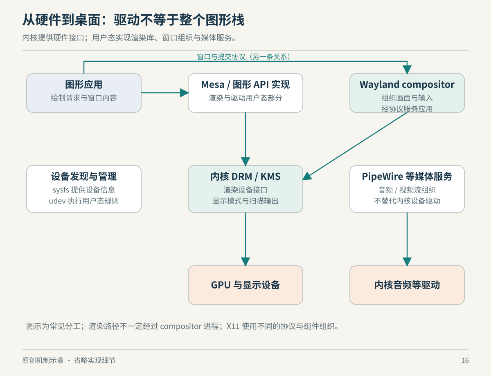

# 第 16 章　驱动与桌面：屏幕背后的协作

插入耳机、拖动窗口、切换 Wi-Fi，表面上都是一次交互。它们背后却横跨内核驱动、设备发现、用户会话和应用框架。把这些全部称为“Linux 驱动”，会让问题失去位置：内核已经认出设备，不代表桌面已选择它；GPU 可以渲染，也不代表显示器已经配置正确。

## 内核提供机制，用户态组织设备生活

sysfs 把内核对象、属性和它们的关系呈现给用户态，通常挂载在 `/sys`。目录关系可以反映设备层级，某些属性读操作返回当前状态，写操作则可能改变配置。因此 `/sys` 看起来像文件目录，却不是普通的磁盘资料库；浏览它是在通过文件接口与内核对象交互。[来源：sysfs 文档](https://docs.kernel.org/filesystems/sysfs.html)

设备变化还会触发事件。udev 在用户态接收内核 uevent，按规则识别设备、设置设备节点权限、建立有意义的链接或命名。它使“这块盘目前被发现为第几个设备”与“用户如何稳定识别它”不必完全绑定。udev 不能代替硬件驱动；其权限或规则问题也不一定需要重写驱动解决。[来源：udev 手册](https://www.freedesktop.org/software/systemd/man/latest/udev.html)

可加载模块允许把部分内核功能按需装入。外部模块构建仍需匹配目标内核的配置、头文件及构建环境，不能因为文件后缀都是 `.ko` 就随意跨内核复制。模块化使交付更灵活，却没有把内核内部接口变成任意版本通用的应用接口。[来源：Building External Modules](https://docs.kernel.org/kbuild/modules.html)

这里可以形成一个实用的分层提问：设备是否被识别？相应功能是否存在？用户是否有权访问？负责组织会话的服务是否选择了它？应用是否请求了正确接口？这种次序不保证一步找到答案，却比反复更换“驱动包”更能解释证据。



*图16：原创机制示意，非所有桌面的固定软件组合。图形渲染、显示输出与音频策略应分开理解。*

## 画出一帧，与把它送上屏幕不同

Linux 图形栈中的 DRM 指 Direct Rendering Manager。它通过设备接口向用户态提供图形相关能力，包括内存管理、同步和输出管理等。不要把这里的 DRM 与数字版权管理混为一谈；缩写相同，所指不同。[来源：DRM Userland interfaces](https://docs.kernel.org/gpu/drm-uapi.html)

KMS，即 Kernel Mode Setting，负责显示输出模型。可以先把它理解为：哪块帧缓冲经由哪些显示平面参与输出、以什么模式送往哪一个连接器。它解决“怎样显示这一帧”的问题，与应用如何把三角形或文字渲染到缓冲区并不是同一个任务。实际硬件对组合、缩放与输出路径有各自约束。[来源：Kernel Mode Setting](https://docs.kernel.org/gpu/drm-kms.html)

Mesa 是用户态图形栈的重要组成，包含多个硬件或软件驱动，以及不同图形接口实现。使用 Mesa 不等于所有计算都由 GPU 完成，软件驱动也能实现渲染；反过来，GPU 已能被内核枚举，也不代表所需用户态图形接口已正确安装。把“内核看得到设备”和“应用取得硬件加速”分开，才能解释为什么某些系统能显示桌面，却渲染异常缓慢。[来源：Mesa Platforms and Drivers](https://docs.mesa3d.org/systems.html)

## Wayland 改的是协作边界

窗口系统还要处理输入分发、窗口位置与最终合成。Wayland 的架构让合成器同时承担显示服务器的角色；客户端渲染自己的内容，并把可供合成的缓冲区交给合成器，后者组织最终画面与输入。Wayland 是协议体系，不是某一个唯一的桌面程序。[来源：Wayland Architecture](https://wayland.freedesktop.org/architecture.html)

Wayland 官方的 X 对照图用于解释职责迁移，但不能把它当成所有现代 X11 绘制的精确时序图：现实中的直接渲染与合成方式更加多样。因此“Wayland 一定比 X11 快多少”不是这张架构图能够证明的结论。本章关注的是谁有最终场景信息、谁分发输入、谁控制输出，而不是凭组件数量给桌面打性能分。

这种边界也影响功能在哪里实现。例如窗口截屏与屏幕共享需要知道最终场景，而应用自身只拥有自己的内容。遇到相关功能差异，应沿桌面合成与会话接口检查，不能只检查显示器驱动是否加载。

## 声音是一张图，还需要决定怎样连接

PipeWire 把多媒体处理组织成节点、端口与连接。音频应用、采集设备、播放设备及处理环节可以形成一张图。与它协作的会话管理器负责发现设备、选择配置、连接节点等策略。PipeWire 核心提供执行与控制接口，不自动替所有场景决定“哪个程序应该送到哪只耳机”。[来源：PipeWire Overview](https://docs.pipewire.org/page_overview.html)

于是“没有声音”可以有不同层次的原因：设备访问、音频节点存在性、连接策略、应用选择，分别需要相应证据。把声音换到另一输出后恢复，只证明这次路径变化有帮助，不能直接证明原设备的内核驱动有缺陷。这里的排障区分是本书从组件职责推导出的观察方法。

网络桌面体验也体现同一设计。NetworkManager 作为用户态服务管理网络连接与接口，并通过 D-Bus 提供状态和控制接口。内核支持 Wi-Fi 硬件，和系统完成连接配置、地址获取及会话管理，是不同层次的问题；也有系统使用其他网络管理方案。[来源：NetworkManager 手册](https://networkmanager.dev/docs/api/latest/NetworkManager.html)

蓝牙同样不只有内核一层。BlueZ 项目包含用户态守护进程及工具，桌面应用与其协作完成设备使用体验；“蓝牙控制器存在”不能替代配对和上层功能状态的检查。本章只用它展示分层，不推断某款耳机、某个编码器或某台电脑的支持状况。[来源：BlueZ 项目 README](https://github.com/bluez/bluez/blob/master/README)

## 从三个日常故障练习分层

第一个场景是“外接显示器能被列出，却没有正常图像”。设备存在性只是一个检查点，还要看输出配置和整个呈现路径；如果应用能在内置屏幕正常渲染，至少不应立刻把问题统称为“所有 GPU 功能失效”。这不是在排除驱动，而是在避免用一个现象替所有层做结论。

第二个场景是“耳机已连接，浏览器仍从扬声器出声”。先把设备连接状态、音频图中是否出现目标节点、浏览器输出实际连向哪里写成三个问题。这样即使最后发现是会话策略，也能说明为什么此前只重启应用不一定改变结果。连接、发现与选择，是互相关联但可分别观察的状态。

第三个场景是“网卡存在，却没有网络”。一个接口出现在 `/sys`，不代表它已经取得合适地址、路由和名字解析设置。这个例子正好与第 14 章的网络机制相接：内核能力是可用网络的必要组成之一，用户态配置和外部网络环境也参与最终结果。

以上是根据本章职责图构造的诊断练习，未指向任何具体硬件缺陷。练习的重点是学会把证据放在准确层级：能够看到什么，与能够证明什么，需要用不同的句子描述。

## 看一眼系统实际采用了什么

下面只列出查询命令，未假设所有系统均安装这些工具，也不附示例输出。`lsmod` 看的是当前加载的模块，不能证明未列出的功能一定不存在，因为功能也可能编入内核。[来源：lsmod(8)](https://man7.org/linux/man-pages/man8/lsmod.8.html)。`pw-dump` 查询 PipeWire 图中的对象；缺少这个工具不等于没有音频支持。

```sh
ls /sys/class
ls /sys/class/drm
lsmod
pw-dump
```

把读到的组件放回职责图：硬件与内核接口形成基础，用户态库和服务组织功能，桌面会话和应用再交付体验。Linux 生态的“丰富”在这里不是内核里塞进了整个桌面，而是许多组件可以沿明确接口持续替换与演进。

## 本章资料与证据边界

本章资料为内核、systemd/udev、Mesa、Wayland、PipeWire、NetworkManager 与 BlueZ 各项目文档，核对日期为 2026-10-22。正文图示表达职责，不要求每台 Linux 都采用全部组件；无桌面系统、专有图形驱动和嵌入式平台可能有不同组合。涉及 Wayland 的官方对照说明用于理解架构，其历史化简图不能证明所有当前实现的性能。未对具体硬件或发行版执行兼容性认证。
