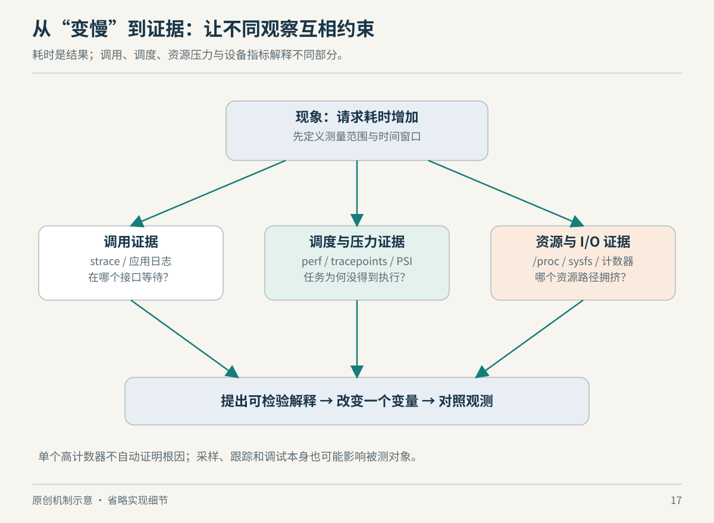

# 第17章　观察 Linux：怎样让一个判断有证据

机器很慢时，几乎任何一张监控图都能为一个故事提供素材。CPU 占用高，可以说算力不够；CPU 占用低，又可以说程序没有充分并行。两句话都可能成立，也都可能偏离原因。可靠的观察要先固定问题：哪个请求变慢，在哪段时间，什么工作量下，比较基线是什么？然后才选择指标。

## 先看状态，再追发生的过程

`/proc` 暴露进程与系统状态，按 PID 的目录包含进程相关信息；`self` 指向读取者自身。这里的数字是接口给出的观测结果，读取不是冻结整台机器拍一张完全一致的照片。进程可能同时变化甚至退出，容器还可能只看到被限制的视图。[来源：The /proc Filesystem](https://docs.kernel.org/filesystems/proc.html)

`/sys` 更适合沿设备与内核对象关系查找属性。二者都使用文件接口，却不能据此认定任何路径都只是普通文本；有些属性可写，写入可能改变系统行为。教学观察先读取状态，并保留“读的是谁、什么时候读”的记录。[来源：sysfs 文档](https://docs.kernel.org/filesystems/sysfs.html)

一个进程显示占用了很多内存，并不能仅凭这项数字证明发生泄漏。它可能保存缓存、共享映射或尚未归还的分配器空间。相同地，负载增加后的响应变慢，也不能仅凭同时发生就证明二者的具体因果链。本书把这条纪律写在工具之前：先陈述观察，再标出解释，最后寻找能够排除其他解释的测量。



*图17：原创方法示意，非内核执行时序。数据缩小解释范围，验证负责检验具体因果。*

## PSI 问的是工作受阻多少

CPU 使用率描述资源忙碌情况，PSI 则量化任务因 CPU、内存或 I/O 资源压力而受阻的时间。接口位于 `/proc/pressure/`。`some` 表达至少部分任务受阻的时间占比，`full` 在相应资源和统计范围内表达所有非空闲任务同时受阻的情况；系统级 CPU `full` 没有同样定义，不能机械照搬内存与 I/O 的解释。[来源：PSI 文档](https://www.kernel.org/doc/html/latest/accounting/psi.html)

这带来一个重要区别：内存已用得多，未必妨碍进度；内存压力开始迫使任务等待，才更直接关联可用性受损。PSI 能提示受阻方向，但不能独自指认某个函数、设备或容器是唯一根因。下面的只读观察显示当前 Python 进程的部分状态，以及环境允许读取的压力信息：

```sh
python3 - <<'PY'
from pathlib import Path

status = Path('/proc/self/status')
if status.is_file():
    wanted = ('Name:', 'Threads:', 'VmRSS:', 'VmSize:')
    print('[当前 Python 进程]')
    for line in status.read_text().splitlines():
        if line.startswith(wanted):
            print(line)
for resource in ('cpu', 'memory', 'io'):
    path = Path('/proc/pressure') / resource
    print(f'[{resource} pressure]')
    try:
        print(path.read_text().strip())
    except OSError as error:
        print(f'不可读取：{error.strerror}')
PY
```

脚本不修改配置，也不制造压力；非 Linux、精简容器或未启用相关功能的内核可能缺失路径。输出只代表执行时的环境，本书不预填任何“应该出现”的数值。若要比较前后，应固定工作量和统计窗口，不能把相隔数分钟的两次快照当成严谨对照实验。

## strace 看接口，perf 看执行成本

strace 可以观察系统调用、信号等进程与内核之间的交互。若程序一直等待某个接口，调用与返回信息有助于定位等待发生在哪里。但系统调用耗时包含的等待，不能直接等同于 CPU 真正在那段代码上运算的时间；追踪本身也会影响被观察者。[来源：strace 项目](https://strace.io/)

以下命令启动一个自己的短命进程并观察其文件相关调用，不附加到其他服务，也不修改目标文件。权限策略或精简工具版本仍可能让命令无法执行：

```sh
strace -e trace=%file cat /dev/null
```

perf 则可收集性能计数器等统计。它适合把“花了多久”进一步拆成任务执行时间、指令或周期等角度；可用事件取决于 CPU、虚拟化环境、权限与内核配置。观察虚拟机时，缺少硬件计数器不表示工作没有发生。[来源：perf-stat(1)](https://man7.org/linux/man-pages/man1/perf-stat.1.html)

```sh
perf stat -- python3 -c 'sum(range(1000000))'
```

这个小命令只演示接口，不能作为机器性能排行榜。真正比较程序版本时，需要控制输入、预热、缓存、频率与并发，并重复测量。一次更低的周期数可能具有线索价值，却不足以单独证明所有用户请求都会更快。

## tracepoint 让你在机制发生处提问

内核 tracepoint 是预留的事件挂钩。连接探针后，执行经过相应位置就调用观察逻辑，并携带相关参数；未连接时也存在少量检查与空间成本。它把问题从“CPU 曲线是什么形状”推进到“调度、I/O 或其他机制何时发生”。[来源：Using the Linux Kernel Tracepoints](https://docs.kernel.org/trace/tracepoints.html)

eBPF 等工具可以利用这些事件组织统计，但观测链也可能丢失信息。没有看到事件，需要先检查挂点、筛选条件、观察窗口及缓冲情况；有一条事件，则仍要确认它是否属于目标请求。相关性来自时间重合，因果解释还需要对象身份、调用路径或可重复对照。

例如一个网关的尾延迟升高，可以先核对请求量与输入尺寸是否变化，再看压力是否与延迟同步；若 I/O 受阻增加，继续区分日志写入、模型文件读取或其他共享工作负载；最后在可控条件下改变一个因素，看症状是否按预测变化。这里提出的是调查策略，不预设任何特定网关已经存在上述瓶颈。

## 把证据写成别人可以复查的记录

可以为一次调查保留一个很短的记录：触发现象的输入与并发、程序和内核版本、观察起止时间、相关进程或容器身份、采用的命令，以及哪些数据没有权限获取。记录限制并不会削弱结论，反而能让读者知道结论能外推到哪里。例如“容器内没有发现额外进程”只能说明这个视图中的观察，不能证明整个宿主机没有后台任务。

| 记录层次 | 合理表达 | 需要避免的跳跃 |
| --- | --- | --- |
| 观察 | 固定窗口内 I/O 压力增加 | 直接宣布磁盘损坏 |
| 关联 | 压力上升与尾延迟同窗出现 | 把同时发生当成单一因果 |
| 假设 | 某类写入可能造成共享等待 | 把假设写成已经证实 |
| 验证 | 固定负载后改变该因素并重复 | 一次改善就承诺普遍加速 |

还要区分“没有采集到”与“统计值为零”。前者可能是挂点、权限或工具缺失，后者才是在既定采集方法下的数值结果。类似地，进程退出后再去读取它的 `/proc` 目录，只能得到一次失败的读取，不能倒推退出前的状态。

如果某次修改同时调整了线程数、缓存与日志级别，即使性能改善，也难以知道究竟哪项起效。分步改变一个因素，是为了让预测能够被检验；若业务环境无法做到，应把结论写成“组合变更改善了现象”，而不是给其中一项独占功劳。这些是实验与推断方法，不要求读者把每次排障都做成论文，却能防止最常见的自我说服。

观察的终点也不是收集最多的工具输出，而是形成可复查的陈述：“在相同输入与并发下，某阶段等待增加；相应事件和资源指标支持这一解释；改变该条件后结果能重复。”这句话中的每个限定，都让结论比“Linux 很慢”更有用。

## 本章资料与证据边界

资料为正文链接的内核 `/proc`、sysfs、PSI、tracepoint 文档及 strace、perf 原始项目手册；核对日期为 2026-10-22。脚本的状态字段是观察入口，不承诺在所有内核与权限环境均存在。调查流程与示例假设由本书组织，不是实测性能报告。指标解释始终需要统计范围、采样窗口与执行环境；单项数字不能独立证明根因。
