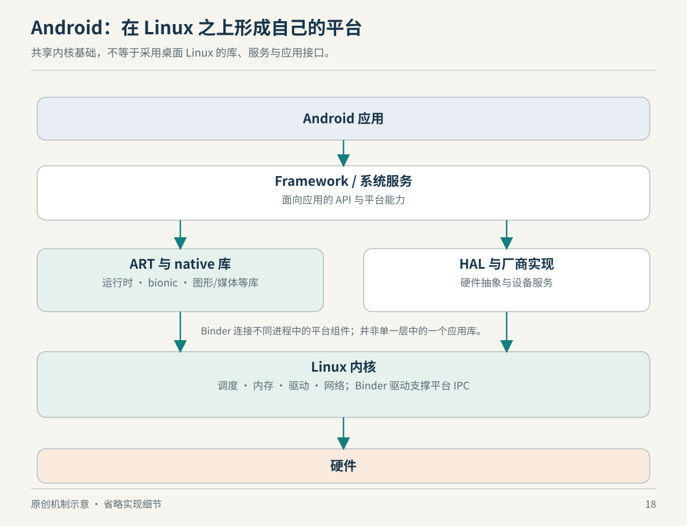

# 18　Android：同一内核上长出的另一套平台

把手机接到电脑，打开一个终端，看到进程和目录，会让熟悉 Linux 的人产生亲切感。但亲切感不等于二进制兼容。Android 是理解“内核”与“平台”区别的好例子：它确实以 Linux 为基础，却通过自己的库、运行时、服务协议和应用模型，组织出另一套使用方式。

*图 18：原创机制示意。方框表示职责；并非每次应用调用都依次穿过所有方框，native 代码也不意味着绕过安全机制。*

## Linux 提供地基，不决定整个房间的布置

AOSP 的体系结构包括应用、应用框架、系统服务、运行时、原生库、硬件抽象层和内核等部分。内核负责的进程、内存和驱动机制仍然重要，但用户使用的“手机能力”，通常由上面的多个部分协作提供。例如相机应用并不是获得任意设备访问权后自己驱动传感器，而是在平台接口和服务组织下使用相机能力。[来源：AOSP Architecture overview](https://source.android.com/docs/core/architecture)

这种分工有一个容易忽略的结果：同样使用 Linux 内核，可以构建不同的平台协议和软件分发方式。某个桌面程序依赖的库、加载器路径、服务接口和目录约定，不会因为底下同为 Linux 就自动出现在手机上。因此“能交叉编译出 ARM 指令”只是迁移的一部分，接下来还要确认程序所期待的用户态环境。

Android 的 Bionic 项目包含 C 库、数学库和动态链接器，提供的是 Android 自己维护的基础运行环境。把一个针对另一套 libc 构建的动态可执行文件搬过来，可能先在解释器路径或共享库解析阶段失败，尚未走到主要业务代码。这不是 CPU 不会执行，而是运行契约没有对齐。[来源：Bionic maintainer overview](https://android.googlesource.com/platform/bionic/+/main/README.md)

## ART 与 Linux 进程处在不同解释层

ART 是 Android 的托管运行时，运行 DEX 格式程序，并承担编译、内存管理等职责。应用具有运行时，并不意味着 Linux 进程不再存在：运行时本身仍然在操作系统提供的执行和资源环境中工作。不要把“虚拟机”这个词在这里的含义，与第 12 章有客户机内核的机器虚拟化混在一起。[来源：AOSP Android runtime and Dalvik](https://source.android.com/docs/core/runtime)

你可以从两个方向理解一个应用。往语言层看，有对象、方法、托管堆和垃圾回收；往操作系统看，有线程、地址空间、打开的文件和调度状态。这两幅图都有效，但它们回答不同问题。一次界面停顿可能与托管层暂停有关，也可能与线程等待系统服务有关；只有识别等待发生在哪一层，才能选对证据。

本书不把 ART 概括成“安装时把所有代码永远编译好”。具体编译策略随系统版本演进，应按目标版本的运行时资料核查。机制层面值得掌握的是：平台可以在 Linux 之上安排自己的执行模型，而不必重新发明底下所有进程和内存管理。

## Binder：把平台服务变成可调用的边界

在单进程中，调用一个函数只需要遵守进程内的调用约定。跨进程请求则必须处理对象身份、参数传递、线程执行和权限等问题。Android 广泛使用 Binder IPC，把应用、框架与部分硬件服务之间的通信组织起来。其内核驱动参与通信，用户态库和接口定义则组织上层调用；不能只把它理解成一条更快的本地网络连接。[来源：AOSP Use binder IPC](https://source.android.com/docs/core/architecture/hidl/binder-ipc)

一个简化的教学例子是：应用想使用某项受管理的能力，框架代理把请求发给对应服务，服务验证调用者并完成工作，再返回结果。这里的“像调用方法”是一种开发接口，不表示过程中没有调度、复制或等待，也不表示拥有通信通道便拥有所有操作权限。

接口能否升级同样重要。Stable AIDL 为跨平台与厂商边界的接口提供稳定性要求；AOSP 文档专门说明了 AIDL HAL 的适用条件和构建约束。旧版 Android 文档还会讨论 HIDL 与不同 Binder 域，阅读时必须留意年代，不能把某一代设备的结构画成永久标准。[来源：AOSP AIDL for HALs](https://source.android.com/docs/core/architecture/aidl/aidl-hals)

## HAL 不是又一层万能驱动

HAL 的目标是把设备相关实现放在标准接口之后，让上层不必知道每家硬件的全部细节。它与内核驱动承担不同职责：HAL 可以提供平台约定的硬件能力实现，内核驱动则处在操作系统的设备管理边界。现代 Android 中存在通过 Binder 通信的 HAL，也有受约束的同进程例外；画图时把所有 HAL 都强制画成独立进程，会丢掉这些条件。[来源：AOSP HAL overview](https://source.android.com/docs/core/architecture/hal)

假设两个手机使用不同的相机硬件。上层需要的是稳定的拍摄能力，而不是分别学习两套寄存器。硬件差异仍然存在，只是被集中在适当边界处理。这种抽象提高了平台组织能力，也引入了接口版本、供应商实现和设备验证的工程问题。它不会让硬件质量、驱动正确性或性能差异自动消失。

## GKI：管理供应链中的变化

Android Common Kernel 基于上游长期维护内核并加入 Android 相关补丁。GKI 项目把通用核心与硬件相关的厂商模块进一步分开，并通过规定的 Kernel Module Interface 管理它们之间的联系。这里的稳定接口只在规定的同一 LTS 与 Android 版本分支及构建条件内成立，不能理解成任何年份的模块都能任意装入任何内核。[来源：AOSP Kernel overview](https://source.android.com/docs/core/architecture/kernel)、[Maintain a stable kernel module interface](https://source.android.com/docs/core/architecture/kernel/stable-kmi)

这与第 1 章讨论的“内核内部接口没有普遍稳定承诺”并不矛盾。一个下游平台可以在限定范围内建立自己的维护合同；合同的存在并不把全体上游接口变成相同合同。理解操作系统生态，很多时候就是识别谁对哪一条边界承担兼容责任。

## 应用沙箱不依赖“只许写某种语言”

Android 利用 Linux UID 等机制隔离应用资源，并结合其他平台保护构成应用沙箱。原生代码也在这一边界内运行，并不会因为使用 C 或 C++ 就自动取得无限权限。语言运行时的内存保护与操作系统的访问控制，是可以同时存在的不同层防线。[来源：AOSP Application Sandbox](https://source.android.com/docs/security/app-sandbox)

因此，理解手机限制时，先区分三种可能：接口根本未提供；调用者缺少授权；底层硬件或系统版本不支持。把它们统一解释为“Android 不够开放”或“Linux 不支持”，都会错过真正的边界。

## 本章资料与证据边界

本章资料均来自 AOSP、Bionic 项目，链接分别对应架构、运行时、IPC、HAL、内核组织与沙箱。以 AOSP 公开架构为准，不保证某家厂商手机具有完全一致的实现；也不讨论全部 Google 服务或应用商店政策。文中的相机与服务调用是教学情境，未声称测量了具体设备调用链。
