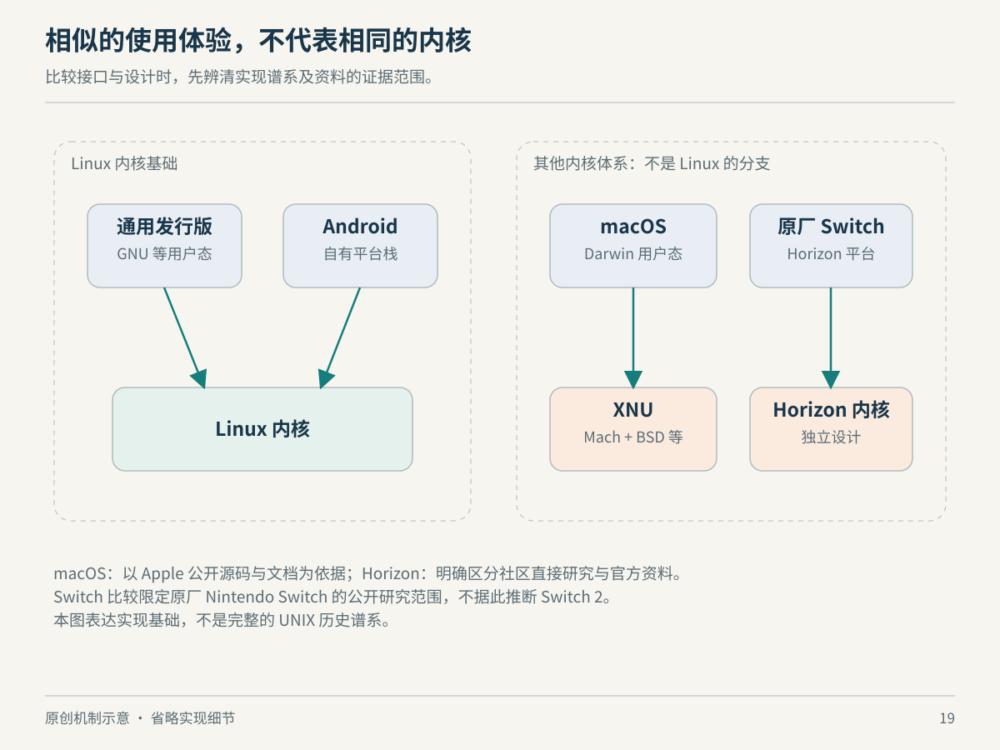

# 19　macOS 与 Switch：相似概念，不同系统

如果两个系统都有进程、文件和线程，能否说它们其实是同一种系统？不能。概念可以相似，接口可以部分相近，底层实现和运行契约仍可能不同。这一章把 Linux 放在更大的地图中，目的不是给操作系统排座次，而是学会判断：一份知识可以迁移到哪里，迁移到哪里就必须重新核实。

*图 19：原创机制对照，不是完整历史谱系。Horizon 部分依据社区直接研究与重实现项目，不代表任天堂官方架构保证；不外推至所有后续主机。*

## macOS：熟悉的终端之下是 XNU

Apple 公布的 XNU 仓库说明，XNU 是 Darwin 的内核组成部分，用于 macOS、iOS 等系统，结合了 Mach、FreeBSD 相关组件和 IOKit。看到 BSD 风格的接口或熟悉的 Unix 命令，并不能把它推导成 Linux 的一个发行版。[来源：Apple XNU README](https://github.com/apple-oss-distributions/xnu)

Apple 的内核编程指南把 Mach、BSD 和 I/O 相关职责放在同一架构中介绍。这份指南属于历史文档，适合了解设计背景，不应拿其中早期地址空间大小或旧文件系统清单断言今天的 Mac。阅读旧资料时，抽取仍有用的职责关系，同时把具体常量和支持列表留给当前文档核实，是避免“引用正确、结论过期”的基本方法。[来源：Apple Kernel Architecture Overview，归档文档](https://developer.apple.com/library/archive/documentation/Darwin/Conceptual/KernelProgramming/Architecture/Architecture.html)

这意味着你在 Linux 学到的“进程需要地址空间”“驱动承担设备管理”等问题意识仍然有用，但 `/proc` 路径、系统调用细节或驱动构建方法不能照搬。迁移知识时，带走问题和职责，重新查证接口和工具。

## 在 Mac 上运行 Linux，边界放在哪里

QEMU 的系统模拟可以配合不同宿主上的加速器。官方文档列出 Linux 上的 KVM 和 macOS 上的 Hypervisor Framework 等选项。加速器服务于特定宿主与架构条件，并不是给任何客体架构都提供免费的本机执行。[来源：QEMU System Emulation Introduction，Supported Accelerators](https://www.qemu.org/docs/master/system/introduction.html)

Docker Desktop 文档则明确说明，用于运行 Linux 容器的环境由 Linux VM 承载，具体 VMM 选项随平台而异。这是“在 Mac 上能运行 Linux 容器”与“macOS 内核能直接提供 Linux 容器所需内核语义”之间的区别。产品可以把启动、目录共享和网络转发整合得很顺，但这些边界仍然存在。[来源：Docker Desktop Virtual Machine Manager](https://docs.docker.com/desktop/features/vmm/)

最有价值的不是背一个后端名称，而是画出当前机器的实际层次：macOS 宿主、虚拟机管理层、Linux 客体、容器进程。排查文件慢、端口不通或内存占用时，不同层上相同的词可能指向不同对象。

## Switch：先把“原厂系统”与“在硬件上运行 Linux”分开

这里讨论原始 Nintendo Switch 平台的 Horizon 系统，只涉及公开可核查的结构性认识，不讨论破解或绕过操作。由于原厂系统不是完整公开的 Linux 式源码项目，证据条件也不同：社区直接研究可以很有价值，但其身份和适用版本必须明确。

Atmosphère 的 mesosphère 文档将其描述为 Horizon 内核的定制重实现，并说明 Horizon 内核遵循微内核设计原则。项目还公开了相应实现代码。这支持我们将 Horizon 作为独立内核架构研究，而不是把 Switch 原厂系统当作 Android 或 Linux 发行版。[来源：Atmosphère mesosphère 组件文档](https://github.com/Atmosphere-NX/Atmosphere/blob/master/docs/components/mesosphere.md)

不过，重实现不是任天堂原始源码逐行公开。它可以说明重实现项目采用的设计和兼容目标，不能单凭项目中的每个字段，就断言所有原厂版本在所有细节上完全相同。社区资料中常见版本标注，正是因为这些边界会变化。与官方 Linux 文档相比，这类论述需要更克制，而不是用更多细节伪装更高确信度。

如果某个平台硬件能够被移植去运行另一操作系统，那是在同一硬件上安排了不同的软件栈。它不能倒过来证明原厂系统本来就是那套操作系统。这个逻辑不仅适用于游戏机，也适用于手机、路由器和个人电脑。

## 为什么完整指令转换仍可能需要系统服务适配

设想你已经忠实转换了一个程序的 CPU 指令。它接下来调用的系统接口、预期的线程同步行为、图形命令、资源格式和设备交互，是否也已经有对应实现？若没有，指令可以执行到某个入口，却没有可用的目标语义。这是根据前面 ABI、模拟和平台边界得到的方法性结论，不是对某个具体移植工程的故障诊断。

QEMU 的 user-mode 文档列出 Linux-user、BSD-user 等模式，并说明系统调用、信号等转换职责；例如 Linux-user 依靠宿主 Linux 提供相应内核服务，不会启动一份客体 Linux 内核。system emulation 则提供更完整的机器模型。两种范围的区别本身，就说明“翻译指令”与“重现程序所需的完整环境”不是同一个交付目标。[来源：QEMU User Mode Emulation](https://www.qemu.org/docs/master/user/main.html)

所谓高层模拟，可以理解为在某些边界上提供等效服务，而不是逐条复刻原来如何工作。是否采用它，是实现策略问题，不能仅由“已经完成指令转换”自动否定或确认。真正应该列出来的是程序依赖的接口，以及每一条接口目前由谁满足。

| 比较维度 | Linux 通用发行版 | Android | macOS | 原始 Switch 原厂平台 |
| --- | --- | --- | --- | --- |
| 内核实现 | Linux | 基于 Linux 的平台内核 | XNU | Horizon 的专用内核，社区资料依据 |
| 用户态组织 | 发行版集成选择 | AOSP 框架与平台组件 | Apple 平台组件 | 专用游戏机系统与服务 |
| 相似性最容易误导之处 | 同内核不等于全部库兼容 | 同 Linux 不等于桌面程序直接可运行 | 类 Unix 不等于 Linux | 同硬件可运行其他系统不等于原厂采用它 |
| 迁移时先核实 | ISA、ABI、库和内核条件 | Android API、Bionic、服务与权限 | 平台 API、二进制格式与系统接口 | 目标系统服务、设备语义及版本 |

表格把不同资料提供的边界合在一起，是教学比较，不是操作系统兼容性认证。尤其不能由概念相近就预测某个程序一定可运行。

## 本章资料与证据边界

Apple 与 QEMU、Docker 的链接是各项目原始资料；Horizon 仅采用直接从事重实现研究的 Atmosphère 项目描述，并明确其非官方身份。没有获取任天堂闭源实现，也没有验证某个商业游戏的可移植性。Switch 后续机型与每代固件的全部细节不在本章结论范围内。
