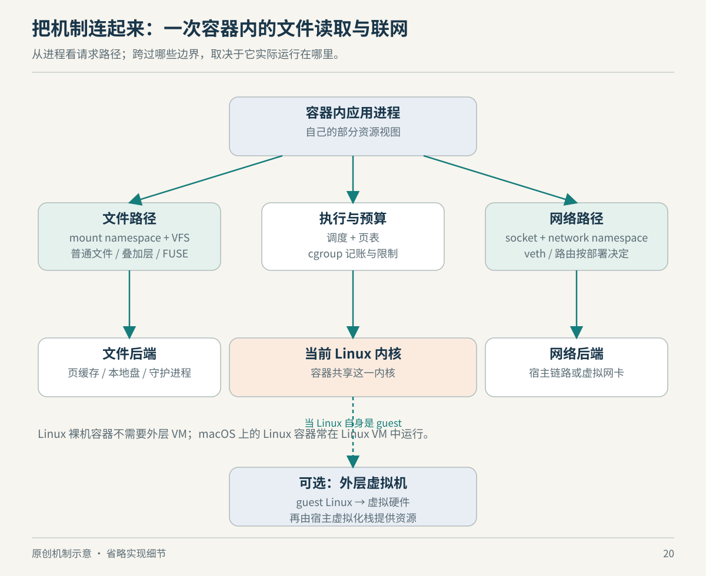

# 第 20 章　贯通全书：在 Mac 上追踪一个 Linux 服务

现在把前面的机制放进同一个情境：你在 Mac 上运行一个 Linux 容器，容器中的服务读取项目文件，处理请求，再把结果返回浏览器。它没有明显报错，却比预期慢。应该先换内核、增大内存，还是修改网络参数？

这不是一份针对特定产品版本的调优处方。我们将它作为教学推演：先建立真实边界，再给每一种解释安排证据。正确答案未必是一条配置，更可能是排除几种看似合理、实际不适用的猜测。

*图 20：原创综合示意。文件、网络和执行是不同路径；不能把图中相邻方框理解成所有请求都会穿过的一条串行流水线。*

## 第一步：找出你说的“宿主”到底是哪一个

在 Docker Desktop 这类环境中，Linux 容器运行于 Linux 虚拟机中，外面才是 macOS。容器进程共享的内核是承载它的 Linux 内核，而 Mac 的 XNU 仍然管理外层系统。Docker 官方资料也把 VMM 作为承载 Linux VM 的组成部分来说明。[来源：Docker Desktop Virtual Machine Manager](https://docs.docker.com/desktop/features/vmm/)

所以，“宿主目录”至少有两种语境：从容器引擎看，是它所在系统能够访问的路径；从使用者看，常常是 Mac 上正在编辑的目录。产品通过目录共享把二者接起来，但这不是同一件事。Docker 的 bind mount 文档特别指出，挂载基于守护进程所在宿主，而非远程客户端所在机器；Desktop 会处理跨虚拟机的集成。[来源：Docker Bind mounts，Considerations and constraints](https://docs.docker.com/engine/storage/bind-mounts/)

先把层次写在纸上：浏览器所在系统、虚拟机所在位置、容器所在环境、文件的实际存放位置。很多“怎么可能”的现象，只是因为同一个词在两段讨论中指向不同位置。

## 第二步：把文件读取与镜像层分开

容器根文件系统可以由镜像内容与可写层组成，但一个挂到 `/workspace` 的外部目录，并不因此自动成为镜像里的可写层。挂载会改变该路径下可见的内容；分析这一目录中的 I/O 时，应追它实际的挂载来源，而不是一看见容器就先归因 OverlayFS。[来源：Docker Bind mounts，Bind-mounting over existing data](https://docs.docker.com/engine/storage/bind-mounts/)

若文件来自 Mac 的共享目录，访问可能经过文件共享后端；若数据来自 Linux VM 中由引擎管理的 volume，路径又不同。Docker 将 volumes 描述为由引擎管理、在引擎宿主中保存的持久化数据。两种配置可能恰好把相同应用文件放在不同路径上，比较之前必须先确认数据位置。[来源：Docker Volumes](https://docs.docker.com/engine/storage/volumes/)

由此可以提出一个实验，而不是先下结论：在保持输入内容、应用版本和主要执行条件一致时，分别测量两种存储位置下的操作延迟；同时记录缓存是否预热、文件数量和并发程度。结果若有差别，仍只支持当前条件下路径相关，不能立即证明某个具体组件有缺陷。这是本书的实验设计建议，未声称已在你的机器测量。

## 第三步：给 CPU 空闲一个准确含义

你看见 Mac 总 CPU 占用不高，不能立刻排除 CPU 相关约束。Linux VM 分到的资源、容器所在 cgroup 的预算、可运行线程数，分别限制不同范围。对于本例中的普通公平调度任务，cgroup v2 的 `cpu.max` 管理带宽预算，`cpu.stat` 可以提供节流相关计数；这些量回答的是组内限制，不是整台物理机器的统一使用率。[来源：Linux Control Group v2，CPU Interface Files](https://docs.kernel.org/admin-guide/cgroup-v2.html)

反过来，观察到节流计数增加，也不够证明它解释了全部用户延迟。还需要对齐时间窗口，确认增长发生在慢请求期间，并区分应用是否同时在等文件、网络或锁。一个计数是证据片段，不是自动完成的因果说明。

架构也要单列检查。若镜像中的应用面向另一 ISA，可能需要指令翻译，而不是同 ISA 客体的硬件辅助执行路径。第 13 章已经说明，QEMU 将指令翻译、用户接口转换与整机模型分为不同职责。[来源：QEMU User space emulator，System call translation 与 Threading](https://www.qemu.org/docs/master/user/main.html)

因此先记录应用构建架构、Linux 客体架构和实际执行后端，再讨论性能。只说“都是在 Mac 上跑”，信息远远不够。

## 第四步：网络通路与文件通路不要画成一条线

容器到外界的请求、外界访问发布端口，以及容器访问宿主服务，是不同方向。Docker Desktop 文档将网络代理、文件共享和控制功能分开描述；采用哪个后端，取决于系统和配置。不能拿一个后端名称，替代整条请求路径的分析。[来源：Docker Desktop Networking，Overview 与 Backend components](https://docs.docker.com/desktop/features/networking/)

观察网络时，先确定应用监听地址、目标地址究竟属于哪个网络视图，再检查转发路径。尤其不能默认容器的 `localhost` 就是 Mac。把宿主服务地址写错，往往会表现为连接失败或等待超时，而不是吞吐不足；扩大 CPU 或内存不会修复指向错误的连接。

若用户延迟高，但服务内部记录的处理时间很短，就要审查计时起止点是否覆盖相同路径。若服务本身记录也很慢，再进入线程等待、I/O、CPU 和资源限制等方向。这里的顺序来自测量边界的逻辑，不是对任何一次实际故障的判定。

## 第五步：把观察组织成一份可反驳的解释

| 初始解释 | 应同时收集的证据 | 仍不能据此断言 |
| --- | --- | --- |
| 文件路径增加了成本 | 实际挂载、操作类型、同条件延迟、缓存状态 | 某个共享协议必然比另一个慢 |
| 容器预算耗尽 | 预算配置、节流计数增量、慢请求时间窗 | 整台 Mac 已没有可用算力 |
| 应用在等待下游 | 请求跨度、连接状态、等待栈或 syscall 时长 | 内核调度器有问题 |
| 内存压力拖慢了服务 | 对应范围的压力、回收及进程内存指标 | 只要加 RAM 就一定解决 |
| 跨架构执行增加成本 | 构建架构、实际执行路径、对照负载 | 所有差异都来自翻译器 |

其中压力可以从 PSI 等接口观察。PSI 描述资源争用导致的停顿及时间影响，而不是简单重复“已经用了多少资源”；它有系统和 cgroup 等范围条件，读取时仍要核实所在环境。[来源：内核 PSI 文档](https://docs.kernel.org/accounting/psi.html)

这张表故意在最后一列保留缺口。技术解释如果不能说清哪些证据还不够，就很容易从“看起来相关”滑向“已经证明”。一份可靠的诊断应该允许下一条数据推翻它。

## 一项新特性来到面前时

你不必把每个选项记住。先问：它改变执行、地址、名字、存储视图、权限、预算，还是设备与协议？再问：接口由谁提供，状态存在哪里，错误由谁报告，代价在哪一侧支付？最后选择能够看见这个边界的工具，并确认工具本身没有改变你要观察的条件。

例如 FUSE 把文件系统的一部分职责交给用户态实现；OverlayFS 组合目录视图；namespace 改变资源的可见范围；cgroup 管理资源组；KVM 控制客体执行；QEMU 提供翻译和机器模型。它们之所以能够长成丰富生态，不是因为每一项都独立解决全部问题，而是因为它们可以在边界明确时组合起来。

现在再回看开头那台“有点慢的容器”，它已经不再是一个黑盒。你知道该画哪几条路径、在哪些位置观察，也知道什么时候应该承认证据还不够。理解 Linux 的收获，正是在新问题出现时，仍然能用这张地图继续前进。

## 本章资料与证据边界

本章是基于已引用机制的综合教学推演，没有运行用户设备、没有给出实测性能排名。Docker 文档是滚动文档，后端名称和产品选项可能变化；本章只采用其跨 VM、文件、网络的职责区别。表格是实验与诊断组织建议，不是自动故障判定器。
