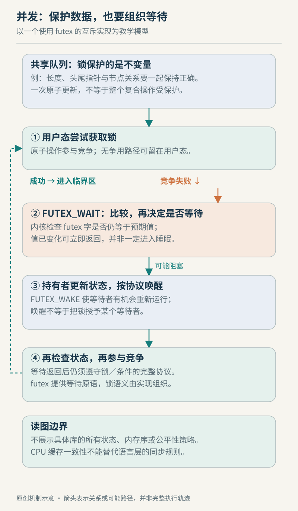

# 第 21 章　并发与同步：从共享数据到等待协议

一个队列有四个工作线程，吞吐却不如两个线程；请求日志显示“已放入”，消费者仍偶尔读到未完成的数据。两个现象都发生在并发程序里，但前者可能是资源竞争，后者首先是正确性问题。理解同步，需要分别回答：谁能修改，别人何时能看见，暂时不能继续的人怎样等待。

## 21.1 先保护关系，再挑选锁

假设队列记录着首位置、尾位置和元素数量。一次入队要写入元素，再更新位置与计数；这些字段必须共同描述一个有效队列。即使每个字段的单独读写都不会撕裂，另一个线程若在更新中途观察，仍可能看到互相矛盾的组合。这里要保护的是对象的不变量，而不只是某个整数。

在 C++ 用户态程序中，不同线程中潜在并发的冲突访问涉及同一内存位置，至少一个是非原子访问，且两者之间没有先行关系时，会构成数据竞争并导致未定义行为。因此，未同步的普通 `count++` 不能仅解释成“偶尔少加一次”；语言层面已不保证程序按这幅交错图执行。数据竞争和业务层面的竞态也不同：把多个操作改成原子操作后，错误的检查与修改顺序仍可能违反业务要求。[C++ 工作草案：数据竞争](https://eel.is/c++draft/intro.races)

互斥锁可以给一组操作划出临界区。一个线程持有锁时，其他遵守同一规则的线程不能进入；POSIX 互斥锁已经由其他线程持有时，`pthread_mutex_lock()` 等待其可用，再以调用线程持有锁的状态返回。锁类型影响重入及错误行为，不能把重复加锁都理解为自动递归。[POSIX 互斥锁接口](https://man7.org/linux/man-pages/man3/pthread_mutex_lock.3p.html)

关键在于“遵守同一规则”：写队列时加锁，读队列时绕过锁，不能得到完整保护。还应让保护范围覆盖整个检查与修改，而不是检查一次是否为空，释放锁，稍后再取元素。前一刻成立的判断，不会替后续操作保留资源。

*图 21-1　原创机制示意。唤醒表示有机会重新检查，不表示已获得锁；本图省略具体锁实现的全部状态与内存序。*

## 21.2 原子性与内存序是不同问题

原子操作保证相应访问不可被拆成可观察的部分；原子读改写则把读取旧值、计算和更新作为一个操作。例如计数器原子加一可避免两个更新互相覆盖，但不能因此把“余额检查、库存扣减、订单写入”自动变成一笔事务。原子类型是否采用无锁实现，还与类型及平台有关，C++ 提供查询接口，而不是保证所有原子对象都无锁。[C++ 原子类型操作](https://eel.is/c++draft/atomics.types.operations)

更隐蔽的问题是发布数据。生产者先准备内容，再写一个“就绪”标志；消费者看到标志后读取内容。仅把标志变成原子变量，还需要选定内存序，建立普通数据访问之间所需的关系。C++ 的 release 写与读取该写入值的 acquire 读可以建立同步关系；relaxed 保留原子访问的性质，但不提供这里所需的跨线程发布顺序。seq_cst 另有更强的顺序约束，也不能补救程序中别处的数据竞争。[C++ 工作草案：内存序](https://eel.is/c++draft/atomics.order)

可以把一次性发布想象成“先装好盒子，再递出可领取的凭据”。但凭据只有按双方约定传递才有意义。这是解释发布关系的比喻，不是缓存会自动逐项清空的硬件模型；若生产者在发布后继续修改盒子，或读者在对象销毁后访问，原先的协议就不足以保证正确。

编译器也参与这份契约：GCC 的内存模型原子内建操作同时表达编译器与目标硬件需要遵守的约束，特定操作不能无锁实现时可能调用运行库。不能只数源代码中的“一个赋值”，也不能以某台 x86 机器暂未复现错误证明代码可移植到 ARM。[GCC 内存模型原子操作](https://gcc.gnu.org/onlinedocs/gcc/_005f_005fatomic-Builtins.html)

`volatile` 不是这份同步契约的替代品。GCC 明确说明，普通对象访问不会因一个 volatile 对象而自动获得所需排序；Linux 内核文档也反对把 volatile 当成方便的原子变量。抑制某些优化、互斥、原子性和跨线程发布，是不同要求。[GCC volatile 说明](https://gcc.gnu.org/onlinedocs/gcc/Volatiles.html)、[内核 volatile 说明](https://docs.kernel.org/process/volatile-considered-harmful.html)

阅读内核代码时还要换一份规则书：内核有 LKMM，以及 `READ_ONCE()`、`WRITE_ONCE()`、锁与内存屏障等专门原语。C／C++ 的用户态语言内存模型与 LKMM 是不同规则体系；本章语言层示例具体采用 C++。不能把内核这些名字机械替换成用户态表达式，也不能把 C++ 原子接口的所有推理直接照搬进内核。[LKMM 文档入口](https://docs.kernel.org/dev-tools/lkmm/index.html)、[内核同步示例](https://docs.kernel.org/dev-tools/lkmm/docs/recipes.html)

## 21.3 futex 连接用户态状态与内核等待

普通锁的无竞争路径可以通过用户态原子操作改变锁状态；争用路径需要阻塞或唤醒时，再通过 futex 让内核参与。它提供的是同步原语的基础，而不是替应用自动维护队列、所有权和全部内存序。用户态库在其上实现更完整的锁协议。[futex 总体接口](https://man7.org/linux/man-pages/man2/futex.2.html)

最值得理解的是“决定睡眠”与“条件改变”之间的缝隙。线程甲看到锁被占用，正准备睡眠；线程乙此时释放锁并通知。如果甲只是先读变量、再无条件睡下，就可能错过这次通知。

`FUTEX_WAIT` 接收一个预期值，原子地完成读取、比较和开始等待；若值已不同，就立即以 `EAGAIN` 失败。这样，若检查时的当前值已不等于预期值，等待者就不会依据该旧值进入睡眠；它并不追踪这个地址曾经出现过的所有历史变化。但它没有替调用者解决状态复用、对象生命周期或错误处理，直接手写锁仍很容易出错。[FUTEX_WAIT](https://man7.org/linux/man-pages/man2/FUTEX_WAIT.2const.html)

`FUTEX_WAKE` 则唤醒至多指定数量的等待者，不保证选中哪一个，也不把业务资源交到对方手中。线程被唤醒后，还要获得调度机会，并按用户态协议重新检查或竞争。普通等待允许虚假唤醒，不能把成功返回当成共享条件必然成立。[FUTEX_WAKE](https://man7.org/linux/man-pages/man2/FUTEX_WAKE.2const.html)、[等待返回语义](https://man7.org/linux/man-pages/man2/FUTEX_WAIT.2const.html)

队列为空的消费者也有类似需要。调用 POSIX 条件变量等待前，线程必须按接口契约持有对应互斥锁；等待在约定意义下原子地释放锁并阻塞，成功返回时重新持有锁；程序仍应循环检查“队列非空”这一谓词，因为通知和谓词不是一回事。其他消费者可能已经取走元素，也可能发生虚假唤醒。优先使用成熟库的这类协议，比按名称拼接 `sleep()` 和通知更容易保持正确。[POSIX 条件等待](https://man7.org/linux/man-pages/man3/pthread_cond_wait.3p.html)

## 21.4 正确以后，还要减少不必要的共享

即便锁使用正确，串行部分也不会因线程增加而自动缩短。若所有工作线程都在同一把锁内更新队列和统计，更多线程可能增加等待；把不需要共同保护的工作移出临界区，可以减少竞争窗口。但划分必须保留不变量，不能为缩短临界区把必要检查拆出去。这是设计分析，不是对某个服务的实测结论。

还有一种竞争发生在程序以为“各自独立”的数据上。不同 CPU 访问同一缓存行内的不同字段，且至少有写入时，缓存一致性维护可能使其他 CPU 的副本反复失效。变量在业务上无关，却共享了硬件传输和一致性管理的粒度，这称为伪共享；不要求双方修改同一个变量。[内核伪共享说明](https://docs.kernel.org/kernel-hacking/false-sharing.html)

例如每个工作线程各写一个计数器，逻辑上已避开同一原子计数器的争抢，计数器却紧挨着落在同一缓存行。按线程分区、调整布局或批量汇总，都值得在确认热点后比较；任意填充结构则可能增加内存占用及访问成本。不要把某个常见缓存行长度硬编码成所有平台的真理，更不能只看 CPU 占用就断言存在伪共享。

## 21.5 给队列问题建立可检验的解释

回到开头，可以按三层排查，而不是先把互斥锁全换成原子变量。

| 观察到的现象 | 先提出的假设 | 还需要什么证据 |
| --- | --- | --- |
| 消费者读到未完成对象 | 发布或生命周期协议不完整 | 对象创建、发布、读取和销毁之间的同步关系 |
| 线程多数在等待 | 共享资源、锁或外部依赖成为瓶颈 | 等待位置、持有锁的代码及请求耗时分解 |
| 增加线程反而更慢 | 串行部分、调度或缓存竞争加重 | 相同负载下的吞吐、延迟及资源指标对照 |
| 独立计数器仍随核心数退化 | 数据布局可能引入伪共享 | 实际字段布局与缓存一致性相关测量 |

这张表是一套提问方法。一个 futex 等待点不能直接告诉你哪把业务锁有问题；一次“加了填充后更快”也不能排除其他布局变化。先证明访问协议正确，再定位实际等待，最后比较减少共享的方案，才能让性能优化不以破坏语义为代价。

### 本章资料与证据边界

本章核对日期：2026-10-22。主要依据 C++ 工作草案、GCC、Linux man-pages 及内核文档。C++ 例子解释用户态线程的规则，LKMM 解释内核同步，POSIX 描述库接口；三者不能混为同一规范。没有给出可直接投入生产的自制 futex 锁，也没有实测某种锁、缓存布局或线程数的加速比。未展开优先级继承、无锁内存回收、RCU、信号上下文与实时内核的全部差异。
