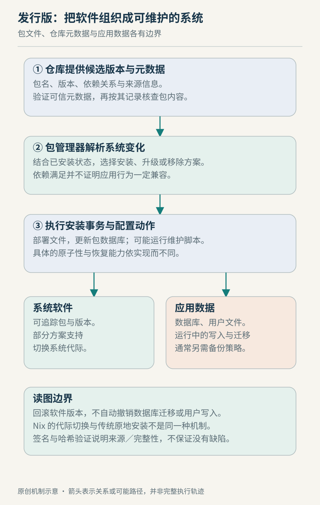

# 第 22 章　软件包与发行版：系统如何组成与更新

前面讨论 ELF 时，我们追问过“文件已经在这里，为什么还不能运行”。现在把视野扩大：一台机器上有成千上万个程序和库，它们由谁提供、怎样搭配、出了更新以后又怎样替换？这些问题处在内核之上，却决定了日常使用中的“Linux 系统”是否完整。

设想你准备部署一个图片转换服务。可执行文件已经编译成功，旁边还有动态库、字体、默认配置和服务启动描述。逐个复制文件可以完成第一次安装，但第二次升级就会遇到新问题：哪些文件属于旧版本？哪个库还被其他服务使用？管理员改过的配置怎样保留？包管理和发行版集成，就是对这类持续维护问题建立约定。

## 22.1 从 ELF 依赖到软件包依赖

ELF 动态依赖描述程序装载时需要的共享对象等信息；包依赖则描述安装与配置所需的软件单元。两者不能一一等同：字体、解释器、证书或供安装脚本调用的工具，也可能是软件包关系的一部分。Debian Policy 区分 `Depends`、`Recommends`、`Suggests` 等关系，还允许替代依赖与版本条件；它不是简单的“名字清单”。[Debian 包关系规范](https://www.debian.org/doc/debian-policy/ch-relationships.html)

例如，一个服务需要“某种字体”与需要“指定 ABI 的共享库”，都是依赖，却有不同满足条件。依赖求解器处理的是包元数据表达的约束，不是在安装前完整执行程序、证明所有业务路径正确。由此可以推知，元数据漏报或实际配置变化，仍可能让已经安装成功的应用运行失败。这是对包关系作用范围的分析，而不是某一发行版的故障统计。



图 22-1　原创关系示意。软件包或系统部署的切换，与业务数据的恢复处在不同边界；箭头不是完整安装时序。

## 22.2 dpkg 与 APT：执行安装，还是决定装什么

在 Debian 系统中，APT 提供获取包、选择版本及组织依赖变更的高层操作。`apt-get update` 更新可用包索引，不等于升级已经安装的软件；安装操作再根据可用信息选择并取得所需包。它们是同一维护过程的不同阶段。[apt-get(8)](https://manpages.debian.org/bookworm/apt/apt-get.8.en.html)

安装后的状态也需要账本。`dpkg-query` 可以从 dpkg 数据库查询包状态、版本、已登记文件及文件所属包。查询结果可能显示包已经解包却尚未配置，而不只有“装了／没装”两种状态。文件归属查询也不覆盖安装脚本额外创建的所有文件，因此数据库不是整台机器的逐字节快照。[dpkg-query(1)](https://manpages.debian.org/bookworm/dpkg/dpkg-query.1.en.html)

包安装还可以运行维护脚本。Debian 的 `preinst`、`postinst` 等脚本承担安装、配置和清理阶段的动作，失败状态会影响后续处理；规范要求这些脚本考虑重复执行与错误恢复。理解这一点，就不会把一次升级想成单纯解压压缩包，也不会把传统包升级当成全机状态的单一原子事务。[Debian 维护脚本规范](https://www.debian.org/doc/debian-policy/ch-maintainerscripts.html)

沿着服务部署的例子追问，复制程序只能回答“字节放到了哪里”；包状态回答“系统登记了什么”；维护脚本回答“安装过程中还做了什么”；服务实际响应才能回答“应用现在是否工作”。这四种证据有联系，但不能互相代替。

## 22.3 仓库与签名：确认来源，不替你证明程序正确

常见 APT 仓库的信任链从签名的 Release 元数据延伸到包索引及包文件的校验和。APT 验证的是这条归档认证关系，不等于逐个检查下载包的独立开发者签名，也不证明程序没有缺陷。信任仓库，仍然是在信任维护仓库和签名密钥的一方。[apt-secure(8)](https://manpages.debian.org/bookworm/apt/apt-secure.8.en.html)

可以把这里的两个问题分别写下来：“下载的内容是否符合受信任仓库发布的内容？”与“这份内容是否适合我的业务？”前者属于来源与完整性，后者还需要功能测试、兼容性判断和运行观察。签名不能替代后者，业务测试也不能替代来源核对。这是由信任链边界得到的判断。

## 22.4 发行版的价值在于持续集成

发行版不是给内核增加一张壁纸。以 Debian 的安全维护为例，维护者可能把修复回移到稳定版已经提供的上游版本，以减少其他行为变化。因此，只看上游版本号较旧，不能直接断定发行版包尚未修复；应结合完整包版本、更新记录和对应安全公告。替换文件后，某些服务或进程还需要重启才能使用更新内容。[Debian 安全 FAQ](https://www.debian.org/security/faq)

这也解释了一个常见维护冲突：团队希望每个组件都“最新”，同时又希望整套系统的行为长期不变。它们对应不同目标。发行版维护选择、应用自己的发布节奏与团队验证能力需要一起考虑；不能把“版本更新得快”或“版本保持得久”单独当成系统质量的结论。

下面这个比较表是本章的教学整理，不是产品排名：

| 要维护的对象 | 需要保留的关系 | 不能仅凭什么作判断 |
| --- | --- | --- |
| 应用可执行文件 | 架构、加载器与用户库接口 | 文件存在 |
| 已安装包集合 | 版本约束、状态与维护动作 | 包名相同 |
| 一次发行版更新 | 组件组合、配置与服务行为 | 上游版本号大小 |
| 一套业务服务 | 数据格式、外部接口与恢复步骤 | 系统能够启动 |

## 22.5 Nix：把环境切换建立在并存的包上

Nix 提供另一种组织办法：包位于 Nix store 中不同的路径，用户环境通过链接组合出可见程序；profile 的不同 generation 记录不同组合，切换当前链接实现用户环境的原子切换和回退。它避免把所有版本都直接覆盖到同一组通用路径，但这里的“原子”首先指该环境引用的切换，不能自动推广为整个业务系统瞬间恢复。[Nix profiles](https://nix.dev/manual/nix/2.34/package-management/profiles.html)

Nix 的 derivation 则表达构建步骤及其输入、执行环境和输出。它让“程序是怎样构建出来的”成为可记录的对象。需要区分两个概念：定义明确的构建输入，与产物每次逐字节相同；单凭采用这套工具，不能替某个具体构建证明完全可复现。[Nix derivation](https://nix.dev/manual/nix/2.34/store/derivation/)

把它放回最初的服务例子，重点便从“往系统里覆盖哪些文件”，转向“生成哪些包，再让服务选择哪套环境”。这是不同管理边界的比较。Nix 包管理器可以讨论用户环境，而 NixOS 还涉及整套系统配置；不能把二者名称互换，也不能把某个用户 profile 的回退当作 NixOS 全系统恢复的实测结论。

## 22.6 只读系统树、原子更新与回滚

OSTree 展示了系统级的另一条路线：先生成完整文件系统树，再进行分发与部署。它本身不是通用包依赖求解器，可以与软件包系统配合使用。这说明“以包组装内容”和“以系统树交付内容”不是必然互斥的选择。[OSTree 概览](https://ostreedev.github.io/ostree/introduction/)

在其更新模型中，新部署先被准备好，再切换相关启动配置，运行中的旧部署不必被逐文件覆盖。这里的原子转换针对可启动部署集合，核心问题是中断后仍能选择完整部署；它不意味着所有正在运行的进程已经切换成新程序。[OSTree 原子更新](https://ostreedev.github.io/ostree/atomic-upgrades/)

“不可变系统”也不意味着整台机器都不可写。以 OSTree 的状态组织为例，`/var` 保存可写状态，有自己的初始化与后续更新语义；它不会因为新系统树到来，就把已有业务状态全部替换成镜像中的内容。[OSTree 与 /var](https://ostreedev.github.io/ostree/var/)

假设图片服务的新版本把任务数据库改成了旧版本不认识的格式。即使系统已经重新启动到旧部署，数据库也可能仍是新格式。这个假设案例不是 OSTree 的已知故障，而是在说明恢复边界：程序回退、配置回退、数据恢复需要分别设计。备份、迁移兼容性与恢复演练不能被“支持回滚”四个字替代。

## 22.7 用只读观察建立自己的软件地图

在有相应工具的 Debian 系统上，可以先检查一个本机已有包，不安装也不升级：

```sh
dpkg-query -s bash
dpkg-query -L bash
```

第一条看登记状态及元数据，第二条看登记文件。包名需按实际环境调整；查到文件不代表文件尚未被管理员修改。命令用途与已登记文件的覆盖范围以 [dpkg-query 手册](https://manpages.debian.org/bookworm/dpkg/dpkg-query.1.en.html) 为准。

读完以后，可以为一个熟悉服务画三张清单：运行需要的程序与库，系统登记的包及版本，必须单独保存的配置与数据。若三张清单被压成一句“已经备份容器／系统”，就还没有说明出了问题能恢复到哪里。

### 本章资料与证据边界

本章核查日期：2026-10-22。Debian 命令引用 bookworm 手册以固定接口说明，不代表推荐该版本；Nix 资料固定到 2.34 文档，OSTree 按所列原始文档解释机制。没有在读者机器执行安装、升级或回滚，也不比较发行版优劣。图、比较表和图片服务情境是原创教学模型；具体包关系、服务重启和数据迁移必须以目标发行版与应用版本的资料核对。
