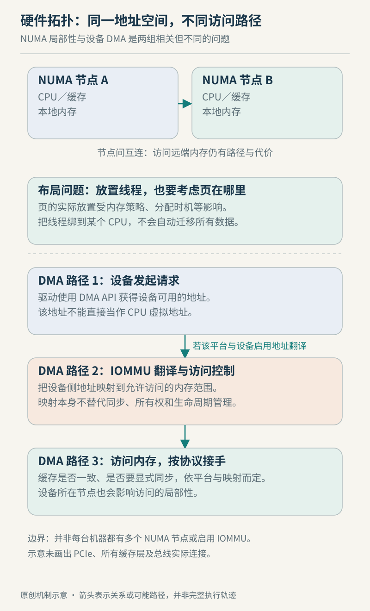

# 第 23 章　硬件与性能拓扑：数据离执行者有多远

把同一个服务从小机器搬到核心更多、内存更大的服务器，吞吐却没有按比例增加。程序没有换算法，CPU 也不总是满载。此时只问“还缺多少算力”可能漏掉另一种成本：执行者要从哪里取得数据，数据又由谁不断修改？本章把进程、内存与设备放回一张有距离的地图。

## 23.1 先分清容量、带宽与等待

一块内存能装多少数据、单位时间能传多少数据、一次依赖访问要等多久，是三个问题。NUMA（非一致内存访问）尤其提醒我们：同一个地址空间中的内存，并不一定与每个 CPU 等距；访问时间取决于 CPU 与内存节点的相对位置。常见的本地节点访问与跨节点访问，因此不能只按总容量比较。[numa(7)](https://man7.org/linux/man-pages/man7/numa.7.html)

可以用两类教学任务理解这个区别。逐个追踪相互依赖的指针，下一次访问要等上一次给出地址；连续处理大块数组，则有机会让多个访问同时推进。二者即使读取相同总字节数，也不应仅凭一个“内存速度”数字预测完成时间。这是访问依赖关系的分析，不是某台机器的测试结论。

判断瓶颈时，可以先把观测量放回它回答的问题，避免拿资源容量解释所有等待：

| 观察到的现象 | 可提出的假设 | 尚不能据此断言 |
| --- | --- | --- |
| CPU 未满，但请求变慢 | 关键执行路径可能在等待数据或同步 | 一定是内存带宽不足 |
| 增加工作线程后吞吐下降 | 共享写入、队列或访问布局可能增加协调成本 | 核心越多越差 |
| 页集中在少数节点 | 初始化或分配策略可能影响页落点 | 这些页都正在被远端频繁访问 |
| 虚拟机内外拓扑不同 | 客户机描述与宿主安排需要联合检查 | 虚拟化配置一定错误 |

这些是组织证据的方法。性能优化仍需保持输入、并发度和测量口径可比，一次改变一个关键条件；如果修改后只是把等待转移到另一个线程，单个线程的指标改善不能代表整个服务改善。

CPU、核心、硬件线程、插槽与 NUMA 节点也不能当成同义词。`lscpu` 会分别呈现这些信息及缓存共享关系，但可用字段受架构影响。虚拟机中的输出主要反映客户机配置，不能直接当作宿主物理布线图。[lscpu(1)](https://man7.org/linux/man-pages/man1/lscpu.1.html)



*图 23-1　原创机制示意，不表示真实芯片布局或延迟比例。CPU 地址转换与设备 DMA 地址转换是不同路径；NUMA 节点也不保证与插槽一一对应。*

## 23.2 缓存保持一致，不等于程序已经同步

多个核心缓存同一片内存时，硬件需要处理副本之间的一致性。但“一份数据如何保持一致”与“两个不同对象的访问按什么次序被观察到”并非同一个问题。Linux 的内存屏障文档专门讨论访问顺序与缓存的关系；不能把屏障统一想象成一次“把全部缓存倒回内存”的动作。[Linux kernel memory barriers](https://docs.kernel.org/core-api/wrappers/memory-barriers.html)

再往上一层，应用还受语言规则约束。例如 C++ 对相互冲突、至少一个非原子且缺少所需先行关系的并发操作定义了数据竞争，结果是未定义行为。知道目标 CPU 有缓存一致性，不能据此省略互斥或正确的原子同步；编译器处理的首先是语言程序，而不只是程序员想象中的指令顺序。[C++ 工作草案：数据竞争](https://eel.is/c++draft/intro.races)

这与第 21 章的锁和等待协议相接：先确保程序具有正确语义，再研究它为什么昂贵。否则把错误共享代码测得“很快”，没有比较价值。

性能上还存在伪共享：两个线程操作不同变量，变量却落在同一缓存行；至少一方的写入仍可能让另一方的访问付出一致性通信成本。Linux 官方文档给出了引用计数与只读字段同处缓存行的例子，并讨论通过数据布局调整降低干扰。这里的竞争单位是缓存行，不是源代码中的变量名称。[False Sharing](https://docs.kernel.org/kernel-hacking/false-sharing.html)

设想每个工作线程都更新自己的计数器。逻辑上已分离，不意味着物理布局已分离；盲目给每个字段补大段填充也会增加空间和缓存占用。应先确认热点访问、写者与布局，再比较改变后的工作负载。缓存行大小与共享层次须查实际平台，不能把某个常见数值写成所有 Linux 的规定。

## 23.3 页放在哪里，与线程在哪里运行要一起看

Linux 的 NUMA 内存策略决定从哪些节点分配页。系统正常运行时的默认策略采用本地优先分配；任务或地址范围可以另设策略，cpuset 的允许范围又会约束选择。已经分配的页也不会仅因修改任务策略就自动全部迁移。[NUMA Memory Policy](https://docs.kernel.org/admin-guide/mm/numa_memory_policy.html)

因此常说的 first touch，应理解为特定分配场景下，首次触发实际页分配的访问影响落点，而不是“谁调用了 `malloc()`，内存就永久归谁附近”。分配策略、允许节点、已有页与回退条件都会改变结果；文件映射、共享页等情况还要查具体规则。只读访问也不能一概等同于已经分配了新的私有可写页。

一个分析例子是：主线程在一个节点初始化全部工作区，随后其他节点的线程长期处理各自分片。若初始化确实导致页集中分配，后续访问可能形成远端流量。可提出“让使用分片的线程参与初始化”的候选方案，但应先确认页分布、线程位置及访问模式；这不是见到 NUMA 就应执行的调优口诀。

把线程限制在某组 CPU，并不等于为它预留独占核心，也不等于同时搬走它的内存。cgroup v2 的 cpuset 分别管理 CPU 与内存节点的允许范围，文档还区分配置值与有效值。容器里面看到的限制，需要与宿主实际可供调度、分配的资源一起理解。[cgroup v2：cpuset](https://docs.kernel.org/admin-guide/cgroup-v2.html)

## 23.4 DMA 绕过 CPU 搬运，不绕过地址与所有权

设备直接访问系统内存的 DMA，省去了让 CPU 逐字节执行搬运指令的某些路径，但仍需要驱动建立可用缓冲区及映射。CPU 使用的虚拟地址、CPU 物理地址和设备使用的 DMA 地址不能混用。在一些系统上数值可能相同，在另一些系统上由 IOMMU 建立不同映射。[Dynamic DMA mapping Guide](https://docs.kernel.org/core-api/dma-api-howto.html)

IOMMU 因而不只是“加速开关”：它可参与设备地址转换与 DMA 隔离。不过隔离粒度受设备和互连拓扑约束，不能假设每个 PCI 功能都能独立分配。VFIO 文档以 IOMMU group 表达可隔离设备集合，说明了桥接、多功能设备与转发路径可能带来的限制。[VFIO](https://docs.kernel.org/driver-api/vfio.html)

数据可见性也必须按 DMA API 的契约处理。某些 coherent 映射不需要显式软件刷新来交换更新，但仍可能需要正确的内存屏障；streaming 映射则需要遵守相应映射与同步操作。不要把“CPU 之间缓存一致”推导成“所有设备天然看到所有更新”。[DMA 映射类型与顺序要求](https://docs.kernel.org/core-api/dma-api-howto.html#types-of-dma-mappings)

在设备密集型工作负载中，可以把处理线程、缓冲页与设备连接位置作为一组分析对象。PCI sysfs 提供 `local_cpus` 等拓扑信息；它提供的是位置线索，不是某种布置一定更快的性能证明。[PCI sysfs](https://docs.kernel.org/PCI/sysfs-pci.html)

## 23.5 虚拟机有两张需要对齐的地图

客户机看见的 vCPU、NUMA 节点与内存距离，是虚拟平台提供的描述；实际执行还依赖宿主线程调度与宿主页分配。QEMU 既提供客户机 NUMA 配置，也提供内存后端的宿主节点与分配策略选项，二者回答不同层次的问题。仅在客户机画出两个节点，不会自动保证宿主按期望位置摆放资源。[QEMU Invocation](https://www.qemu.org/docs/master/system/invocation.html)

因此“给虚拟机增加 vCPU 后变慢”可以沿三条线查：客户机工作负载是否有足够并行度，宿主是否有可用执行资源，以及 vCPU 执行位置与其内存、设备路径是否匹配。这里给的是排查结构，并未声称拓扑一定是根因；软件锁、I/O 等待等仍可能占主导。

## 23.6 一次只读观察，把猜测落到对象上

在提供相应接口的 Linux 环境中，可先查看：

```sh
lscpu
lscpu -e=CPU,NODE,SOCKET,CORE,ONLINE
cat /proc/$$/numa_maps
```

`$$` 指当前 shell，只用于观察本身；分析服务需换成有权读取的实际进程。`numa_maps` 按地址范围展示有效策略与节点页分布，例如 `N0=…` 记录该节点上当前映射的页数；它不是访问次数，更不是远端访问耗时。[numa(7)：numa_maps](https://man7.org/linux/man-pages/man7/numa.7.html)

若系统缺少 util-linux、未暴露 NUMA 信息或某字段为空，先核对工具、架构、虚拟平台和权限，不从缺项直接推断硬件不存在。观察后仍需记录负载、候选瓶颈与验证条件，再决定是否调整亲和性、分配策略或数据布局。

## 本章资料与证据边界

本章核对日期：2026-10-22。主要资料为 Linux 的内存策略、DMA、VFIO、伪共享及 cgroup 文档，QEMU 官方调用说明、Linux 手册页，以及 C++ 工作草案。本文不把 Linux 内核屏障接口当作用户态 C++ 同步接口，也不提供通用绑核参数或未经测量的加速倍数。例子均为机制分析，未对某款处理器、云主机或虚拟机配置进行性能实测；CXL、复杂异构内存分层、设备一致性协议细节与生产级直通配置留待专门资料。
